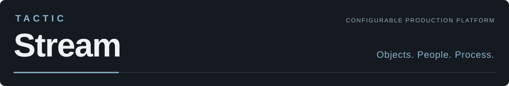
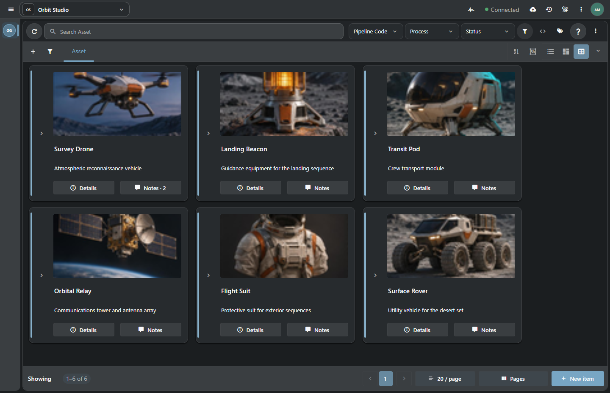
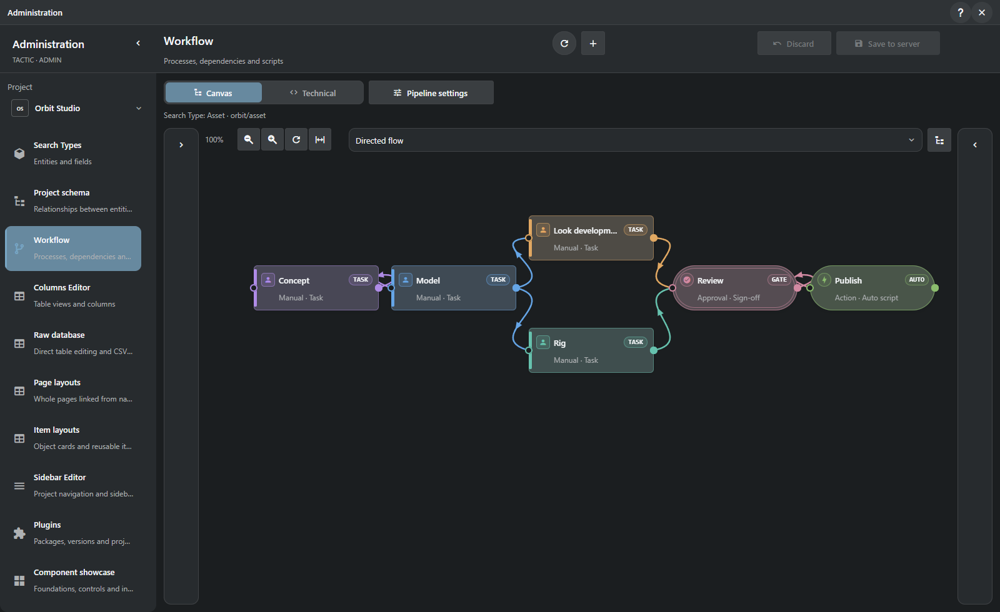
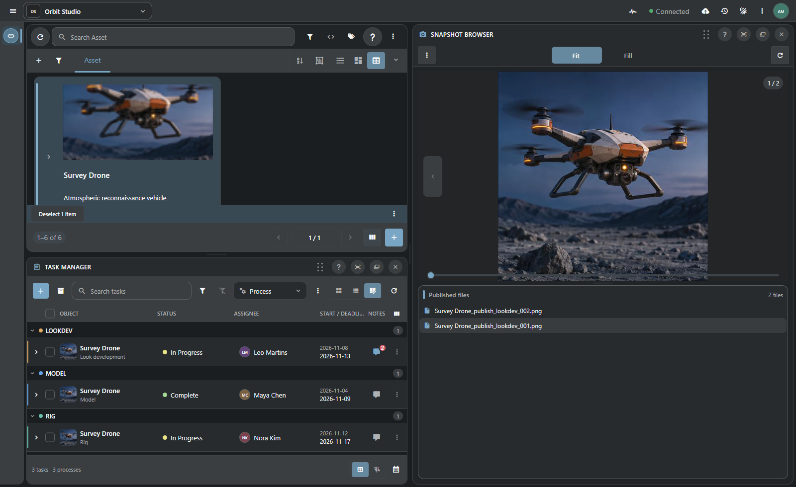
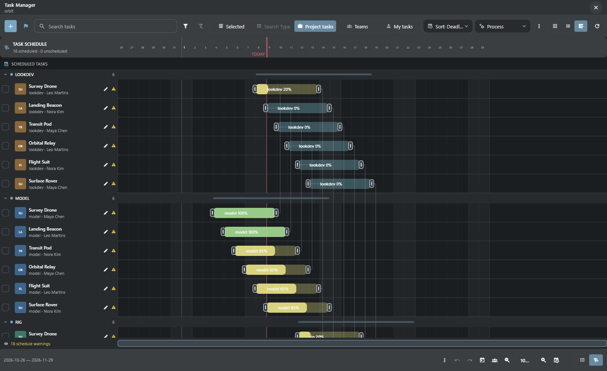
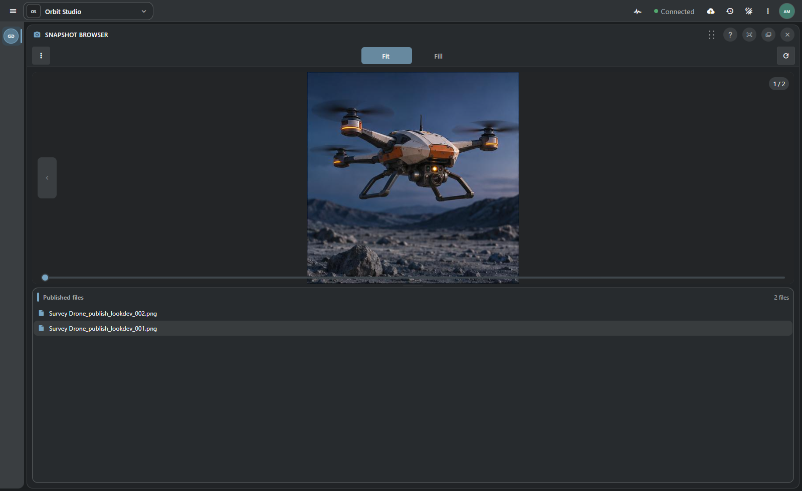
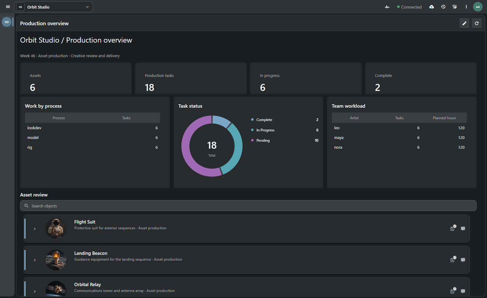
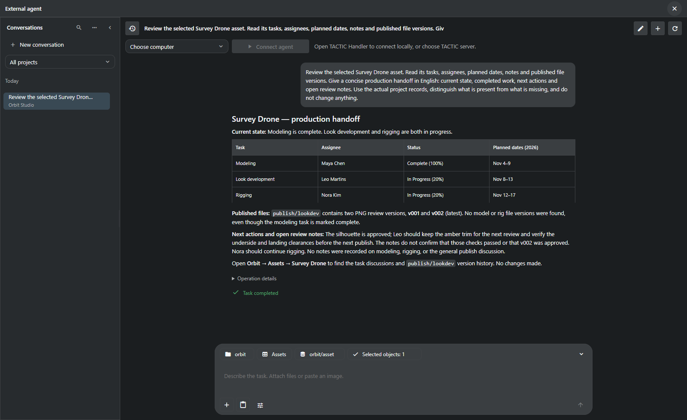
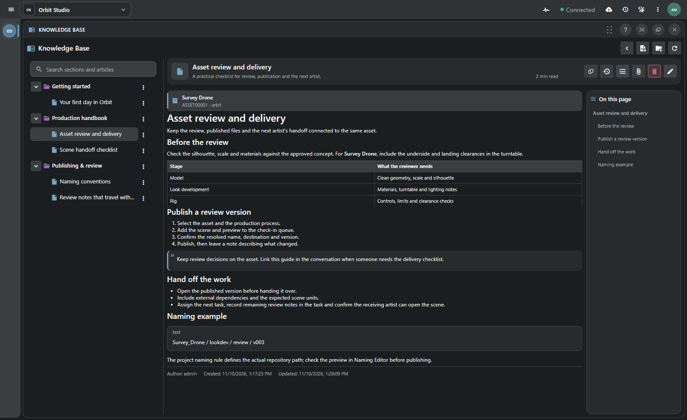
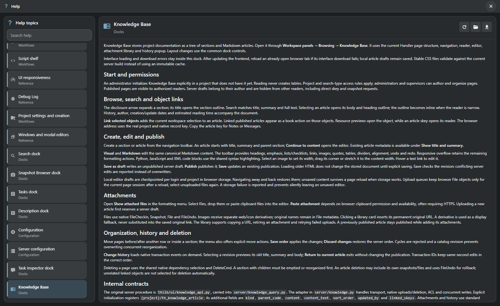

# 

**Organize studio work, from the project model to the files you deliver.**

[Русский](README.ru.md) · **[Get started](#run-stream-and-set-up-a-project)** · [Why Stream](#why-fork-tactic) · [Feature tour](tactic_stream/docs/presentations/product-tour.en.md) · [Documentation](tactic_stream/docs/index.md)

The model is approved, rigging is still under way, and an animator needs a scene to test. That handoff involves tasks, review decisions and specific files. TACTIC Stream helps keep them together: define the project’s objects, arrange the work into stages and see what is ready to pass on. The team works in a browser; TACTIC Handler adds a native desktop and Maya integration.

> **Development prototype.** Stream is under active development. The Perforce-like File Workspace is also a prototype.

## Why fork TACTIC

TACTIC already had a strong idea: let a studio define its own objects, relationships, processes and publication rules. Stream is an independent fork that builds new working tools on that foundation: a Python 3.14 server, a Vue browser application and visual project editors. Server and interface evolve together so a studio can configure its process and use it every day. The name reflects that aim: work passes between people and stages, while its records and files stay connected.

That explains how the pieces fit. The schema defines what the team works on, workflow describes what happens next, tasks assign the work, and snapshots record what was delivered. Visual editors let you configure those pieces together. Tactic Frame descriptions are shared by browser-based Stream and native Handler, whose desktop tools also work with local files and Maya.

[What comes from TACTIC, what Stream changes, and why →](tactic_stream/docs/presentations/product-tour.en.md#why-fork-tactic)

## Run Stream and set up a project

| Run Stream | Start here |
| --- | --- |
| **Windows desktop / SQLite** | [Portable package guide](tactic_stream/docs/delivery/WINDOWS_DELIVERY.en.md): local application, repository and optional native Handler. |
| **Linux server / PostgreSQL** | [Server deployment guide](tactic_stream/docs/delivery/SERVER_DELIVERY.en.md): Docker Compose, Apache and a dedicated database. |
| **From source** | [Local development](tactic_stream/README.md#local-development): Python 3.14, editable installation and the repository launcher. |

The first setup asks you to create the administrator password. Open or create a project, configure its data, then create accounts and grant the team access.

## Working in Stream

### Workflow: stages, dependencies and actions

After modeling, look development and rigging might run in parallel, followed by approval before publication. Workflow describes that route. Its nodes carry server rules: create the next tasks, check a condition, run an action or send a notification. The editor lets you see the route as a whole and inspect what each stage does.

[Workflow: from definition to execution →](tactic_stream/docs/presentations/product-tour.en.md#workflow-what-runs-when-a-stage-is-complete)

### A workspace for each department

A review needs the image and its notes; planning needs tasks and dates. Docks let you put the right panels together and save that arrangement. Item View keeps the objects and their contents in reach, while Sidebar Editor, Item Layouts and page editing help make those tools useful to a particular department.

[Item View →](tactic_stream/docs/presentations/product-tour.en.md#item-view-find-an-asset-and-see-what-belongs-to-it) · [Docks →](tactic_stream/docs/presentations/product-tour.en.md#docks-for-review-planning-and-publishing) · [Sidebar Editor →](tactic_stream/docs/presentations/product-tour.en.md#sidebar-editor-a-starting-screen-for-each-department)

### Assign the work and see the schedule

A task list tells you who is doing what. Gantt shows how that work fits into the schedule. Open a task to return to its object and discussion; use Messages for team coordination. Object overview and server activity help you trace why a plan or status changed.

[Planning →](tactic_stream/docs/presentations/product-tour.en.md#assign-the-work-and-keep-track-of-dates) · [Notes and Messages →](tactic_stream/docs/presentations/product-tour.en.md#messages-and-notes-discuss-the-work-and-keep-decisions)

### Keep the object and version with every delivery

The next person needs to know what a file belongs to and which version it is. Check-in records the publication against an object and process, Naming Editor defines its name and destination, and Snapshot Browser takes you back to the files. Handler adds local synchronization and opening scenes in Maya.

[Check-in, versions, naming and delivery →](tactic_stream/docs/presentations/product-tour.en.md#check-in-and-check-out-hand-files-to-the-next-person)

### Team workload and assets on one page

Start with the question the page should answer: what is awaiting review, where is work building up, or what is this department doing? Dashboard Editor lets you place the relevant figures, charts and Item View together, then add actions for the selected object. The overview becomes a starting point for the next task.

[Dashboards and visual page authoring →](tactic_stream/docs/presentations/dashboards.en.md)

### Ask the assistant to check the handoff

Sometimes you want someone to pull the picture together: what is ready on this asset, which versions exist, and what is still missing? The assistant reads project records through its available tools and shows its findings. In the demonstration below, it found a completed modeling task with no model publication to support the handoff.

[Assistant: providers, tools and capabilities →](tactic_stream/docs/presentations/assistant.en.md)

### A shared guide to working on the project

Keep onboarding notes, delivery requirements and technical decisions where the team works each day. A Knowledge Base article can link to specific objects and include example files. Authors write in Visual or Markdown, save drafts and publish finished material; readers find it through the article tree and search.

[Knowledge Base: authoring and publishing →](tactic_stream/docs/presentations/knowledge-base.en.md)

Built-in Help explains how to use the application itself. Open the relevant article from a working tool, search for another topic and save a Markdown copy. English and Russian articles are available inside the application.

[Explore built-in Help →](tactic_stream/docs/presentations/help.en.md)

## Configure Stream for the way your studio works

| Area | Explore |
| --- | --- |
| **Model and administration** | [Schemas and visual editors](tactic_stream/docs/presentations/product-tour.en.md#administration-define-your-projects-objects-and-relationships), [users and access](tactic_stream/docs/presentations/product-tour.en.md#bring-people-into-the-project-and-set-their-access), [configuration](tactic_stream/docs/presentations/product-tour.en.md#configuration-server-repositories-and-personal-settings). |
| **Context and activity** | [Object overview](tactic_stream/docs/presentations/product-tour.en.md#the-work-and-history-behind-an-asset) and [server history](tactic_stream/docs/presentations/product-tour.en.md#activity-feed-who-changed-what-in-the-project). |
| **Scripts and integrations** | [Script Editor and shelves](tactic_stream/docs/presentations/product-tour.en.md#script-editor-turn-a-script-into-a-team-tool), [server APIs](tactic_stream/docs/admin_agent/SOURCES.md#ts-server-api), [development setup](tactic_stream/README.md). |
| **Interface language** | [Tactic Frame](tactic_stream/docs/presentations/product-tour.en.md#tactic-frame-a-shared-ui-language-for-handler-and-stream): one shared UI description, native controls in Vue and Qt Quick. |

**[Full product tour →](tactic_stream/docs/presentations/product-tour.en.md)** · [All documentation](tactic_stream/docs/index.md)

Screenshots are current application captures on isolated Orbit Studio data; records and artwork are illustrative. Stream and Handler ship independently. Original TACTIC compatibility is documented by [scope and verification](tactic_stream/docs/compatibility.md).

Built from [Southpaw TACTIC](https://github.com/Southpaw-TACTIC/TACTIC). [TACTIC license](tactic_stream/LICENSE.TACTIC) · [Third-party licenses](tactic_stream/docs/presentations/product-tour.en.md#compatibility-limitations-and-licenses).
