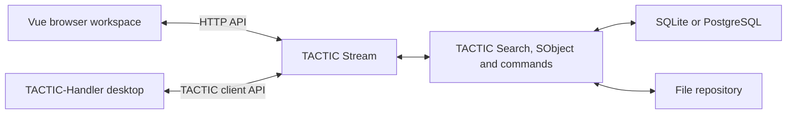

# TACTIC Stream

**Self-hosted TACTIC server and web workspace for asset and shot production.** Define what a project tracks, design how each record appears, and run tasks, review, and publishing against the same server-owned records.

[Русский](README.ru.md) · [Run locally](#run-locally) · [Server deployment](#deployment-and-recovery) · [Server API](#server-api) · [Documentation](tactic_stream/docs/index.md)


*Orbit Studio in the browser. A configured Item View binds an image, a title, a description, and record actions to each asset.*

> **Development prototype.** Start with an isolated project. The Perforce-like file workspace and its browser inspection tools are a separate prototype.

## From production model to workspace

A project defines its records through **Search Types**, relationships through its schema, and work through pipelines and processes. Build the views that artists and coordinators use on top of that model. The server continues to own record identity, access, and publishing rules.

### Design the Item View

Start in **Administration → Item layouts**. Choose a Search Type, build a named card or row, and bind each element to real record data. Place previews and fields in the layout, add actions, and check the result against project records before saving it. Reuse the saved layout in a dashboard item block.


*The editor works on a draft and shows a live preview. Saving publishes the configuration for the selected Search Type.*

[Item Layouts guide](tactic_stream/frontend/public/help/item_layouts.en.md) · [Table view](tactic_stream/docs/assets/github-workspace.png)

### Use the saved view with production data

In the workspace, a card can lead to object details, tasks, notes, and linked records. Teams can use the same records in a table for editing, a dashboard for coordination, or a task workspace for scheduling. Project administrators configure which views and tools appear in navigation.


[Tasks and planning](tactic_stream/frontend/public/help/tasks.en.md) · [Administration](tactic_stream/frontend/public/help/administration.en.md) · [Example dashboard plugin](examples/workspace_pulse/README.md)

### Publish and review

Upload through the web check-in workflow and review the resulting snapshots and files. TACTIC applies project permissions, naming, and repository configuration. For local repository mappings, desktop file operations, and Maya, connect the independent **TACTIC-Handler** client to the same server.

[Snapshot Browser](tactic_stream/frontend/public/help/dock.snapshot.en.md) · [Handler connection](tactic_stream/docs/delivery/HANDLER_DEPLOYMENT.md)

## How the pieces fit



The Python core retains native `Search`, `SObject`, schema, pipeline, and command semantics. The browser owns interaction and drafts. Stream and Handler each ship their own build and render applicable **Tactic Frame** descriptions with Vue and Qt Quick controls. [Architecture](tactic_stream/docs/architecture.md) · [Frame contract](tactic_stream/docs/frame/contract.md)

## Run locally

From the source checkout on Windows, create a Python 3.14 environment. Use a fresh data directory for a first run.

```powershell
Set-Location tactic_stream
py -3.14 -m venv .venv
.\.venv\Scripts\python.exe -m pip install -e .
..\START_TACTIC_STREAM.bat
```

The launcher initializes SQLite when needed, asks for an administrator password on first setup, and opens the configured address. The source tree includes the built web client. [CLI and development setup](tactic_stream/README.md#local-development)

## Deployment and recovery

| Mode | What it runs | Setup |
| --- | --- | --- |
| Local source | Python monitor, bundled web assets, SQLite | [Local development](tactic_stream/README.md#local-development) |
| Portable Windows | Desktop launcher, bundled Python and web app, SQLite, optional native Handler workflow | [Windows package guide](tactic_stream/docs/delivery/WINDOWS_DELIVERY.en.md) |
| Dedicated Linux server | Stream behind Apache with PostgreSQL, delivered with Docker Compose | [Server package guide](tactic_stream/docs/delivery/SERVER_DELIVERY.en.md) |

Back up the database, repository, and configuration together before upgrading. Rolling back requires the older application and its matching data backup. [Backup and recovery](tactic_stream/docs/delivery/RECOVERY_ACCEPTANCE.md)

## Server API

On a running instance, `/api/documentation` lists methods and `/api/compatibility` describes the original TACTIC contract. The bundled Python client can query the server through XML-RPC. This example uses the demo project and prompts for credentials locally.

```python
from getpass import getpass
from tactic_client_lib import TacticServerStub

server = TacticServerStub(setup=False, protocol="xmlrpc")
server.set_server("http://127.0.0.1:8081")
server.set_project("orbit")
server.set_ticket(server.get_ticket(input("Login: "), getpass("Password: ")))

for asset in server.query("orbit/asset", columns=["code", "name"], limit=12):
    print(asset["code"], asset["name"])
```

Use the actual server address, project, and Search Type from your installation. Validate workflows with the plugins and schema you intend to use. [API source map](tactic_stream/docs/admin_agent/SOURCES.md#ts-server-api) · [Compatibility scope](tactic_stream/docs/compatibility.md) · [Core data model](tactic_stream/frontend/public/help/core_model.en.md)

| Explore further | Reference |
| --- | --- |
| Build layouts, dashboards, or extensions | [Item Layouts](tactic_stream/frontend/public/help/item_layouts.en.md) · [Workspace Pulse](examples/workspace_pulse/README.md) · [Studio Review](examples/studio_review/README.md) |
| Develop the server or web UI | [Application README](tactic_stream/README.md) · [Architecture](tactic_stream/docs/architecture.md) |
| Verify a deployment | [Delivery index](tactic_stream/docs/delivery/index.md) · [Recovery acceptance](tactic_stream/docs/delivery/RECOVERY_ACCEPTANCE.md) |

## License notices

[Original TACTIC](tactic_stream/LICENSE.TACTIC) · [QuickJS-NG](tactic_stream/LICENSE.QUICKJS-NG) · [Vue](tactic_stream/frontend/public/LICENSE.VUE.txt) · [Bundled icon fonts](tactic_stream/frontend/public/licenses/icon-fonts/SOURCES.md)
