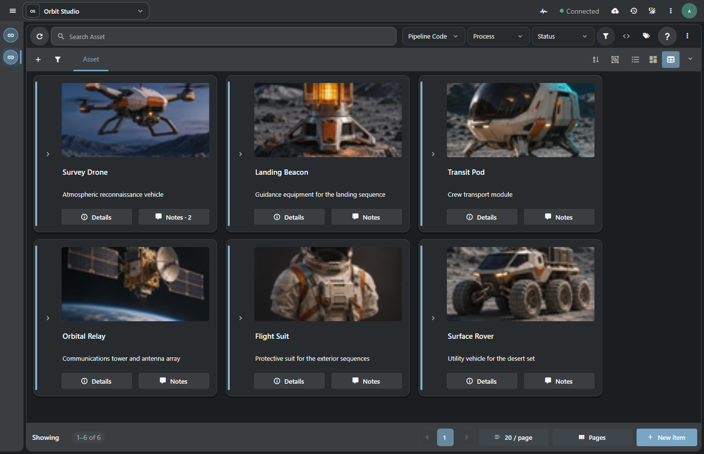
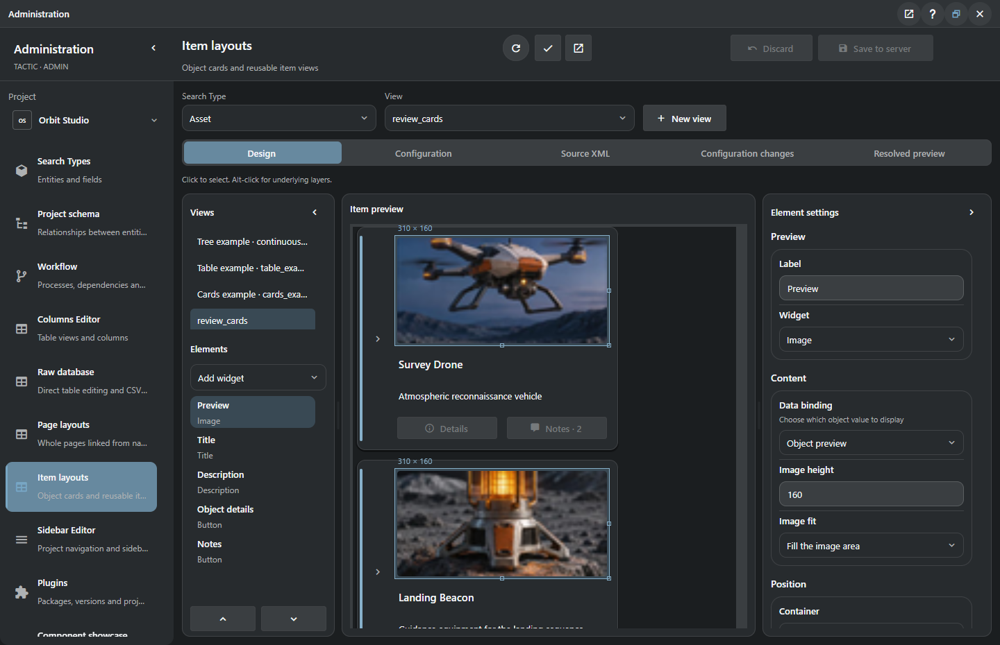
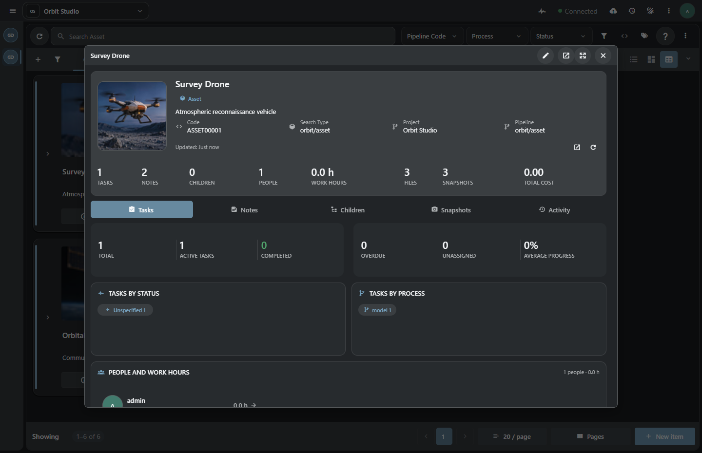
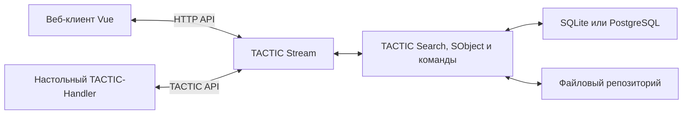

# TACTIC Stream

**Сервер TACTIC и веб-пространство для производства ассетов и шотов.** Опишите данные проекта, соберите представления для команды и ведите задачи, ревью и публикации на одних и тех же серверных записях.

[English](README.md) · [Локальный запуск](#локальный-запуск) · [Развёртывание](#развёртывание-и-восстановление) · [API сервера](#api-сервера) · [Документация](tactic_stream/docs/index.md)



*Orbit Studio в браузере. В каждом Item View превью, название, описание и действия привязаны к данным ассета.*

> **Прототип в разработке.** Начните с изолированного проекта. Perforce-like workspace и его инструменты просмотра в браузере — отдельный прототип.

## От модели проекта к рабочему пространству

**Search Type** определяет записи, схема — их связи, а пайплайны и процессы — работу над ними. На этой модели строятся представления для художников, координаторов и администраторов. Идентификаторы, права и правила публикации хранит сервер.

### Соберите Item View

Откройте **Администрирование → Раскладки объектов**. Выберите Search Type и соберите именованную карточку или строку. Привяжите превью и поля к данным записи, добавьте действия и проверьте раскладку на объектах проекта. Сохранённый вид можно переиспользовать в блоке дашборда.



*Редактор показывает черновик на реальных данных проекта. Сохранение публикует конфигурацию для выбранного Search Type.*

[Руководство по Item Layouts](tactic_stream/frontend/public/help/item_layouts.ru.md) · [Табличный вид](tactic_stream/docs/assets/github-workspace.png)

### Работайте с сохранённым представлением

Карточка может вести к деталям объекта, его задачам, заметкам и связанным записям. Те же данные доступны в таблице для редактирования, на дашборде для координации и в менеджере задач для планирования. Администратор определяет, какие представления появятся в навигации.



[Задачи и планирование](tactic_stream/frontend/public/help/tasks.ru.md) · [Администрирование](tactic_stream/frontend/public/help/administration.ru.md) · [Пример дашборда Workspace Pulse](examples/workspace_pulse/README.ru.md)

### Публикуйте и проверяйте версии

Загрузите файлы через браузерный check-in и проверьте снапшоты. Права, правила именования и репозиторий задаются проектом TACTIC. Для работы с локальными путями, синхронизацией файлов и Maya подключите к тому же серверу отдельный клиент **TACTIC-Handler**.

[Snapshot Browser](tactic_stream/frontend/public/help/dock.snapshot.ru.md) · [Подключение Handler](tactic_stream/docs/delivery/HANDLER_DEPLOYMENT.md)

## Как устроена система



Ядро Python сохраняет нативную модель `Search`, `SObject`, схем, пайплайнов и команд TACTIC. Браузер ведёт взаимодействие и черновики. Stream и Handler поставляются независимо и отображают общие описания **Tactic Frame** своими контролами Vue и Qt Quick. [Архитектура](tactic_stream/docs/architecture.md) · [Контракт Frame](tactic_stream/docs/frame/contract.md)

## Локальный запуск

Выполните команды из корня исходного репозитория на Windows. Для первого запуска используйте новый каталог данных и Python 3.14.

```powershell
Set-Location tactic_stream
py -3.14 -m venv .venv
.\.venv\Scripts\python.exe -m pip install -e .
..\START_TACTIC_STREAM.bat
```

При первом запуске скрипт инициализирует SQLite, предложит создать пароль администратора и откроет настроенный адрес. Веб-интерфейс уже собран в исходном дереве. [CLI и среда разработки](tactic_stream/README.md#local-development)

## Развёртывание и восстановление

| Режим | Состав | Как запустить |
| --- | --- | --- |
| Локально из исходников | Python, собранный веб-интерфейс, SQLite | [Настройка среды](tactic_stream/README.md#local-development) |
| Портативная Windows-сборка | Десктопный лаунчер, Python и веб-клиент, SQLite и Handler | [Поставка для Windows](tactic_stream/docs/delivery/WINDOWS_DELIVERY.ru.md) |
| Отдельный Linux-сервер | Stream за Apache, PostgreSQL и Docker Compose | [Серверная поставка](tactic_stream/docs/delivery/SERVER_DELIVERY.ru.md) |

Перед обновлением сохраните вместе базу, файловый репозиторий и конфигурацию. Для отката нужны прежняя сборка и соответствующая копия данных. [Резервное копирование и восстановление](tactic_stream/docs/delivery/RECOVERY_ACCEPTANCE.md)

## API сервера

На запущенном сервере `/api/documentation` описывает методы, а `/api/compatibility` — границы совместимости с оригинальным TACTIC. Встроенный клиент Python выполняет запросы через XML-RPC. Пример ниже читает записи демопроекта и запрашивает пароль локально.

```python
from getpass import getpass
from tactic_client_lib import TacticServerStub

server = TacticServerStub(setup=False, protocol="xmlrpc")
server.set_server("http://127.0.0.1:8081")
server.set_project("orbit")
server.set_ticket(server.get_ticket(input("Login: "), getpass("Password: ")))

for asset in server.query("orbit/asset", columns=["code", "name"], limit=12):
    print(asset["code"], asset["name"])
```

Укажите адрес сервера, проект и Search Type вашей установки. Проверяйте сценарии на тех схемах и плагинах, с которыми собираетесь работать. [Карта серверного API](tactic_stream/docs/admin_agent/SOURCES.md#ts-server-api) · [Совместимость](tactic_stream/docs/compatibility.md) · [Модель данных](tactic_stream/frontend/public/help/core_model.ru.md)

| Что дальше | Документация |
| --- | --- |
| Создать раскладку, дашборд или расширение | [Item Layouts](tactic_stream/frontend/public/help/item_layouts.ru.md) · [Workspace Pulse](examples/workspace_pulse/README.ru.md) · [Studio Review](examples/studio_review/README.ru.md) |
| Разрабатывать сервер или веб-клиент | [README приложения](tactic_stream/README.md) · [Архитектура](tactic_stream/docs/architecture.md) |
| Проверить развёртывание | [Документация поставки](tactic_stream/docs/delivery/index.md) · [Приёмка восстановления](tactic_stream/docs/delivery/RECOVERY_ACCEPTANCE.md) |

## Лицензионные уведомления

[Оригинальный TACTIC](tactic_stream/LICENSE.TACTIC) · [QuickJS-NG](tactic_stream/LICENSE.QUICKJS-NG) · [Vue](tactic_stream/frontend/public/LICENSE.VUE.txt) · [Наборы иконок](tactic_stream/frontend/public/licenses/icon-fonts/SOURCES.md)
