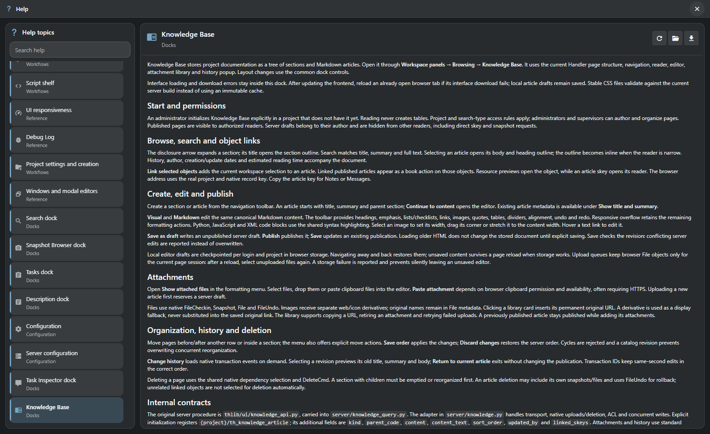

# Built-in Help

**Find the next step without leaving the workspace.**

[TACTIC Stream](../../../README.md) · [Русский](help.ru.md) · [Knowledge Base](knowledge-base.en.md) · [Full feature tour](product-tour.en.md)

Help puts the application's instructions beside the work: how a panel behaves, what a setting changes, and how to complete a workflow. Open it from the application menu, or use a window's Help action to go straight to the relevant topic.

## Start with the screen you are using

A question about check-in should lead to check-in instructions. Contextual Help actions select an article for the current tool; the topic catalog remains available for exploring the wider workflow. Configuration, administration, search, publishing, scripting and workspace panels have their own explanations.

| When you need to… | Help provides… |
| --- | --- |
| Find an unfamiliar action | Search across article titles, groups and text. |
| Follow a procedure | A formatted article with headings, examples and links to related topics. |
| Move between topics | A searchable catalog, keyboard navigation and remembered article scroll positions. |
| Read in your working language | English and Russian articles, selected with the interface language; English fallback when needed. |
| Keep a reference | Download a Markdown copy of the current article. |

## Documentation that belongs to the application

Stream serves the Help catalog and articles with its browser application. The reader offers article links, reload and Markdown download. Articles carried over as original Handler references are explicitly marked: desktop-specific options belong to Handler and are not promises of browser functionality.

Help is the product's reference library. The **Knowledge Base** is where the team writes its own production handbook: onboarding, naming rules, delivery checklists and technical decisions, linked to actual project objects.

[Explore the Knowledge Base →](knowledge-base.en.md)

## Try it in a real workflow

1. Open a working tool, such as Configuration or Commit Queue.
2. Use its Help action to open the matching article.
3. Search for another topic, follow a related link, or download the article for later.

[Getting started](../../frontend/public/help/getting_started.en.md) · [Search guide](../../frontend/public/help/search.en.md) · [Knowledge Base guide](../../frontend/public/help/dock.knowledge.en.md)

*Fresh capture of the Stream browser application. The presentation shows the current development prototype.*
