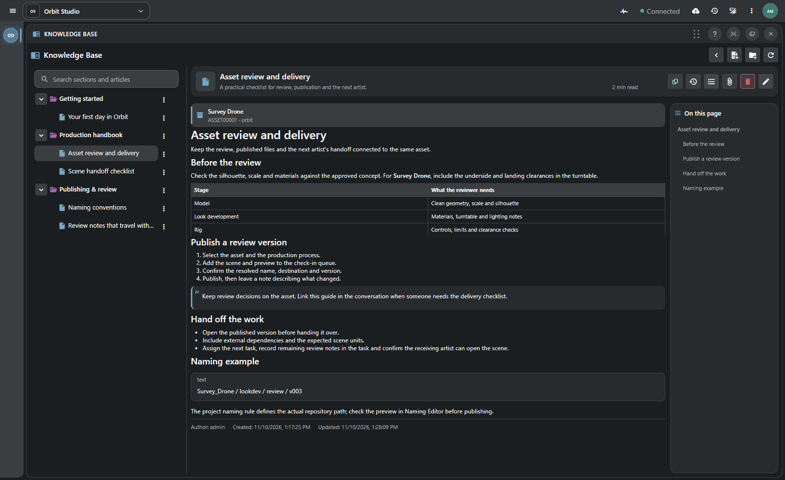
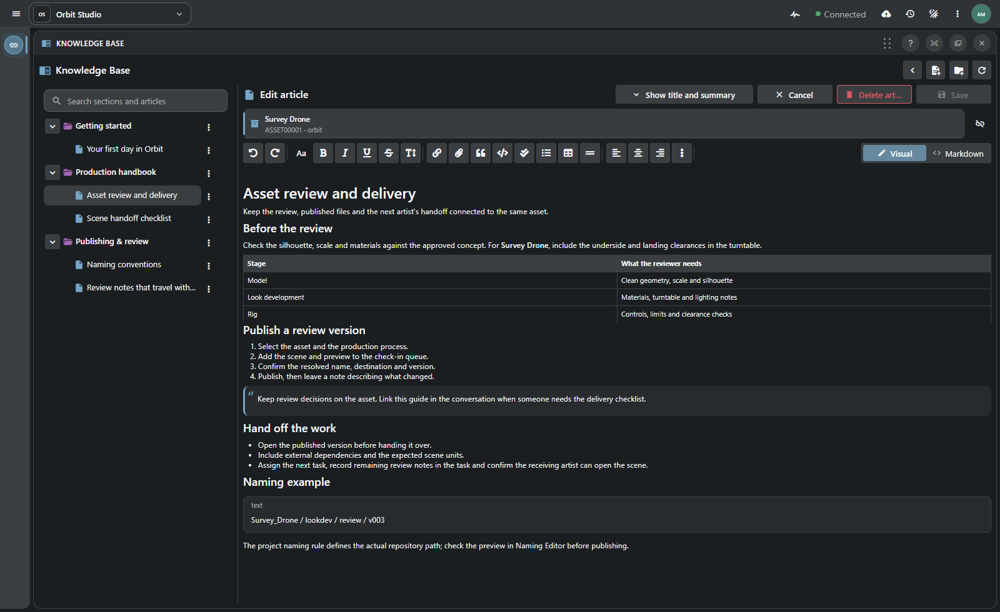
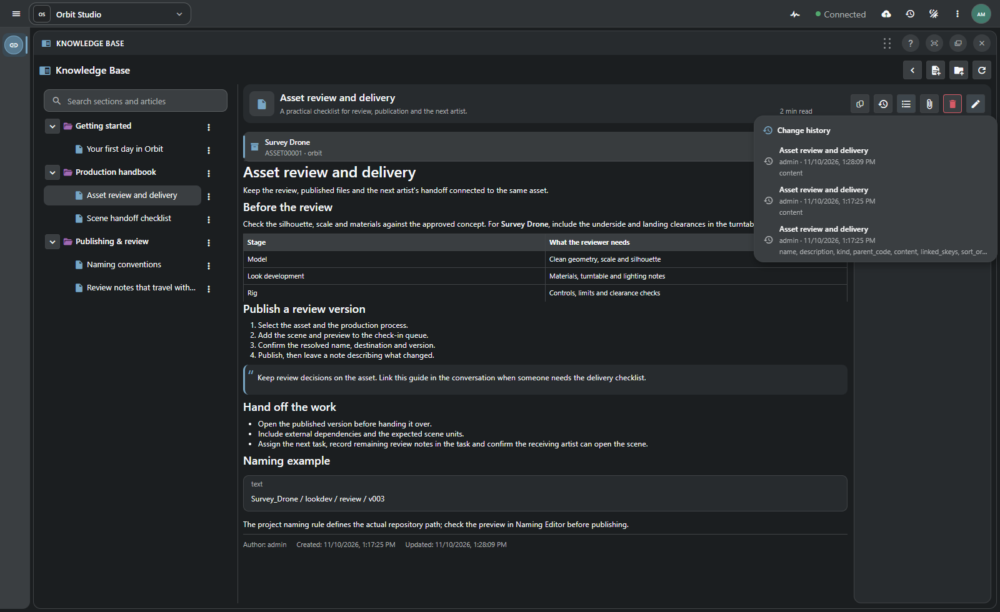

# Your studio’s Knowledge Base

**Give recurring production questions a useful, lasting answer.**

[TACTIC Stream](../../../README.md) · [Русский](knowledge-base.ru.md) · [Built-in Help](help.en.md) · [Full feature tour](product-tour.en.md)

A team collects useful knowledge: how to hand over a scene, what to include in a review, why a technical decision was made. Knowledge Base gives that material a home in the project. Open an article beside Item View, link it to an object and send a colleague the link.

## Link delivery requirements to an asset

Survey Drone has an **Asset review and delivery** guide in the example above. An artist can read it beside the asset, check the delivery requirements and share the same article in Notes or Messages. Published linked articles are also available from their objects. A common guide can cover several records without needing a separate copy for each asset.

| Material | Where it helps |
| --- | --- |
| Artist onboarding | A first-day checklist, project conventions and links to the working tools. |
| Delivery standards | A checklist attached to the assets or shots it governs. |
| Department handbook | Nested sections for modeling, look development, rigging and review. |
| Technical notes | Code examples, supporting files and decisions that remain easy to find. |

## Find a rule or read the whole section

A newcomer can work through a whole section; someone returning to a familiar rule can search by title, summary or body text. Long articles have a heading outline to help readers jump to the relevant part. The author, creation/update dates and estimated reading time accompany the article.

As the handbook grows, authors can move articles between sections and change their order. Arrange the tree first, then save it or discard the changes. Readers see the saved organization.

## One article, two editors: Visual and Markdown

Some authors prefer to select text and use formatting buttons; others are quicker with Markdown. **Visual** and **Markdown** edit the same document, so both approaches work. Headings, lists, tables, quotes, images, links and code blocks give a procedure the structure it needs.

An instruction often needs an example: a scene, an image or a supporting file. Upload it to the article’s library, insert it into the text or copy its permanent link. Files use the project’s publication storage. A linked asset remains a separate object you can return to from the article.

## Keep writing in a draft, then publish for the team

1. Create an article in the appropriate section and add the instructions.
2. Link the relevant objects and upload supporting files.
3. Continue locally or **Save as draft** to keep an unpublished server copy owned by the author.
4. **Publish** when readers should see it; use **Save** to update an existing publication.

You do not have to finish an article in one sitting. Local checkpoints keep unfinished text while you move between articles; **Save as draft** stores a private copy on the server. Published pages are visible to readers with the required access. If another author has changed the article in the meantime, saving reports a revision conflict.

Browser checkpoints use storage for the current login and project. After a page reload, files that were selected but not yet uploaded must be selected again. Clipboard attachments depend on browser permission and availability, often requiring HTTPS.

## Read an earlier version of the article

When requirements change, **Change history** lets you read the earlier wording. The list shows authors, dates and changed fields from native transactions. Open a revision to inspect its title, summary and body, then return to the current article. Reading an older version does not restore or republish it.

## Make the Knowledge Base available to the team

An administrator explicitly initializes Knowledge Base in a project. Administrators and supervisors can author and organize pages, subject to server permissions; authorized readers browse published material. In TACTIC Stream, open **Workspace panels → Browsing → Knowledge Base** and arrange the dock around your work.

Use **Help** for the application's instructions and **Knowledge Base** for the team's own knowledge. The two meet naturally: a product guide explains how check-in works; a project article explains what this team expects in a delivery.

[Complete Knowledge Base guide](../../frontend/public/help/dock.knowledge.en.md) · [Built-in Help](help.en.md) · [Docks and workspace layouts](product-tour.en.md#docks-for-review-planning-and-publishing)

*Fresh screenshots from the Stream browser application on an isolated Orbit Studio project. The handbook content and assets are illustrative; the reader, editor and history are the actual application.*
