# TACTIC Stream: how the project works

[Visual presentation](../../../README.md)

**Stream develops TACTIC’s server and browser workspace.** This tour explains how the project model, workflow, tasks and files form a working process, then looks at how a team can configure it.

**Start with an asset, then follow its work through the team.**

[Русский](product-tour.ru.md) · [Workflow](#workflow-what-runs-when-a-stage-is-complete) · [Tasks & Gantt](#assign-the-work-and-keep-track-of-dates) · [Files & naming](#check-in-and-check-out-hand-files-to-the-next-person) · [Tactic Frame](#tactic-frame-a-shared-ui-language-for-handler-and-stream) · [Administration](#administration-define-your-projects-objects-and-relationships) · [Get started](#install-connect-and-add-your-own-tools)

[Docks](#docks-for-review-planning-and-publishing) · [Sidebar Editor](#sidebar-editor-a-starting-screen-for-each-department) · [Object overview](#the-work-and-history-behind-an-asset) · [Server history](#activity-feed-who-changed-what-in-the-project) · [Users & access](#bring-people-into-the-project-and-set-their-access)

| Explore the assistant | Build your own workspace |
| --- | --- |
| [**The built-in project assistant →**](assistant.en.md) — Ask about real records, prepare changes and inspect the operations behind an answer. | [**Custom dashboards →**](dashboards.en.md) — Combine metrics, charts, Item View and selection-driven tools into a project page. |

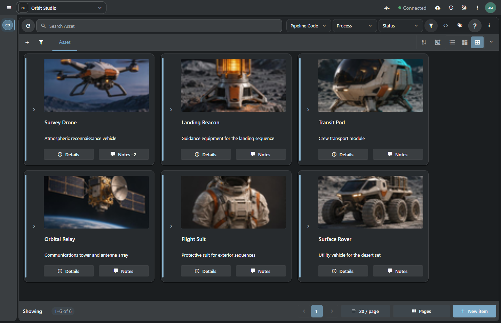

*Fresh captures of the current application in Orbit Studio, a disposable demonstration project with fictional people and concept artwork. The interfaces and records are real; the artwork is illustrative.*

> **Development prototype.** The product is under active development. The Perforce-like File Workspace is also a prototype. Evaluate your actual schema, permissions, scripts and file workflows on isolated data before production use.

## Why fork TACTIC

[Southpaw TACTIC](https://github.com/Southpaw-TACTIC/TACTIC) already brought together workflow, configurable data and asset management. Stream preserves that foundation: Search Types, `Search`/`SObject`, schemas, pipelines, commands, permissions and file publications.

**The fork continues TACTIC’s idea of configurable production.** Stream develops the server core, browser application and project-authoring tools together. Native Handler works alongside them; visual editors make schemas, processes and views accessible through the interface. “Stream” reflects the connection between stages: tasks, decisions and files accompany the work as it passes to the next person.

| Foundation retained from TACTIC | Stream's approach | Practical result |
| --- | --- | --- |
| Configurable entities and relationships | Native core on Python 3.14, visual schema and field editors | Build the studio's model and work with it through current tools. |
| Workflow and command execution | Modern graph authoring, process inspectors and native server operations | Configure the route and inspect the rules that execute it. |
| Configurable views | Vue workspace, native Qt Handler and shared Tactic Frame descriptions | Use the browser or a desktop workflow with a common UI vocabulary. |
| Snapshots and naming | Publication tools, naming preview and explicit queues | Keep versions and file destinations attached to their production context. |
| Scriptable platform | Current editor, provider-independent assistant and visual page authoring | Extend the project through code, configuration or scoped assistant tools. |
| Server deployment | SQLite local edition and PostgreSQL server deployment | Evaluate locally, then deploy a dedicated service with an appropriate database. |

Workflow, the object model and publications come from TACTIC. Stream’s work is in developing that foundation and the tools people use with it today. This describes the approach; a performance comparison needs measurements on a particular workload.

Consider an asset moving from modeling to rigging. The completed task describes progress, review notes record decisions, and a snapshot identifies the files that were actually handed over. The next person needs all three. Objects, pipelines, tasks, conversations and publications are connected so you can work out what happened and where to pick up.

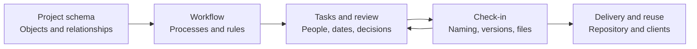

## Item View: find an asset and see what belongs to it

Work usually starts with something specific: an asset, shot, document or another project object. **Item View** lets you recognize it by its preview, read useful fields and reach its actions. The tree reveals related records, processes and publications. When you need to compare or edit many fields, a table gives you sorting, filters and selection.

Each search tab keeps its working state when you move elsewhere. Filters narrow the server query; tags and quick filters help you return to familiar sets of records. Put tasks, notes, snapshots, details or a calendar beside the results, then save the arrangement so the department can start there next time.

### Item Layouts: useful fields and actions on each card

A review needs an image and useful actions; a dense list needs a few short fields. **Item Layouts** can provide either by connecting text and images to object data. Supported actions can sit inside the card. Preview the result on project records and save it as a presentation you can use again.

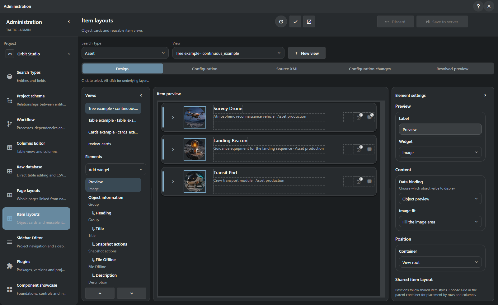

**Page layouts, item layouts and columns have distinct jobs:** a page composes a workspace, an item layout composes one object, and a table view chooses its fields and widgets. The sidebar connects these definitions to project navigation. [Item Layouts Help](../../frontend/public/help/item_layouts.en.md)


## Docks for review, planning and publishing

During a review, give the preview most of the screen and keep its notes nearby. For planning, that space may be more useful split between objects and tasks. **Docks** let you build both arrangements from working panels: place them side by side, stack them into tabs or put a tool away until it is needed.

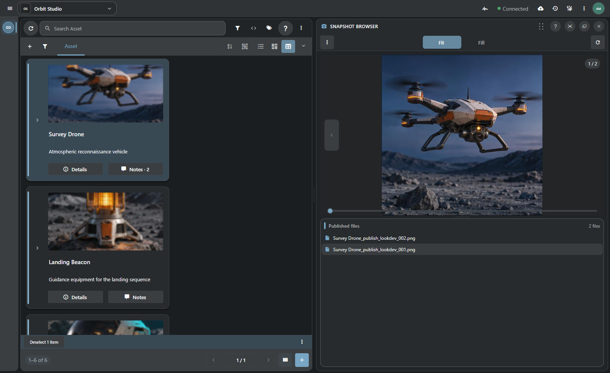

### Arrange the panels and make room

Drag a panel's grip toward an edge to split the target, toward its center to create a tab stack, or toward the title to exchange positions. Resize the dividers, reorder stack tabs, maximize a panel temporarily or hide it and recover its space. A cancelled drag restores the previous arrangement.

Stream floats panels inside the browser workspace. It does not detach a dock into a native operating-system window. Narrow/phone presentation uses a compact active panel without rewriting the desktop split layout.

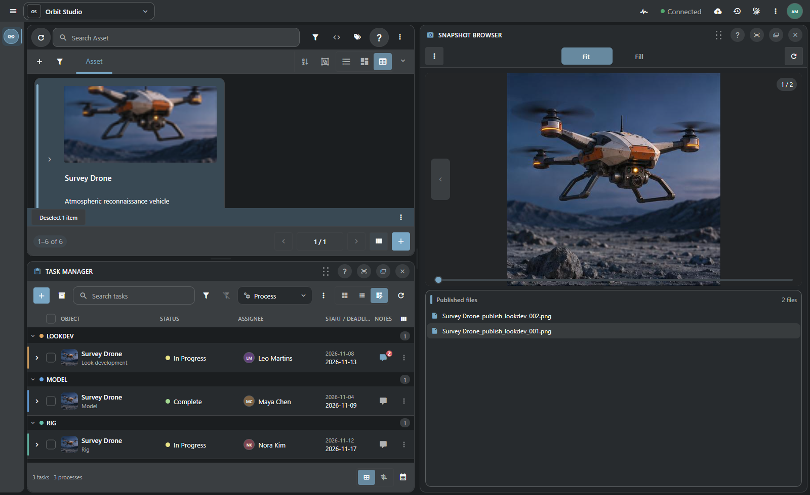

| Workspace | A useful composition |
| --- | --- |
| **Review** | Item View + Snapshot Browser + Description/Notes: choose a record, inspect the publication, keep its discussion visible. |
| **Planning** | Results + Task Manager/Gantt + task details or calendar where supported: connect assignments and dates to production objects. |
| **Publishing** | Results + Drop Plate + Commit Queue: identify the destination, prepare files and inspect the pending publication. |
| **Documentation** | Results + Knowledge Base: keep project records beside the team's reference material. |

Selection connects the panels: choose an object, process or snapshot in Search, and the tools following that selection show its data. Open a task and Inspector goes to that task. Rearranging the panels keeps this connection between selection and content.

### Save a layout for yourself and the team

Personal workspace state retains placement, sizes, visibility and stacks in its owning client/tab. **Layout presets** save named project arrangements on the server: apply, refresh, save, replace and delete are separate operations. Assign a preset to a sidebar entry so a department opens into a useful default; later personal tab state can retain that user's arrangement.

A preset describes panels and their layout. It does not save credentials, commit an editor draft or become a saved search. Reset restores workspace geometry without deleting project records or saved searches. In combination with Item Layouts, Columns Editor, page layouts and script shelves, docks let a studio compose a wide range of working interfaces from implemented tools. [Docks and windows](../../frontend/public/help/windows.en.md)


## Sidebar Editor: a starting screen for each department

Two departments can work with the same assets and need different starting screens. “Asset review” can open a visual presentation and review panels; “Asset planning” can open the relevant search and tasks. Sidebar Editor assigns each entry its Search Type, initial search, view, dock layout and script shelf. Navigation then opens a workspace that is already prepared for the job.

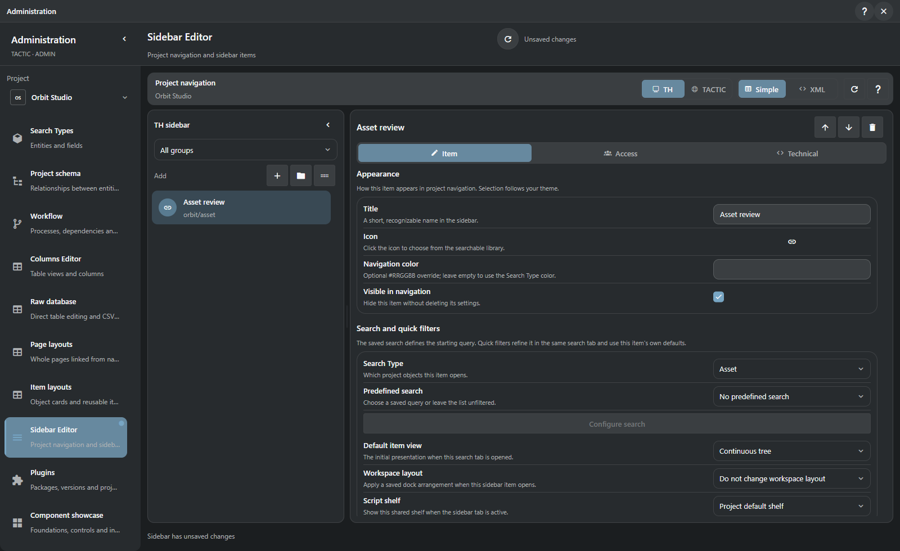

| Editor area | What you build |
| --- | --- |
| **Navigation tree** | Links, sections and separators; order, nesting and visible entries. |
| **Item** | Display title, icon, Search Type, predefined search, initial item presentation, assigned dock preset and shelf. |
| **Configure search** | Prepare the actual search workspace, including saved search, quick filters, process visibility, sorting and grouping. |
| **Access** | Groups allowed to see an item; preview the draft for a selected group. Hidden entries remain editable. |
| **Technical / XML** | Stable internal identity, child views and the supported widget/view configuration. |

Handler's `tactic_handler` sidebar and TACTIC's `project_view` are independent definitions. The editor chooses the target explicitly. Its project selector controls the authoring scope, even if another project is open in the main workspace.

Rename the display title to change the label while retaining the internal identity. A configured Saved Search initializes the entry's first tab; reopening retains its working state instead of adding a duplicate tab. XML Apply updates the draft, and Save publishes the sidebar. Group preview changes what the editor shows; it does not impersonate that group or replace server data permissions. [Sidebar Editor Help](../../frontend/public/help/sidebar_editor.en.md)


## The work and history behind an asset

Before picking up an asset, it helps to see who worked on it, which notes remain and what has been published. **Details / SObject Report** brings that history together for one record. The header shows its preview, identity, description and figures; the sections lead into tasks, notes, relationships, files and activity.

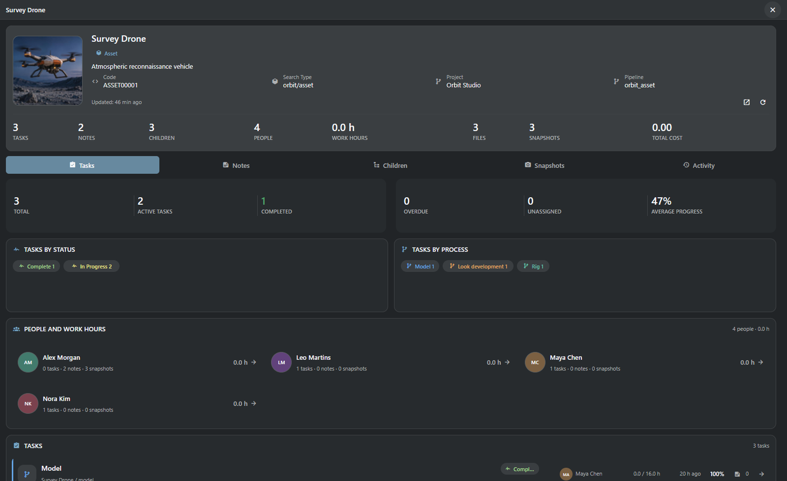

| Section | What it answers |
| --- | --- |
| **Tasks and participants** | Who is involved, what statuses/processes exist, and how much work has been logged? Participants are gathered from tasks, notes, publications and work entries. |
| **Notes** | Which decisions and comments belong to the object or its processes? Open a note in its original context. |
| **Children and relations** | What related production objects sit underneath or alongside this record? |
| **Snapshots and files** | Which processes have publications, how many files do they contain, and what is their total size? Expand the process tree for versions and previews. |
| **Activity** | Who created or changed the object, tasks, notes, publications, work entries and supported relationships? |

A task opens the matching Task Manager scope and selects the exact task in Inspector. A note returns to its process discussion. Publications retain their source project. Cost information is shown only with the corresponding permission. The report helps explain what is behind an object’s status and opens the records you need to inspect. [SObject Report Help](../../frontend/public/help/sobject_info.en.md)


## Workflow: what runs when a stage is complete

After modeling, an asset might move through look development and rigging in parallel, then wait for approval before publication. A pipeline describes that route. The server runs configured responses to events: updating tasks, handling dependencies, calling scripts and sending notifications. The asset’s production route and a task’s progress within one stage have different jobs, so their pipelines are configured separately.

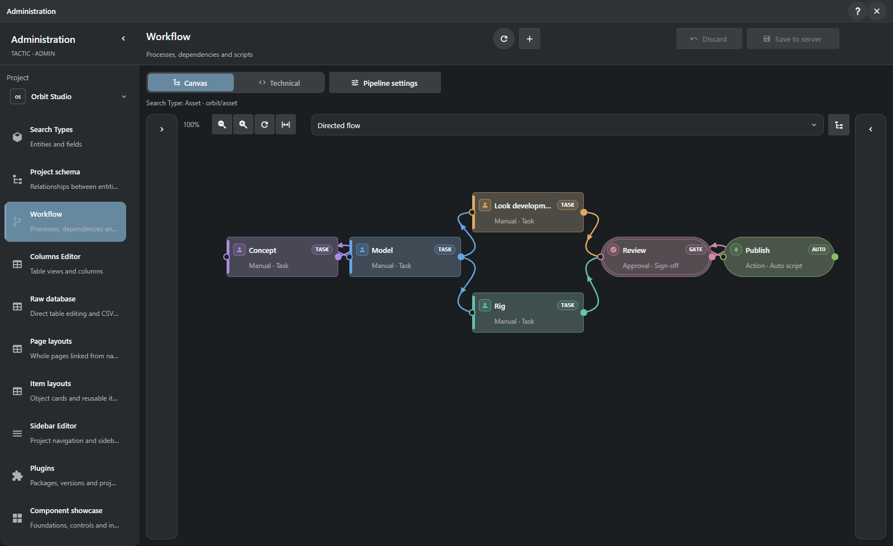

*A configured production graph with parallel look development and rigging, an approval stage and an automatic action. The screenshot demonstrates the definition; it is not evidence that every branch has executed.*

| Node or rule | What it contributes |
| --- | --- |
| Manual and approval | Work assigned to people; review and sign-off stages. |
| Action and condition | Run configured server behavior or choose a route from a condition. |
| Hierarchy, input and output | Organize nested pipelines and their entry/exit points. |
| Dependency and progress | Coordinate related work and process completion. |
| Status and process events | React to pending, action, complete, revise, reject or error transitions. |
| Process rules | Update task or parent status, create downstream tasks, record actual dates, invoke a saved script or class, and configure notifications. |

Author in **Administration → Workflow**: choose a pipeline, arrange its graph, inspect the selected process, edit its type-specific settings, and save the draft. Technical views expose XML and advanced configuration when a studio needs precise control. Dependencies, triggers, notification rules and naming are related configuration, not interchangeable concepts. Saving a graph does not execute its actions or send mail.

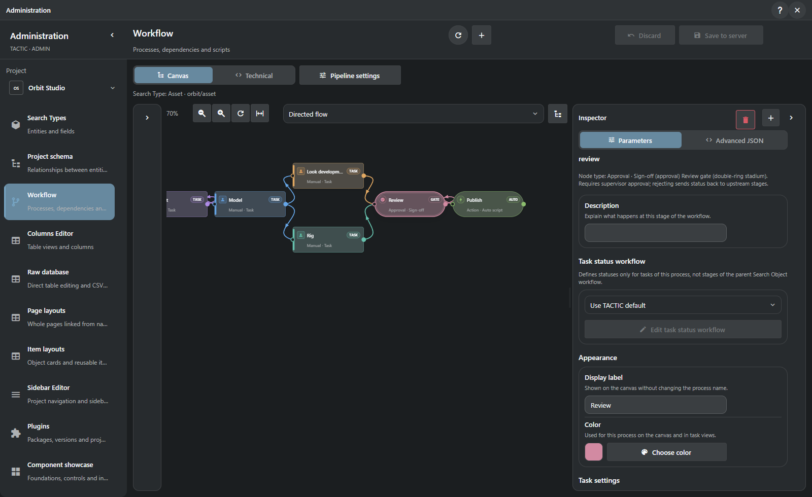

## Assign the work and keep track of dates

### Task Manager: your assignments and the team’s work

An artist needs assigned work; a supervisor needs the department or project plan. Task Manager can change that scope, from selected objects and a Search Type to personal and team tasks. Table and compact views show assignees, supervisors, statuses, dates, progress and effort. Search, filters, grouping and sorting help you focus on the part of the plan you need.

Edits remain explicit drafts until saved. Bulk changes apply to the selected tasks; the inspector keeps a task's object and discussion accessible. Server permissions determine the readable fields and available edits.

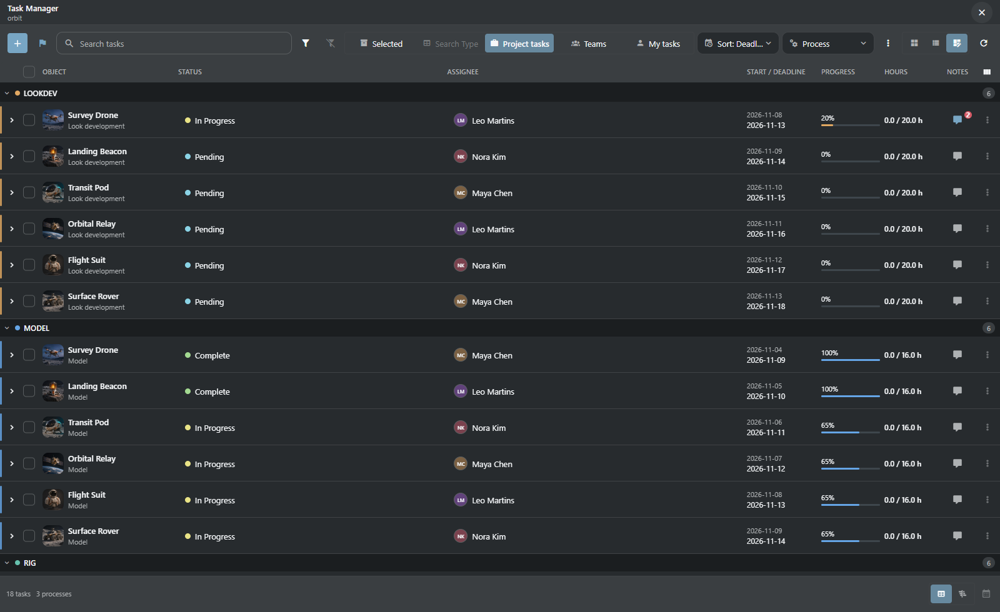

### Gantt: dates, overlapping work and time spent

A list can hide the fact that one person has two assignments due at the same time. Gantt places tasks on a timeline and shows scheduling warnings. Move or resize bars, adjust progress, change scale and group by assignee. Existing dependencies are visible, and tasks without dates remain accessible.

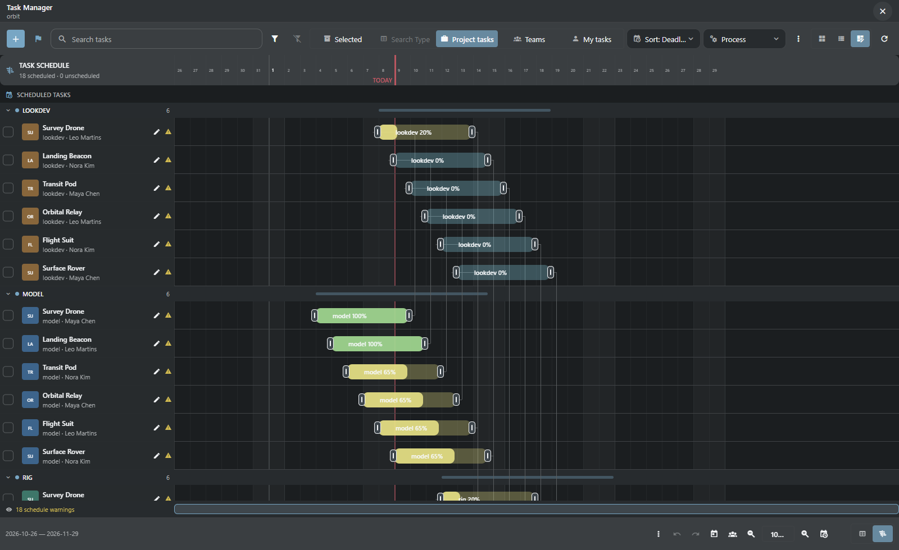

*Orbit's sample schedule deliberately contains overlaps. The warnings are part of the real interface. Dependency visualization does not imply automatic cascading rescheduling.*

The task calendar and agenda provide a date-oriented view; milestones represent project checkpoints. Work-hour entries and cost reports connect effort to people and work where the account has access. [Task Manager Help](../../frontend/public/help/dock.tasks.en.md) · [Calendar Help](../../frontend/public/help/dock.task_calendar.en.md)

## Messages and Notes: discuss the work and keep decisions

Use **Messages** to bring reviewers together, clarify a deadline or reach a colleague in another project. It has direct and group conversations, Favorites, replies, mentions, reactions, pins, forwarding, search and member management. Add files through the picker, drag and drop or the clipboard; unfinished messages stay in drafts.

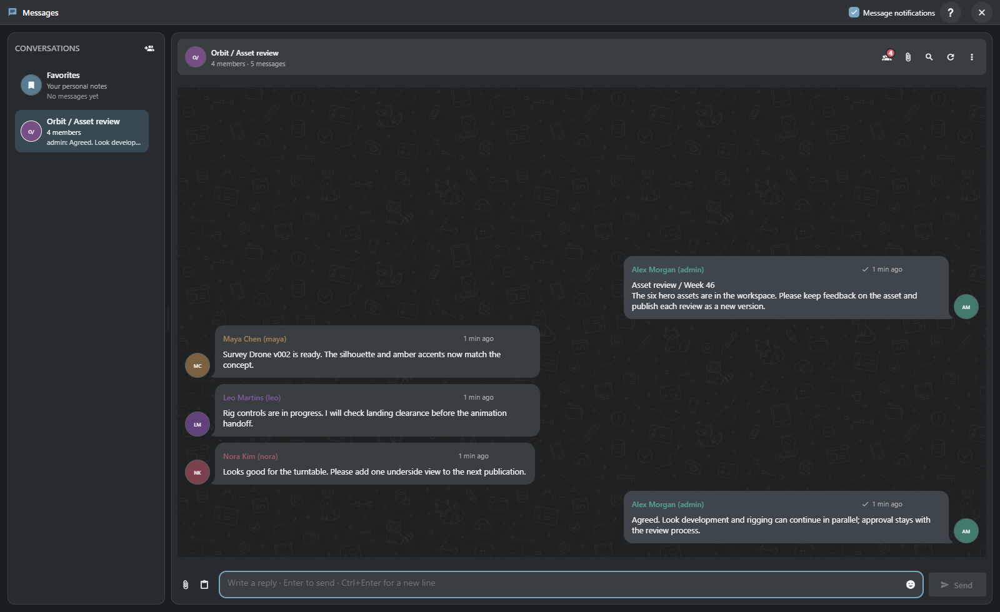

When a conversation settles a decision about an asset, record it in **Notes** against the object, process or task. The next person can find it with the work. Recurring instructions belong in **Knowledge Base**, with its article tree, attachments and revision history. Notifications and the activity journal help people notice changes and return to the affected records.

[Built-in Help: search and contextual instructions →](help.en.md) · [Knowledge Base: articles, editor and history →](knowledge-base.en.md)


## Activity Feed: who changed what in the project

When a status or file has changed and you need to understand why, open **Activity Feed**. It shows supported project events: notes, publications, tasks, field changes and work hours. Each entry includes the actor, time, details and a way back to the object or task. An object’s Activity section narrows the history to that record and supported child and relationship events.

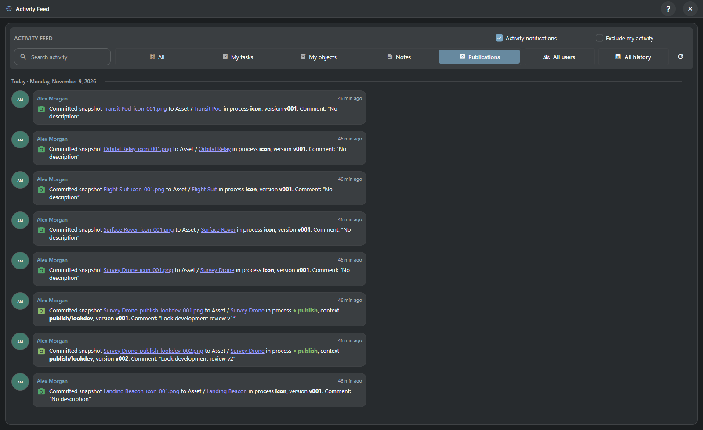

Filter by people and activity category, exclude your own actions, search loaded events or choose a day from the calendar. Older events load while scrolling; calendar counts cover accessible history beyond the currently loaded list. Dates follow the user's local timezone, while relative ages use synchronized server time.

Three histories serve different purposes. **Activity Feed** explains project changes. **Notifications** records notices from the current client session and links to their sources. **System Activity / Debug Log** exposes runtime work and diagnostics. Clearing a notification list does not erase the server journal, messages or file versions. History coverage depends on the events recorded by each operation or extension.


## Check-in and check-out: hand files to the next person

Publishing is the point where work on your machine becomes available to someone else. It needs an object, process, version and description attached to it. In the browser, the path starts with choosing the files and their destination and ends with a snapshot saved on the server:

1. Select the record and publication context; add files in the browser's supported upload/check-in flow.
2. Review the target, description and naming settings before submitting.
3. The server validates permissions and naming, stores the files and records a snapshot.
4. Use Snapshot Browser to inspect versions, previews and file lists, or download the required publication.

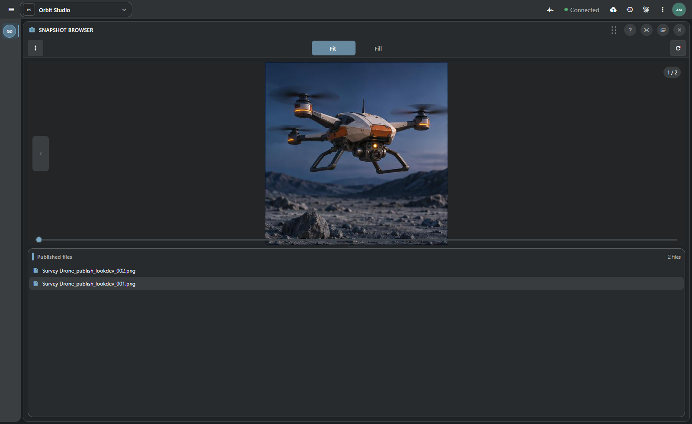

The browser handles uploads and downloads. Handler adds workstation paths, local repository mappings and DCC scene operations when the workflow requires desktop access. The shared server remains the owner of publication metadata, naming and permissions.

A snapshot ties a version to its object, process/context, author, description and files. New versions and revisions are different operations. `latest` and `current` naming rules are separate from versioned storage. File sequences retain their range information so checkout can resolve the published frames.

### Naming Editor: file names and paths by studio rules

A naming convention is useful when it is applied to each publication. Naming Editor defines rule conditions, contexts, filename and directory patterns, sandbox paths and repository aliases. Names can use object, snapshot and file values, with TSQL conditions or a trusted saved script where needed. Try the rule on an example before saving it.

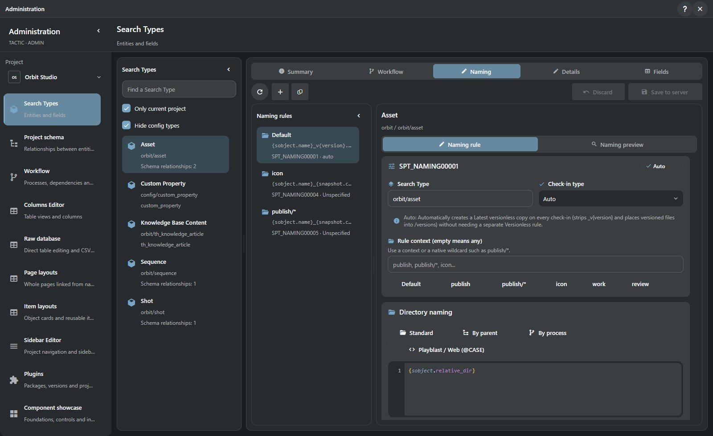

For example, a rule can derive a filename from the object's name, version and extension: `{sobject.name}_v{version}.{ext}`. The native naming engine resolves the actual paths at publication time. A preview is not a reservation: the final check-in still validates the version and collisions. Script-based naming executes trusted project code.

### Bring published files into local Handler

Handler's **Repository Sync** can discover and download the selected objects, processes and versions into a mapped local repository. Its queue and presets belong to the desktop client. Stream supplies the records and files; Repository Sync is not a browser feature. The same boundary applies to desktop Watch Folders and native Maya operations.

## Tactic Frame: a shared UI language for Handler and Stream

Handler and Stream run in different environments, but many of their windows serve the same purpose. **Tactic Frame** provides a shared language for describing those interfaces: their elements, geometry, state and actions. Qt Quick and Vue render the description with their own controls. The structure can be developed in one place while Handler keeps its native Qt interface.

Frame uses standard JavaScript modules (`.mjs`) and ordinary data structures. A feature's `describe(model, width, height, language)` builds its visible structure from state. Controllers handle actions and domain operations; the description does not become a second server API.

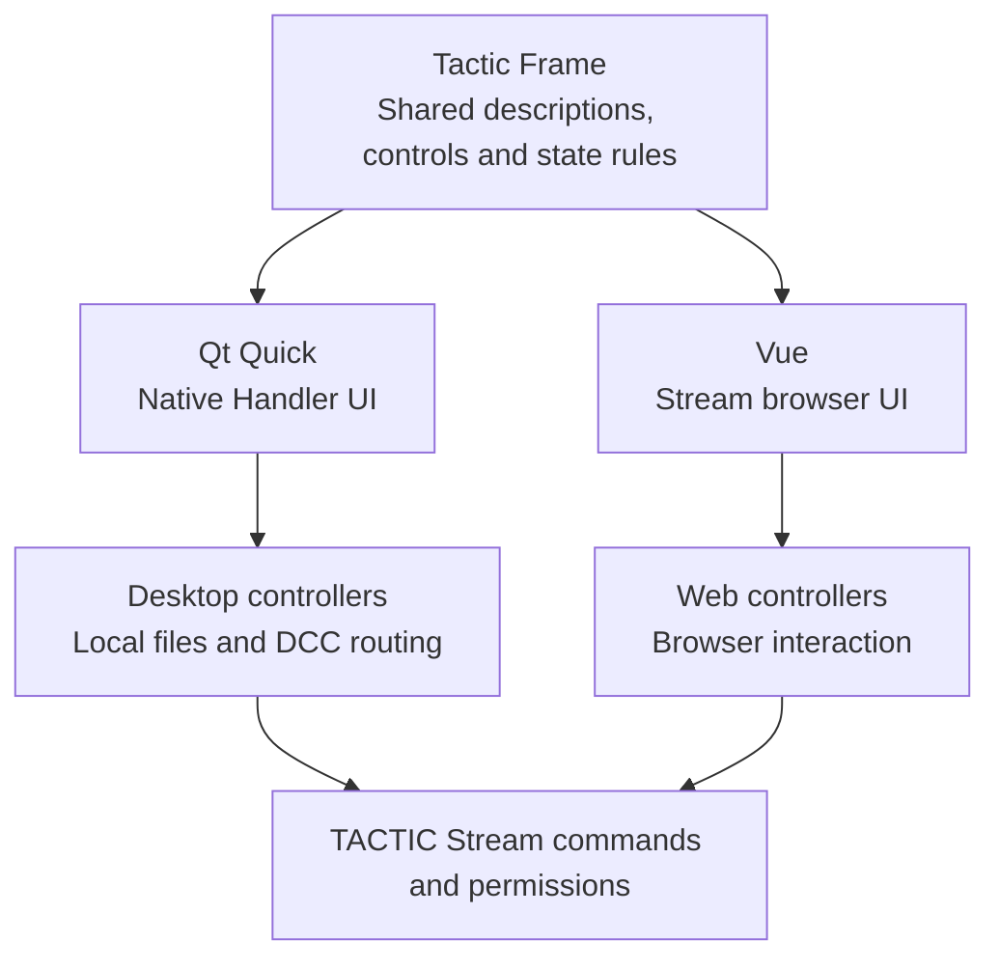

A small description module saved beside this document illustrates the contract. The host supplies `model` and handles the `name` action; production modules also use the shared translation helpers.

```javascript
import { label, node, rect } from "../../src/tactic_stream/shared_ui/core/frame.mjs";

export function describe(model, width, height, language) {
    return { nodes: [
        label("title", rect(16, 12, width - 32, 28), "Review"),
        node("Field", "assetName", rect(16, 48, width - 32, 38), {
            label: "Asset", text: model.name, action: { type: "name" }
        })
    ] };
}
```

Shared building blocks cover fields, buttons, selectors, virtualized lists, tables, graphs, editors and window structure. Themes, translations, focus and input behavior belong to the contract as well as geometry. **Component showcase** makes those building blocks inspectable inside the application.

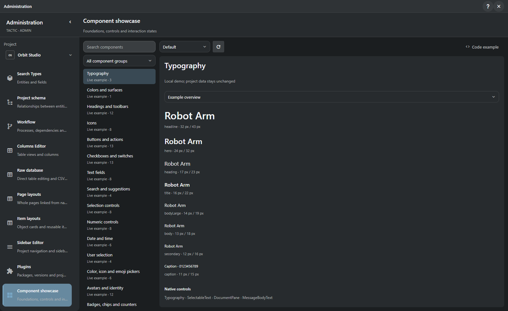

Project XML views and visual layout documents configure content above this layer. They are not a replacement file syntax for Frame modules. Both products ship independently and carry their own shared-description copy; supported behavior must be checked in both renderers. [Frame contracts](../frame/index.md)

## Script Editor: turn a script into a team tool

A one-off command can grow into a department tool. In Script Editor, write it, run the whole script or a selection, inspect the result and errors, then save it in the project library. Tabs, drafts, undo, highlighting, completion, search/replace and outline navigation support the editing work. Folders and clear names help colleagues find the finished tools.

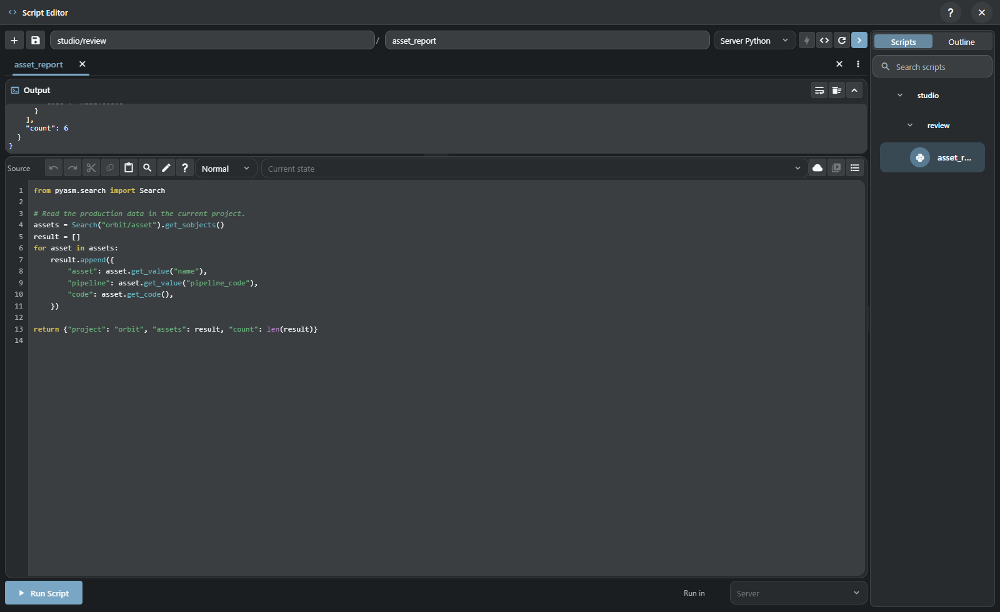

| Runtime | Where it runs and what it can use |
| --- | --- |
| **Server Python** | The TACTIC server, its project context, native objects and commands. |
| **Browser JavaScript** | The browser with its supported context, project/selection values, `rpc` and refresh helpers. |
| **Server JavaScript** | QuickJS-NG on the server with the synchronous `server` API; no browser DOM or desktop DCC context. |

Execution location matters. A returned server result appears in the editor; server Python process stdout remains in the server log. Administrator/supervisor capabilities govern editing and running scripts.

**Script shelves** put saved actions beside the work: shared studio tools, personal tools and tools attached to a search tab. Server workflow events and saved scripts provide project automation. Handler additionally owns its Before/After hooks around desktop and DCC actions. Code execution is a trusted capability, separate from merely viewing a script.

[Script Editor Help](../../frontend/public/help/script_editor.en.md) · [Script Shelf Help](../../frontend/public/help/script_shelf.en.md)

## Administration: define your project’s objects and relationships

Projects differ in what they need to track, how those things relate and which information people need. Administration describes that model through Search Types and a schema, then defines its views and actions. Asset and Shot are possible object types; a project can use its own. The schema graph helps you see their relationships together.

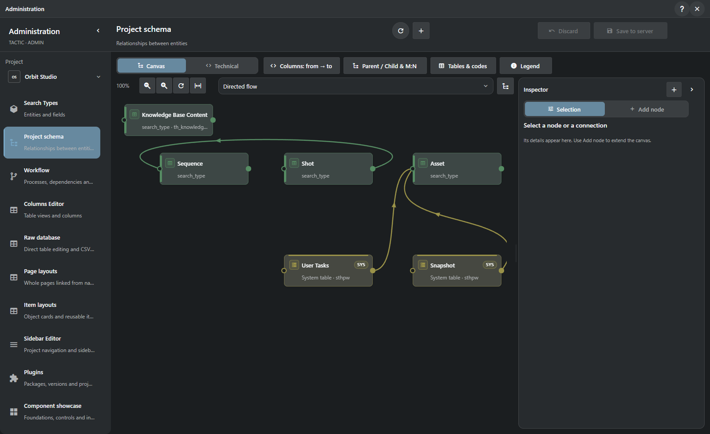

| Section | What you configure |
| --- | --- |
| **Search Types** | Entity definitions, fields and their naming rules. |
| **Project schema** | Relationships between entities and the project graph. |
| **Workflow** | Pipelines, process properties, dependencies and automation. |
| **Columns Editor** | Table views, columns and native field widgets. |
| **Raw database** | Direct authorized table inspection/editing and CSV work, with protected-table restrictions. |
| **Page layouts** | Whole dashboard pages, their blocks, data sources and navigation. |
| **Item layouts** | Reusable cards, rows and object presentations. |
| **Sidebar Editor** | Navigation groups, entries, views and workspace entry points. |
| **Plugins** | Packages, versions and project activation. |
| **Component showcase** | The control vocabulary used by the interfaces. |
| **Users** | Accounts and their project access. |
| **Groups** | Membership and shared access configuration. |
| **Access rules** | Inherited and explicit allow/deny rules; effective access checks for a user. |

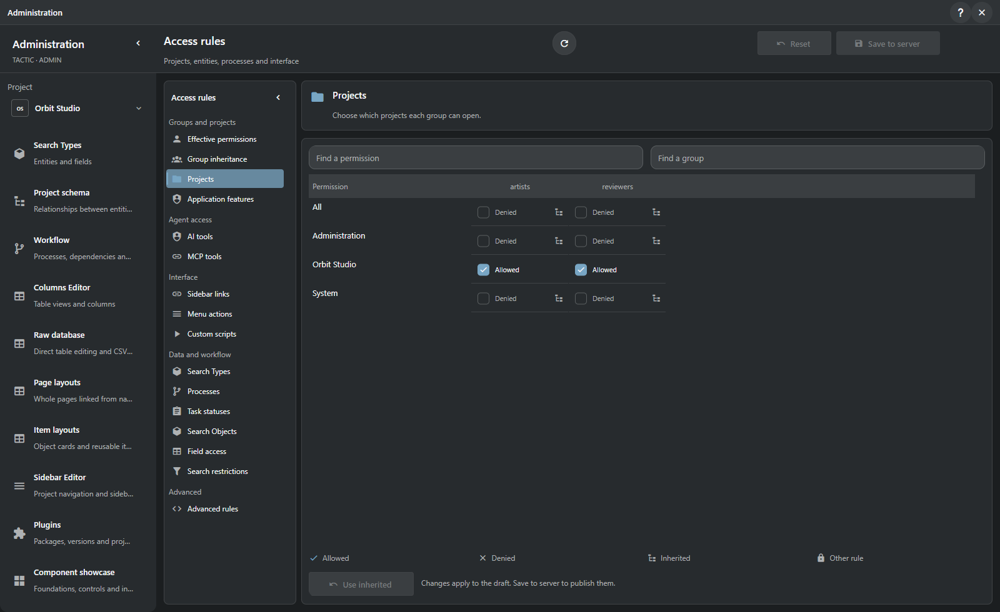

Authoring sections keep their own drafts. Save/discard controls and revision checks make changes explicit; permissions remain enforced by server operations. A visual editor does not grant its user unrestricted database access. [Administration Help](../../frontend/public/help/administration.en.md)


## Bring people into the project and set their access

One person may work on several projects and appear in tasks, conversations, publications and activity records. A shared server account carries that identity, profile, contact information, settings and group memberships. Moving between projects does not lose the connection to who did the work.

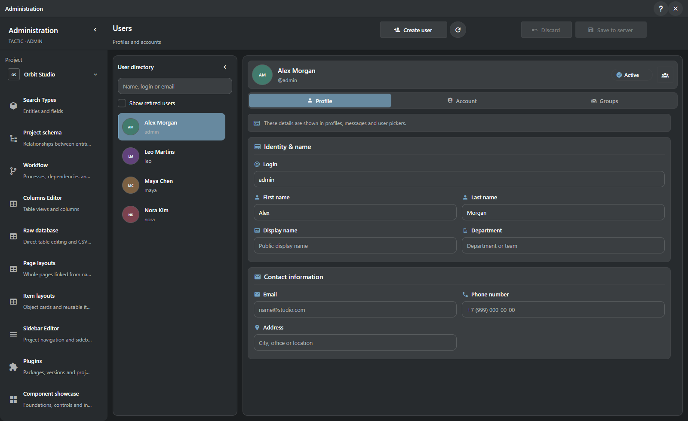

### Create an account, retire it or bring someone back

Create an account, set its initial password and profile, and assign the required groups. Edit existing profile/account fields without reading back a password. Retire an account when access should stop and reactivate it when appropriate; the existing production history retains its author identity. A retired account and a deleted project object are different operations.

### Groups and rules: what a person can actually access

Groups manage membership and descriptions. Access rules manage the policy: access level, project scope, supported object/process/status/action rules, inheritance and explicit allow/deny. Sidebar visibility is a separate part of the interface policy; hiding a link is not the same as denying access to its records.

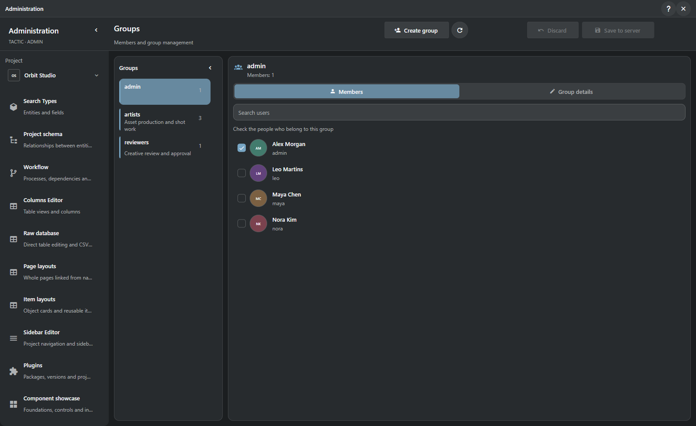

A person may belong to several groups, and rules can be inherited or overridden. After configuring access, check the result for that particular user. A group matrix shows one part of the policy; effective-access checks help establish what the combined rules allow.

A practical onboarding sequence is **account → groups → project/data permissions → sidebar visibility → check the resulting user access**. Administration's selected project scopes project definitions; it does not turn server-wide users into project-local accounts. Drafts, confirmation and native server checks remain in force throughout.

## Configuration: server, repositories and personal settings

Server addresses, repository paths and personal theme choices change for different reasons than the project schema. They live in Configuration. Each page keeps a draft: Apply affects the current page, Save handles pending changes, and leaving unsaved settings is guarded. Appearance can be previewed before you keep or revert it.

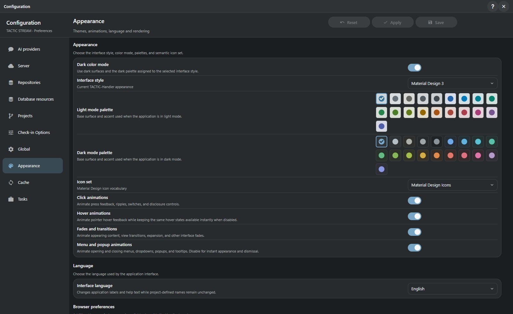

| Area | Purpose |
| --- | --- |
| **AI providers** | Provider profiles, model discovery and executor selection for the assistant. |
| **Server** | Connection and supported server options, live service information and explicit lifecycle actions. |
| **Database resources** | Configure/test resources and bind existing schemas; this does not migrate data. |
| **Repositories** | Repository names, colors, mappings and supported server storage settings. Saving a path does not move files. |
| **Projects** | Project creation, templates and project-level setup. |
| **Check-in Options** | Defaults for file preparation, naming and publishing behavior. |
| **Global** | General interaction and update preferences applicable to the current client. |
| **Appearance** | Light/dark themes, palettes, icon choices and English/Russian interface language. |
| **Cache** | Cache policy, visibility and maintenance. |
| **Tasks** | Task defaults and effort/time preferences. |


Supported server XML settings expose service, network, security, directory and scheduling controls with validation and restart requirements. Changing configuration and restarting a service are separate actions. Repository and database migration require their own procedure. [Configuration Help](../../frontend/public/help/configuration.en.md)

## Let the assistant check an asset’s readiness

Ask what is ready for review, which version is published or what is missing from a handoff. The built-in **External agent** window captures the project, page, Search Type and selected objects. Its executor reads or changes data through scoped native tools.

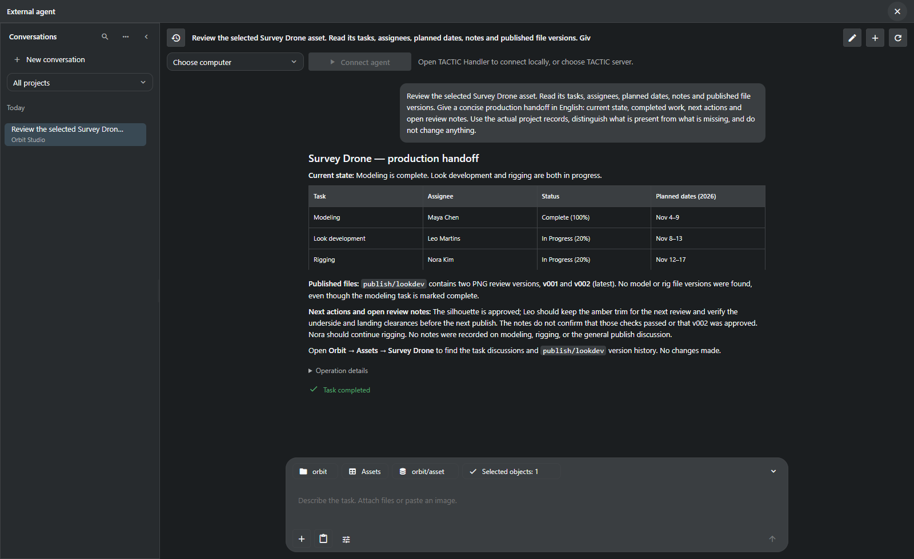

In this demonstration it found a useful discrepancy: modeling was marked Complete, but no model publication existed. It distinguished review comments from proof of approval. The full presentation covers conversations, attachments, provider choices, project configuration, task changes, script trials and the limits of undo.

**[Explore the built-in assistant →](assistant.en.md)**

## Dashboards for supervisors and reviewers

A production overview should help you decide where to look next. A custom page can place metrics, reports and charts beside Item View, forms and actions. A supervisor gets a route from the bigger picture to an asset; a reviewer gets a tree with the selected object’s details nearby. The blocks use project data and the current access rules.

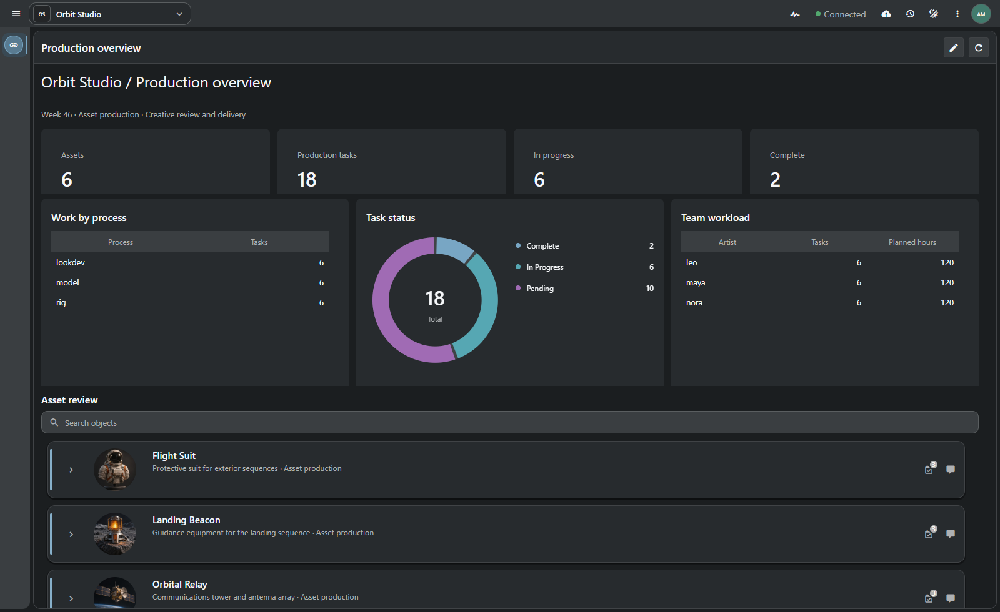

**[Explore custom dashboards and their visual editor →](dashboards.en.md)**

## Install, connect and add your own tools

### Run Stream from source

Use Python 3.14 on Windows and a fresh data directory for the first installation.

```powershell
Set-Location tactic_stream
py -3.14 -m venv .venv
.\.venv\Scripts\python.exe -m pip install -e .
..\START_TACTIC_STREAM.bat
```

The launcher initializes SQLite when needed, requests an administrator password on first setup and opens the configured address. Built web assets are included in the checkout. [CLI and development setup](../../README.md#local-development)

| Delivery | Components | Guide |
| --- | --- | --- |
| Portable Windows | Launcher, bundled Python/web application, SQLite and optional Handler workflow | [Windows delivery](../delivery/WINDOWS_DELIVERY.en.md) |
| Dedicated Linux server | Stream behind Apache with PostgreSQL, delivered through Docker Compose | [Server delivery](../delivery/SERVER_DELIVERY.en.md) |

Back up database, repository and configuration together. An application rollback needs its matching data backup. [Recovery](../delivery/RECOVERY_ACCEPTANCE.md)

### Connect your own tools to the server

On a running instance, `/api/documentation` exposes the method catalogue and `/api/compatibility` describes the original contract. XML-RPC remains an integration entrance for existing clients. The native core retains familiar `pyasm`/`tactic` modules and command semantics; integration code must use the appropriate server API rather than Handler's in-memory client objects.

[Server API source map](../admin_agent/SOURCES.md#ts-server-api) · [Core model](../../frontend/public/help/core_model.en.md) · [Architecture](../architecture.md) · [Workspace Pulse example](../../../examples/workspace_pulse/README.md) · [Studio Review example](../../../examples/studio_review/README.md)

## Compatibility, limitations and licenses

Stream and Handler are independent repositories and bundles. Stream does not import Handler or the legacy source tree at runtime. Original TACTIC compatibility is an explicit verification effort, not a blanket guarantee that every historical plugin or script works unchanged.

The old `pyasm.prod` production layer and Drupal are outside this port; MySQL support is deferred, and S3 is excluded. Check the [compatibility scope](../compatibility.md) before planning a migration. [Documentation index](../index.md)

The screenshots illustrate configured workflows on a small demo project. They are not a performance benchmark or a claim of release acceptance. Studio-specific scripts, schemas, integrations and permissions need validation against the deployed version.

[Original TACTIC license](../../LICENSE.TACTIC) · [QuickJS-NG](../../LICENSE.QUICKJS-NG) · [Vue](../../frontend/public/LICENSE.VUE.txt) · [Icon-font notices](../../frontend/public/licenses/icon-fonts/SOURCES.md)
