# TACTIC Stream — Подробный обзор продукта

[Визуальная презентация](../../../README.ru.md)

**Stream развивает сервер и браузерное рабочее пространство TACTIC.** В этом обзоре разберём, как модель проекта, workflow, задачи и файлы складываются в рабочий процесс, а затем — как настроить его под команду.

**Начнём с ассета и посмотрим, как вокруг него устроена работа команды.**

[English](product-tour.en.md) · [Workflow](#workflow--исполняемый-движок-процессов) · [Задачи и Gantt](#планирование-и-ежедневная-работа) · [Файлы и naming](#от-рабочего-файла-к-отслеживаемой-публикации) · [Tactic Frame](#tactic-frame-единое-описание-два-нативных-интерфейса) · [Администрирование](#administration-настройка-самого-проекта) · [Запуск](#запуск-и-расширение)

[Доки](#доки-собрать-интерфейс-под-конкретную-работу) · [Sidebar Editor](#sidebar-editor-навигация-как-часть-рабочего-процесса) · [Обзор объекта](#обзор-объекта-целостная-производственная-запись) · [История сервера](#история-на-сервере-понять-что-произошло) · [Пользователи и права](#пользователи-группы-и-итоговые-права)

| Ассистент проекта | Собственное рабочее пространство |
| --- | --- |
| [**Встроенный чат-бот →**](assistant.ru.md) — Вопросы по реальным данным, подготовка изменений и журнал операций за каждым ответом. | [**Кастомные дашборды →**](dashboards.ru.md) — Метрики, диаграммы, Item View и инструменты выбранного объекта на одной странице. |

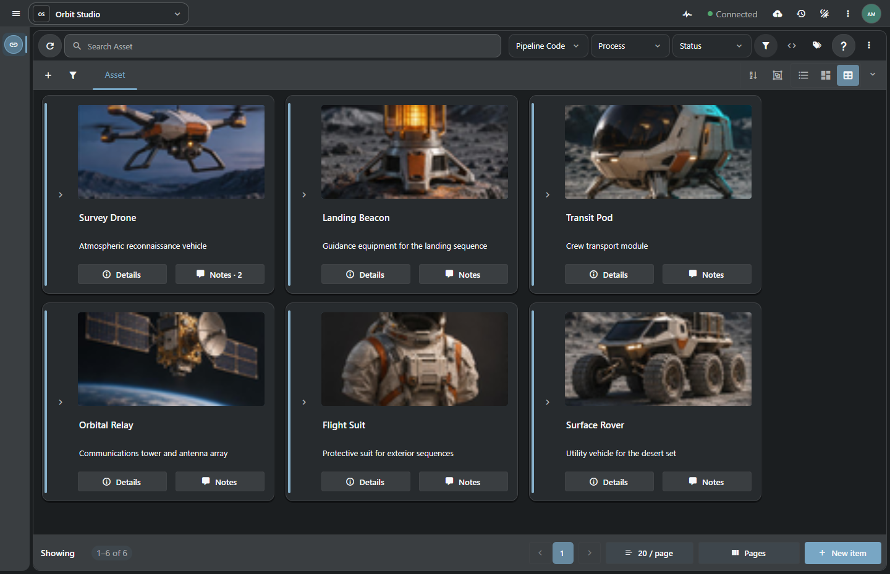

*Свежие снимки текущего приложения в изолированном демопроекте Orbit Studio. Участники вымышлены, концепт-арты служат иллюстрациями; интерфейсы и записи проекта настоящие.*

> **Прототип в активной разработке.** Perforce-like File Workspace также остаётся прототипом. Перед использованием в производстве проверяйте свою схему, права, скрипты и файловые операции на изолированных данных.

## Зачем существует проект

[Southpaw TACTIC](https://github.com/Southpaw-TACTIC/TACTIC) уже объединял workflow, настраиваемую модель данных и управление ассетами. Stream сохраняет эту основу: Search Types, `Search`/`SObject`, схемы, pipelines, команды, права и файловые публикации.

**Форк продолжает идею настраиваемого производства, заложенную в TACTIC.** В Stream вместе развиваются серверное ядро, браузерное приложение и инструменты настройки проекта. Рядом работает нативный Handler; визуальные редакторы позволяют разбирать схему, процессы и представления через интерфейс. Название «Stream» отражает связь между этапами: задачи, решения и файлы сопровождают работу до её передачи дальше.

| Основа TACTIC | Подход Stream | Практический результат |
| --- | --- | --- |
| Настраиваемые сущности и связи | Нативное ядро на Python 3.14, визуальные редакторы схемы и полей | Модель студии доступна через актуальные инструменты. |
| Workflow и исполнение команд | Современный граф, инспекторы процессов и штатные серверные операции | Можно настроить маршрут и разобрать исполняемые правила. |
| Конфигурируемые представления | Vue, нативный Qt Handler и общие описания Tactic Frame | Браузерный и desktop-сценарий используют общий язык интерфейсов. |
| Snapshots и naming | Инструменты публикации, предпросмотр нейминга и явные очереди | Версии и пути файлов сохраняют производственный контекст. |
| Скриптуемая платформа | Редактор, сменяемые провайдеры ассистента и конструктор страниц | Расширение кодом, конфигурацией или ограниченными инструментами ассистента. |
| Серверная установка | Локальная SQLite и серверное развёртывание PostgreSQL | Локальная оценка и отдельный сервис с подходящей базой. |

Workflow, модель объектов и публикации пришли из TACTIC. Работа над Stream сосредоточена на том, как развивать эту основу и пользоваться ею сегодня. Это описание подхода; сравнение скорости требует отдельного измерения на конкретной нагрузке.

Возьмём передачу ассета из моделинга в риг. Завершённая задача сообщает о прогрессе, заметки содержат решения ревью, а snapshot указывает на конкретные сданные файлы. Для следующего участника важны все три вещи. Поэтому объект, pipeline, задачи, обсуждения и публикации связаны: по ним можно восстановить, что сделано и с чего продолжать.

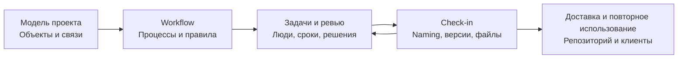

## Рабочее пространство начинается с объекта

Обычно работа начинается с конкретной вещи: ассета, шота, документа или другого объекта проекта. В **Item View** можно узнать его по изображению, прочитать важные поля и перейти к действиям. Дерево раскрывает связанные записи, процессы и публикации. Когда нужно сравнить или поправить много полей, удобнее таблица с сортировкой, фильтрами и выделением.

При переходе между поисковыми вкладками сохраняется их рабочее состояние. Фильтры ограничивают серверную выборку, а теги и быстрые фильтры помогают возвращаться к привычным наборам. Задачи, заметки, snapshots, детали и календарь можно разместить рядом с результатами. Сохранённая раскладка избавляет отдел от необходимости каждый раз собирать это рабочее место заново.

### Карточки под конкретный рабочий процесс

Для ревью важны изображение и нужные действия; для плотного списка — несколько коротких полей. В **Item Layouts** можно собрать оба варианта, связав текст и изображения с данными объекта. Поддерживаемые действия добавляются прямо в карточку. Результат виден на записях проекта и сохраняется как представление, которое можно использовать снова.

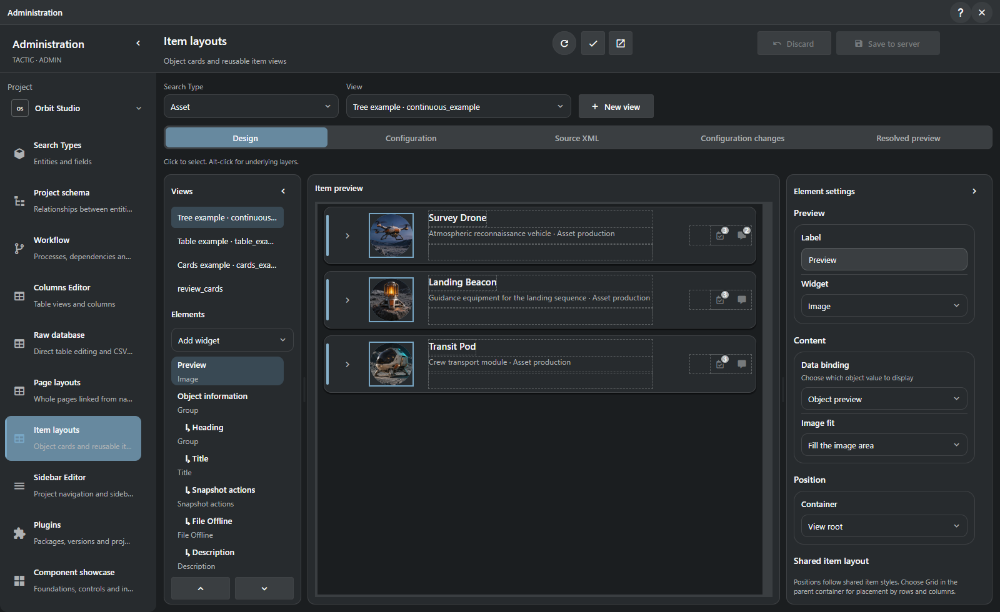

**У Page layouts, Item layouts и Columns Editor разные задачи:** страница собирает рабочее место, item layout оформляет отдельный объект, табличное представление задаёт поля и виджеты. Sidebar связывает эти определения с навигацией проекта. [Справка по Item Layouts](../../frontend/public/help/item_layouts.ru.md)


## Доки: собрать интерфейс под конкретную работу

Во время ревью превью стоит отдать большую часть экрана, а заметки оставить рядом. Для планирования ту же область полезнее разделить между объектами и задачами. **Доки** позволяют собрать такие рабочие места из готовых функциональных панелей: расположить их рядом, объединить во вкладки или временно убрать лишнее.

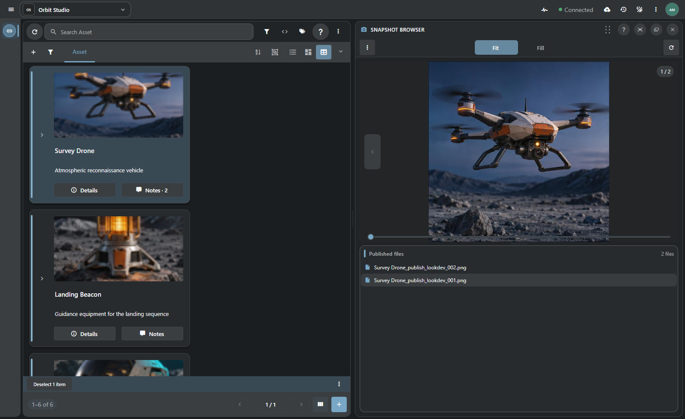

### Разделить, объединить, вынести и восстановить

Перетащите grip панели к краю, чтобы разделить область, в центр — чтобы создать стек вкладок, к заголовку — чтобы поменять панели местами. Двигайте разделители, меняйте порядок вкладок, временно разворачивайте док или скрывайте его, освобождая место. Отменённое перетаскивание возвращает прежнюю компоновку.

Stream размещает плавающие панели внутри браузерного рабочего пространства; отдельные нативные окна доков здесь не поддерживаются. На узком экране используется компактная активная панель без перезаписи desktop-компоновки.

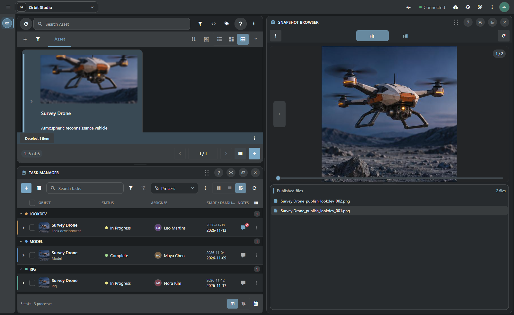

| Рабочее место | Возможная композиция |
| --- | --- |
| **Ревью** | Item View + Snapshot Browser + Description/Notes: выбор объекта, просмотр публикации и её обсуждение. |
| **Планирование** | Results + Task Manager/Gantt + детали задачи или календарь там, где доступны: назначения и даты рядом с объектами производства. |
| **Публикация** | Results + Drop Plate + Commit Queue: выбор назначения, подготовка файлов и проверка ожидающей операции. |
| **Документация** | Results + Knowledge Base: записи проекта рядом со справочными материалами команды. |

Панели связаны через выделение: выберите объект, процесс или snapshot в Search, и следующие за ним инструменты покажут его данные. Откройте задачу — инспектор перейдёт именно к ней. Можно переставлять эти панели, сохраняя связь между выбором и содержимым.

### Личная компоновка и общий старт отдела

Клиент и вкладка сохраняют своё состояние: размещение, размеры, видимость и стеки. **Layout presets** хранят именованные проектные компоновки на сервере: применение, обновление списка, сохранение, замена и удаление — отдельные действия. Назначьте пресет пункту sidebar, чтобы отдел получал подходящий стартовый интерфейс; последующая личная компоновка вкладки может сохранять изменения пользователя.

Пресет описывает панели и их расположение. Он не сохраняет авторизацию, не применяет черновик редактора и не заменяет Saved Search. Reset восстанавливает геометрию без удаления записей проекта и сохранённых запросов. Вместе с Item Layouts, Columns Editor, страницами дашбордов и полками скриптов доки позволяют собирать множество рабочих интерфейсов из реализованных инструментов. [Доки и окна](../../frontend/public/help/windows.ru.md)


## Sidebar Editor: навигация как часть рабочего процесса

Два отдела могут работать с одними ассетами и начинать с разных экранов. Пункт «Asset review» можно связать с визуальным представлением и панелями ревью, а «Asset planning» — с нужным поиском и задачами. В Sidebar Editor у пункта задаются Search Type, начальный поиск, представление, раскладка доков и полка скриптов. Так навигация открывает уже подготовленное рабочее место.

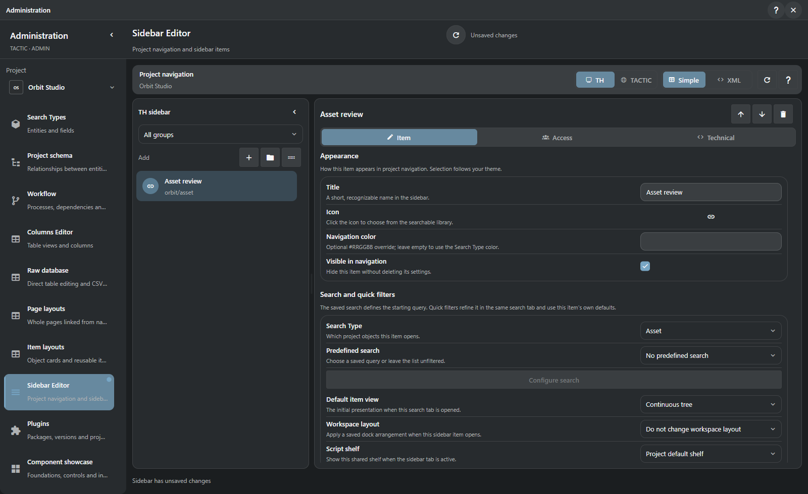

| Область редактора | Что собирается |
| --- | --- |
| **Дерево навигации** | Ссылки, разделы и разделители, порядок, вложенность и видимость. |
| **Item** | Заголовок, иконка, Search Type, исходный сохранённый поиск, вид объектов, пресет доков и shelf. |
| **Configure search** | Настройка настоящего поиска: сохранённый запрос, quick filters, видимость процессов, сортировка и группировка. |
| **Access** | Группы, которым виден пункт, и предпросмотр черновика для выбранной группы. Скрытые пункты остаются доступны для редактирования. |
| **Technical / XML** | Постоянный внутренний идентификатор, дочерние представления и поддерживаемая конфигурация виджета/view. |

Sidebar Handler `tactic_handler` и TACTIC `project_view` — независимые определения. Цель выбирается явно. Проект в редакторе задаёт область изменений, даже если в основном рабочем пространстве открыт другой проект.

Для переименования подписи меняется Title, сохраняя внутреннюю идентичность пункта. Назначенный Saved Search инициализирует первую вкладку; повторное открытие сохраняет рабочее состояние вместо создания дубликата. Apply XML меняет черновик, Save публикует sidebar. Предпросмотр группы не выполняет вход от её имени и не заменяет серверные права на данные. [Справка Sidebar Editor](../../frontend/public/help/sidebar_editor.ru.md)


## Обзор объекта: целостная производственная запись

Прежде чем брать ассет в работу, полезно посмотреть его историю: кто участвовал, какие замечания остались и что опубликовано. **Details / SObject Report** собирает это у одной записи. В заголовке видны превью, данные объекта, описание и показатели; дальше можно перейти к задачам, заметкам, связям, файлам и событиям.

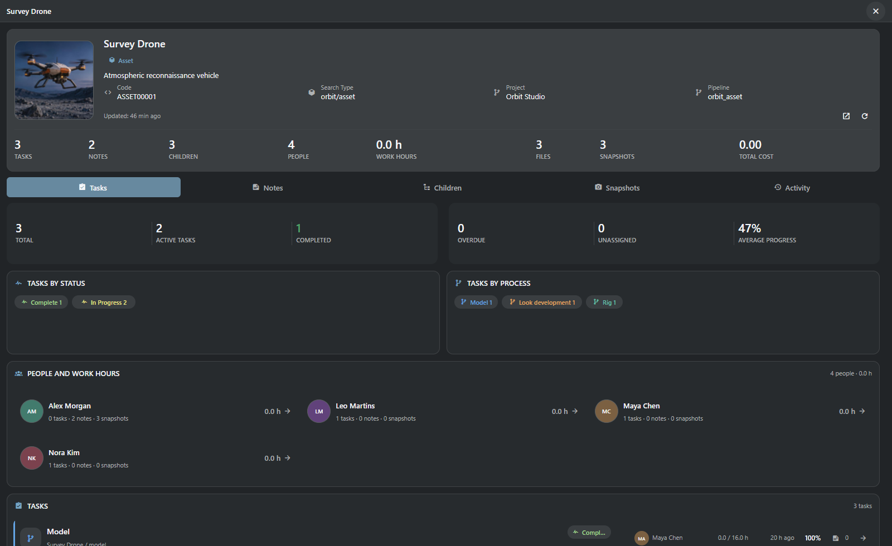

| Раздел | На какой вопрос отвечает |
| --- | --- |
| **Задачи и участники** | Кто вовлечён, какие есть статусы и процессы, сколько работы учтено? Участники собираются из задач, заметок, публикаций и записей времени. |
| **Notes** | Какие решения и замечания относятся к объекту и его процессам? Заметка открывается в исходном контексте. |
| **Дочерние объекты и связи** | Какие связанные производственные записи находятся под объектом или рядом с ним? |
| **Snapshots и файлы** | В каких процессах есть публикации, сколько в них файлов и каков общий размер? Дерево процесса раскрывает версии и превью. |
| **Activity** | Кто создавал или менял объект, задачи, заметки, публикации, записи времени и поддерживаемые связи? |

Задача открывает соответствующую область Task Manager и точную запись в Inspector. Заметка возвращает к обсуждению процесса. Публикация сохраняет исходный проект. Стоимость показывается только при наличии соответствующего права. Так можно разобраться, что стоит за статусом объекта, и открыть нужную запись прямо из обзора. [SObject Report](../../frontend/public/help/sobject_info.ru.md)


## Workflow — исполняемый движок процессов

После моделинга можно направить ассет в lookdev и риг параллельно, а затем дождаться согласования перед публикацией. Pipeline описывает такой маршрут, а сервер выполняет настроенные реакции на события: меняет задачи, учитывает зависимости, вызывает скрипты и уведомления. У самого ассета есть производственный путь; у задачи на отдельном этапе — свои статусы. Поэтому pipeline объекта и pipeline статусов задачи настраиваются отдельно.

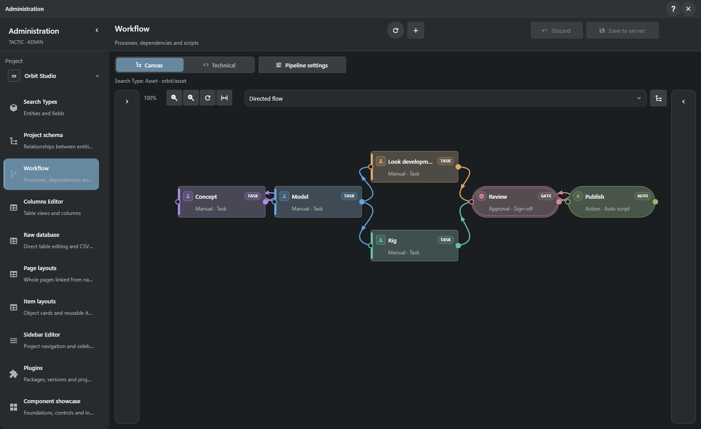

*Настроенный граф с параллельными lookdev и rig, этапом согласования и автоматическим действием. Снимок показывает определение процесса, а не подтверждает выполнение каждой его ветки.*

| Узел или правило | Для чего используется |
| --- | --- |
| Manual и approval | Работа исполнителей, ревью и согласование результата. |
| Action и condition | Настроенное серверное действие или выбор ветки по условию. |
| Hierarchy, input и output | Вложенные pipelines, точки входа и выхода. |
| Dependency и progress | Согласование зависимой работы и завершения процессов. |
| Status и события процесса | Реакции на pending, action, complete, revise, reject и error. |
| Правила процесса | Смена статуса задачи или родителя, создание следующих задач, запись фактических дат, вызов сохранённого скрипта или класса, настройка уведомлений. |

В **Administration → Workflow** выбирают pipeline, компонуют граф и редактируют параметры выбранного процесса. Набор настроек зависит от типа узла. Технические представления открывают XML и расширенную конфигурацию. Зависимости, триггеры, уведомления и naming связаны с workflow, но имеют собственные настройки. Сохранение графа само по себе не запускает его действия и не отправляет письма.

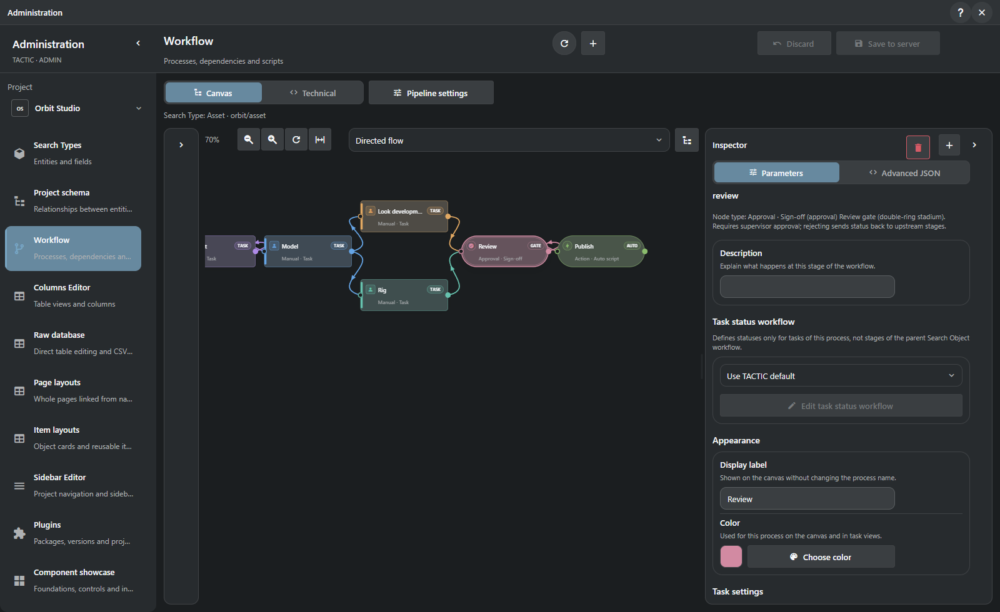

## Планирование и ежедневная работа

### Task Manager

Художнику нужен список своей работы, руководителю — задачи отдела или проекта. Task Manager позволяет менять этот охват: от выбранных объектов и Search Type до личных и командных задач. В таблице и компактных представлениях видны исполнители, супервайзеры, статусы, даты, прогресс и трудозатраты. Поиск, фильтры, группировка и сортировка помогают выделить нужную часть плана.

Изменения остаются черновиком до сохранения. Массовое редактирование применяется к выбранным задачам; инспектор сохраняет доступ к объекту и обсуждению. Доступные поля и операции определяются серверными правами.

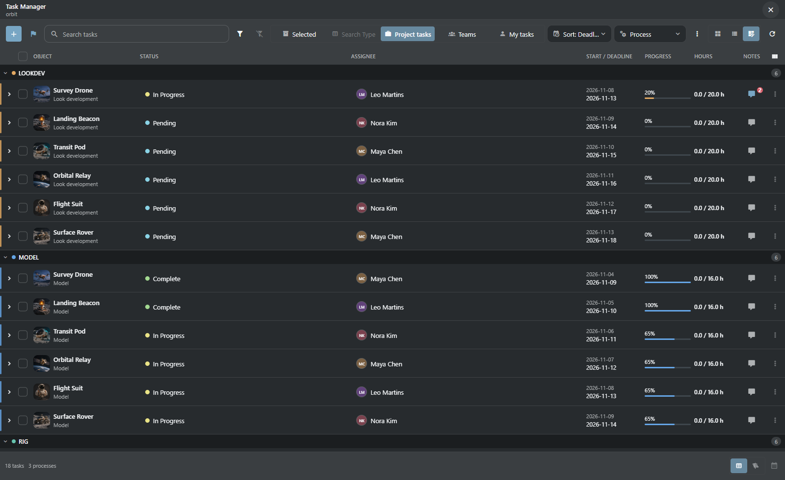

### Gantt, календарь и трудозатраты

В списке трудно заметить, что одному человеку назначены две работы на один срок. Gantt показывает задачи на временной шкале и выводит предупреждения расписания. Полосы можно двигать и растягивать, менять прогресс, масштаб и группировку по исполнителю. Видны существующие зависимости; задачи без дат тоже остаются доступными.

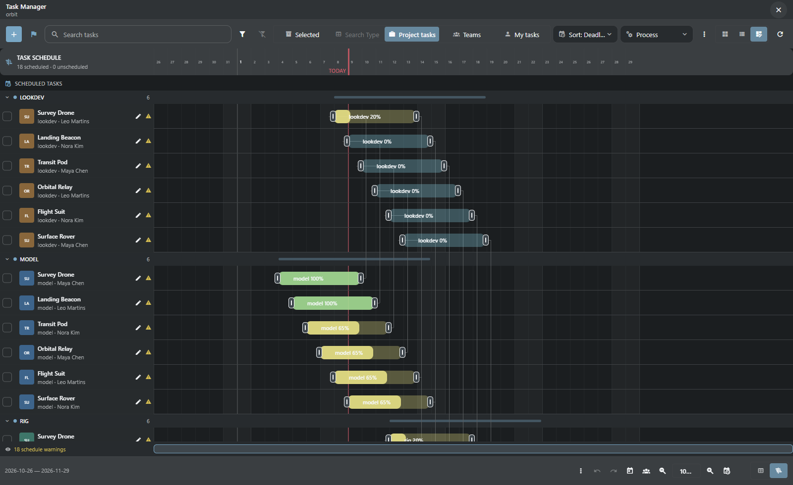

*В демонстрационном расписании есть пересечения, и интерфейс действительно показывает предупреждения. Отображение зависимостей не означает автоматического каскадного переноса задач.*

Календарь задач и agenda дают представление по датам, milestones обозначают контрольные точки проекта. Учёт часов и отчёты по стоимости связывают затраты с людьми и работой в пределах доступных пользователю прав. [Task Manager](../../frontend/public/help/dock.tasks.ru.md) · [Календарь](../../frontend/public/help/dock.task_calendar.ru.md)

## Общение с сохранением контекста

В **Messages** можно собрать участников ревью, уточнить срок или передать вопрос коллеге из другого проекта. Есть личные и групповые разговоры, Избранное, ответы, упоминания, реакции, закрепления, пересылка, поиск и управление участниками. Файлы добавляются через выбор, перетаскивание или буфер обмена; незаконченные сообщения остаются в черновиках.

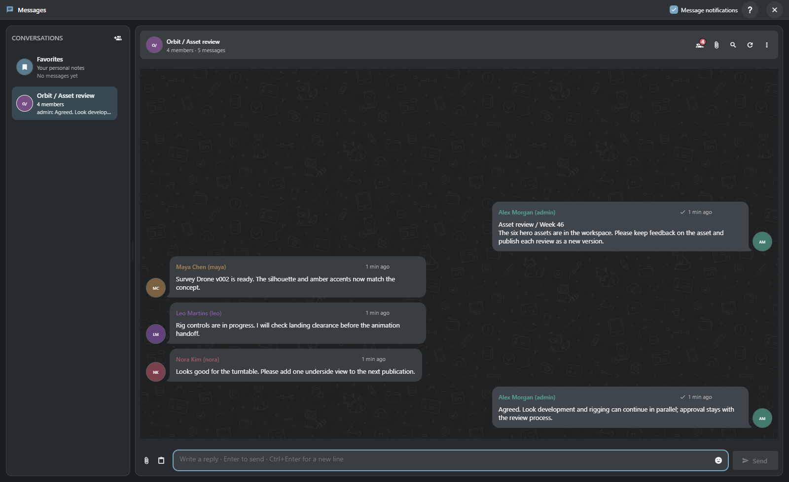

Когда в разговоре принято решение по ассету, его удобно оставить в **Notes** у объекта, процесса или задачи. Позже следующий участник найдёт его вместе с работой. Повторяющиеся инструкции лучше оформить в **Knowledge Base**, где есть дерево статей, вложения и история редакций. Уведомления и журнал активности помогают заметить изменения и вернуться к соответствующим записям.

[Встроенная справка: поиск и контекстные инструкции →](help.ru.md) · [База знаний: статьи, редактор и история →](knowledge-base.ru.md)


## История на сервере: понять, что произошло

Если статус или файл изменился и нужно понять, что произошло, откройте **Activity Feed**. Журнал показывает поддерживаемые события проекта: заметки, публикации, задачи, изменения полей и трудозатраты. У события есть автор, время, детали и переход к объекту или задаче. Раздел Activity в обзоре объекта сужает эту историю до одной записи и поддерживаемых событий её потомков и связей.

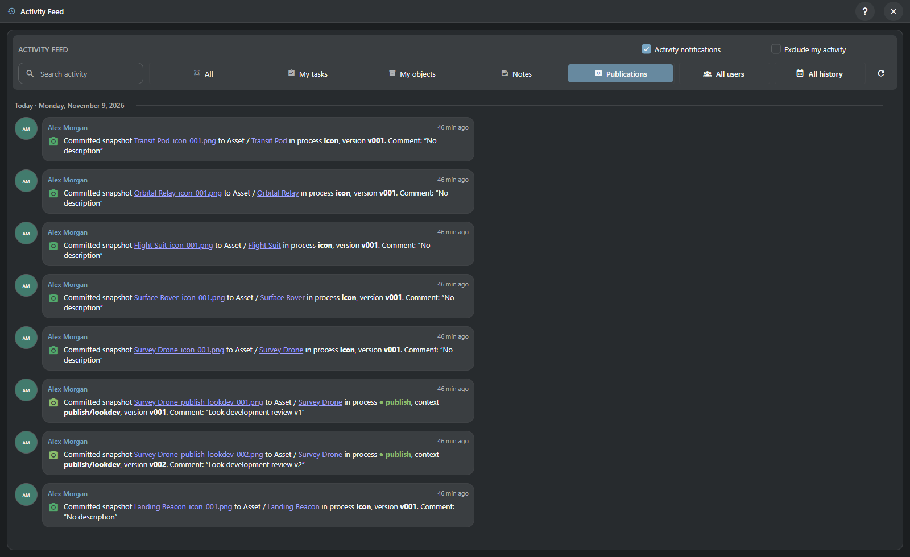

Фильтруйте людей и категории, исключайте собственные действия, ищите по загруженным событиям или выбирайте день в календаре. Прокрутка подгружает прошлые события; счётчики календаря охватывают доступную историю за пределами текущего списка. Даты показываются в локальном часовом поясе, относительное время учитывает синхронизацию с сервером.

У трёх историй разные задачи. **Activity Feed** объясняет изменения проекта. **Notifications** хранит уведомления текущей сессии клиента и переходы к их источникам. **System Activity / Debug Log** показывают текущую работу и диагностику приложения. Очистка уведомлений не удаляет серверный журнал, переписку или версии файлов. Полнота истории зависит от того, какие события записывает конкретная операция или расширение.


## От рабочего файла к отслеживаемой публикации

Передача файла — момент, когда личная работа становится доступной другим. Вместе с ней нужно сохранить объект, процесс, версию и описание результата. В браузере этот путь начинается с выбора файлов и назначения, а заканчивается записью snapshot на сервере:

1. Выберите запись и контекст публикации; добавьте файлы через поддерживаемый браузерный upload/check-in.
2. Проверьте объект, описание и параметры naming перед отправкой.
3. Сервер проверит права и нейминг, сохранит файлы и зарегистрирует snapshot.
4. В Snapshot Browser изучите версии, превью и состав файлов или скачайте нужную публикацию.

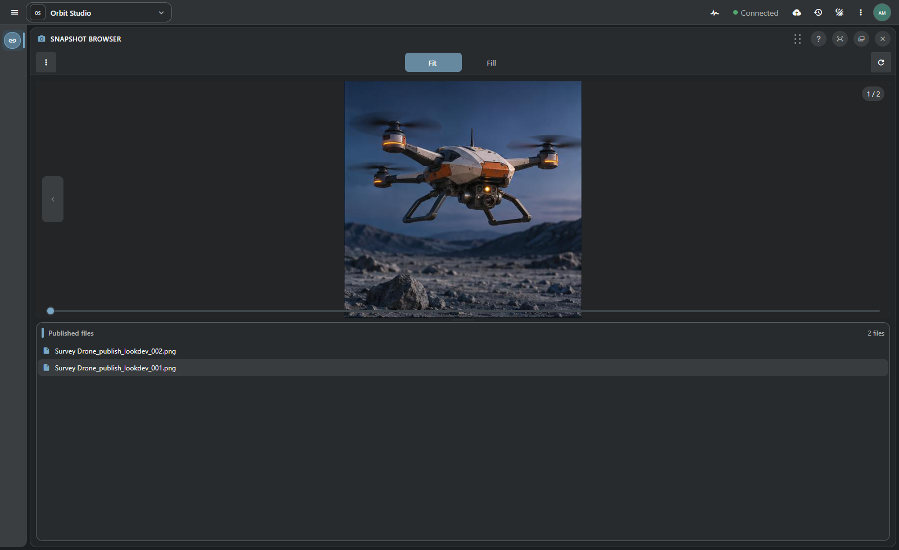

Браузер обеспечивает загрузку и скачивание. Для локальных путей, mappings репозитория и операций со сценами DCC используется Handler. Сервер остаётся владельцем метаданных публикации, нейминга и прав.

Snapshot связывает версию с объектом, процессом/контекстом, автором, описанием и файлами. Новая версия и ревизия — разные операции. Правила `latest` и `current` отделены от версионного хранения. Файловые последовательности сохраняют информацию о диапазоне, чтобы checkout мог разрешить опубликованные кадры.

### Naming как правило производства

Соглашение об именах полезно, когда оно действует при каждой публикации. В Naming Editor задаются условия выбора правила, контексты, шаблоны имён и каталогов, sandbox-пути и алиасы репозиториев. Имя можно собрать из данных объекта, snapshot и файла, дополнить условиями TSQL или доверенным сохранённым скриптом. Прежде чем сохранить правило, его результат можно посмотреть на примере.

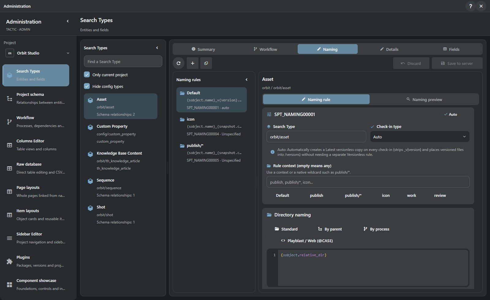

Например, имя может собираться из названия объекта, версии и расширения: `{sobject.name}_v{version}.{ext}`. При публикации путь заново разрешает нативный naming engine. Предпросмотр не резервирует имя: финальный check-in проверяет версию и коллизии. Скриптовые правила выполняют доверенный код проекта.

### Доставка в desktop-сценарии

**Repository Sync** в Handler обнаруживает и скачивает выбранные объекты, процессы и версии в сопоставленный локальный репозиторий. Его очередь и пресеты принадлежат desktop-клиенту. Stream предоставляет записи и файлы; Repository Sync не является браузерной функцией. Та же граница действует для Watch Folders и нативных операций Maya.

## Tactic Frame: единое описание, два нативных интерфейса

Handler и Stream работают в разных средах, но многие их окна решают одну задачу. **Tactic Frame** даёт общий язык для описания таких интерфейсов: их элементов, геометрии, состояния и действий. Qt Quick и Vue берут это описание и отображают его своими компонентами. Поэтому общее устройство окна можно развивать в одном описании, сохраняя нативный Qt-интерфейс Handler.

Frame использует обычные JavaScript-модули `.mjs` и структуры данных. Функция `describe(model, width, height, language)` формирует видимую структуру из состояния. Контроллеры обрабатывают действия и обращаются к предметным операциям; описание интерфейса не становится отдельным серверным API.

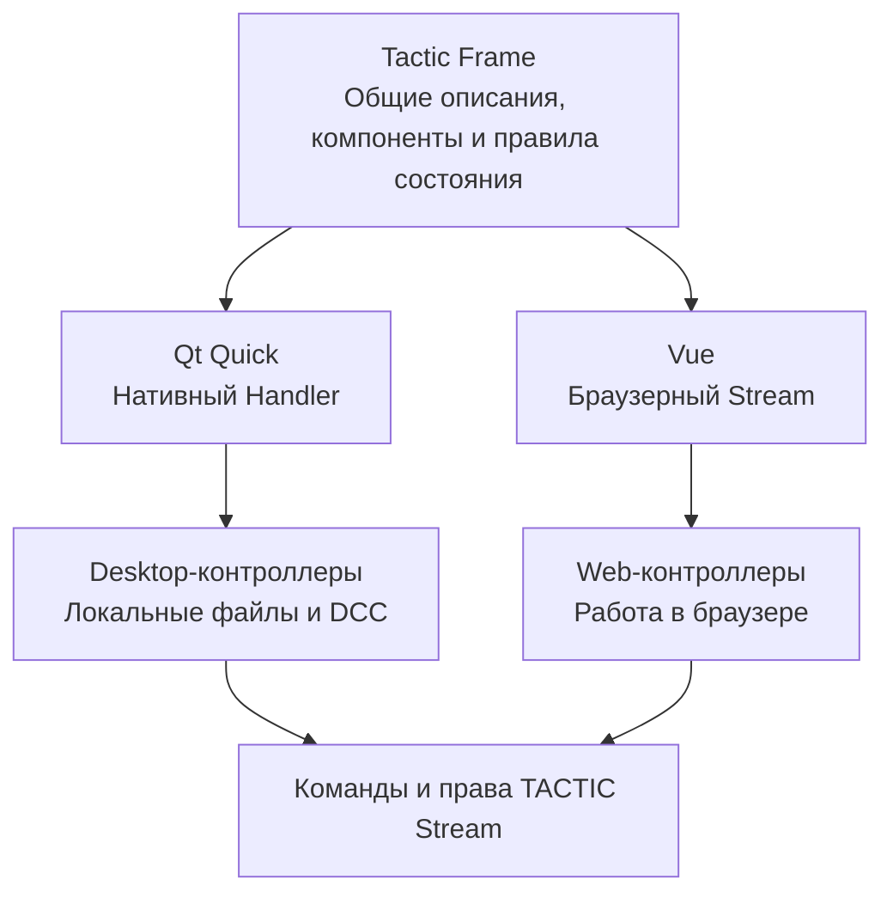

Небольшой модуль рядом с этим документом иллюстрирует контракт. Host передаёт `model` и обрабатывает действие `name`; рабочие модули также используют общие функции перевода.

```javascript
import { label, node, rect } from "../../src/tactic_stream/shared_ui/core/frame.mjs";

export function describe(model, width, height, language) {
    return { nodes: [
        label("title", rect(16, 12, width - 32, 28), "Review"),
        node("Field", "assetName", rect(16, 48, width - 32, 38), {
            label: "Asset", text: model.name, action: { type: "name" }
        })
    ] };
}
```

Общая библиотека включает поля, кнопки, селекторы, виртуализированные списки, таблицы, графы, редакторы и структуру окон. Контракт охватывает не только геометрию, но и темы, перевод, фокус и ввод. **Component showcase** показывает этот набор компонентов внутри приложения.

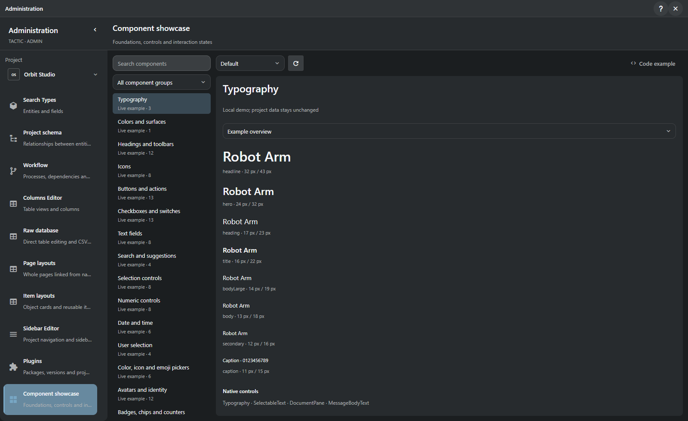

XML-представления проекта и документы визуальных редакторов настраивают содержимое поверх этого слоя. Это отдельные форматы конфигурации, а не новый синтаксис файлов Frame. Продукты собираются независимо и содержат собственные копии общих описаний; поведение проверяется в обоих рендерах. [Контракты Frame](../frame/index.md)

## Script Editor, полки и автоматизация

Разовая команда со временем может стать инструментом отдела. В Script Editor её можно написать, выполнить целиком или по выделенному фрагменту, посмотреть результат и ошибки, затем сохранить в библиотеку проекта. Вкладки, черновики, undo, подсветка, автодополнение, поиск/замена и навигация по структуре помогают дорабатывать код. Папки и понятные имена позволяют коллегам находить готовые инструменты.

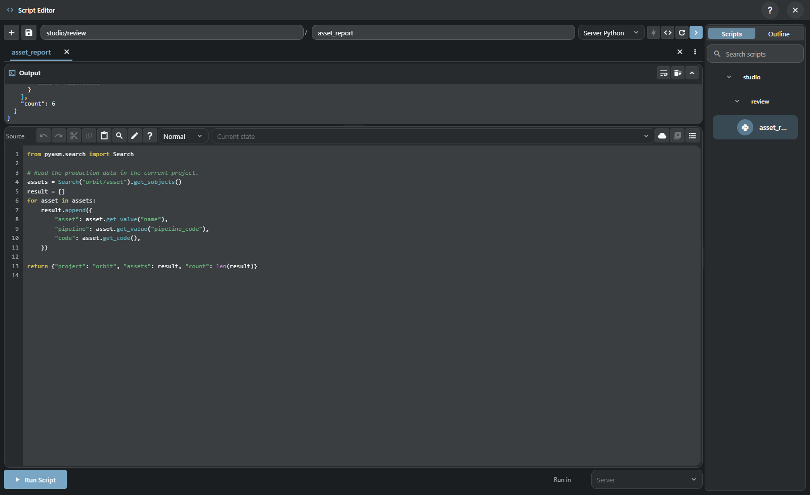

| Среда | Где выполняется и что доступно |
| --- | --- |
| **Server Python** | Сервер TACTIC, контекст проекта, нативные объекты и команды. |
| **Browser JavaScript** | Браузер, поддерживаемый контекст проекта/выделения, `rpc` и helpers обновления. |
| **Server JavaScript** | QuickJS-NG на сервере с синхронным `server` API; без браузерного DOM и DCC-контекста. |

Место исполнения существенно: возвращаемый серверный результат появляется в редакторе, stdout процесса Server Python остаётся в серверном журнале. Редактирование и запуск определяются возможностями администратора/супервайзера.

**Script Shelf** размещает действия рядом с работой: общая полка студии, личные инструменты и полки конкретных поисковых вкладок. Серверные события workflow и сохранённые скрипты обеспечивают автоматизацию проекта. Handler дополнительно предоставляет Before/After hooks вокруг desktop- и DCC-действий. Право выполнять доверенный код отделено от возможности просматривать скрипт.

[Script Editor](../../frontend/public/help/script_editor.ru.md) · [Script Shelf](../../frontend/public/help/script_shelf.ru.md)

## Administration: настройка самого проекта

У разных проектов отличается само устройство работы: какие объекты есть, как они связаны и какие данные нужны людям. В Administration можно описать эту модель через Search Types и схему, затем настроить представления и действия. Asset и Shot — возможные типы объектов; проект может использовать собственные. Граф схемы помогает увидеть связи целиком.

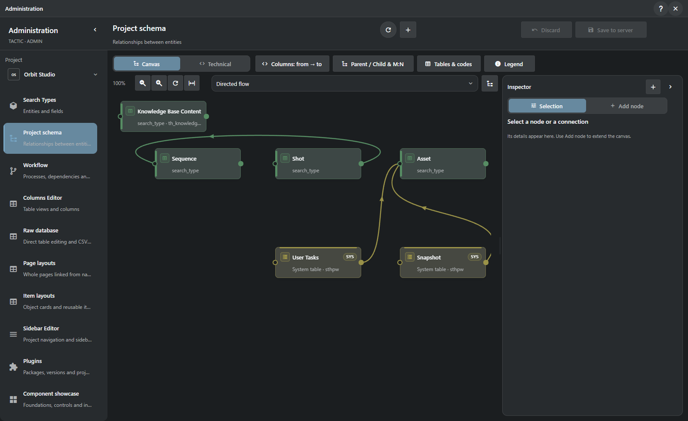

| Раздел | Что настраивается |
| --- | --- |
| **Search Types** | Типы сущностей, поля и правила нейминга. |
| **Project schema** | Связи между сущностями и граф проекта. |
| **Workflow** | Pipelines, свойства процессов, зависимости и автоматизация. |
| **Columns Editor** | Табличные представления, столбцы и нативные виджеты полей. |
| **Raw database** | Разрешённый просмотр/редактирование таблиц и CSV с ограничениями для защищённых таблиц. |
| **Page layouts** | Страницы дашбордов, блоки, источники данных и навигация. |
| **Item layouts** | Переиспользуемые карточки, строки и представления объектов. |
| **Sidebar Editor** | Группы навигации, пункты, представления и входы в рабочие пространства. |
| **Plugins** | Пакеты, версии и активация в проекте. |
| **Component showcase** | Набор компонентов, из которых построены интерфейсы. |
| **Users** | Учётные записи и доступ к проектам. |
| **Groups** | Участники групп и общие настройки доступа. |
| **Access rules** | Наследуемые и явные allow/deny, проверка эффективных прав пользователя. |

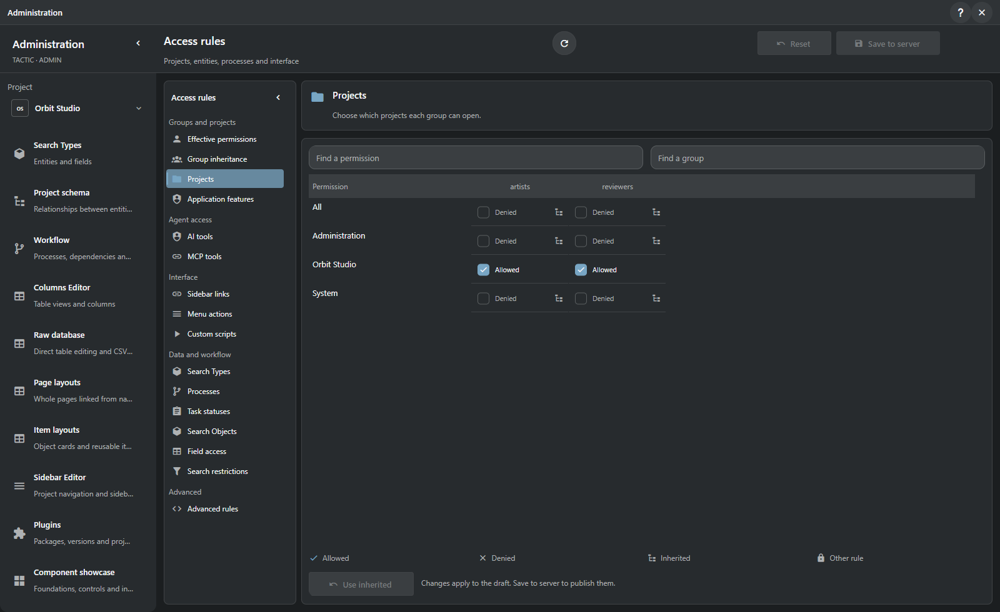

Разделы редактирования сохраняют собственные черновики. Save/Discard и проверка ревизии делают изменение явным; серверные операции продолжают проверять права. Наличие визуального редактора не даёт неограниченного доступа к базе. [Справка по Administration](../../frontend/public/help/administration.ru.md)


## Пользователи, группы и итоговые права

Один сотрудник может участвовать в нескольких проектах и появляться в задачах, разговорах, публикациях и журнале событий. Для этого используется единая серверная учётная запись с профилем, контактами, настройками и членством в группах. При переходе между проектами сохраняется понимание, кто выполнил действие.

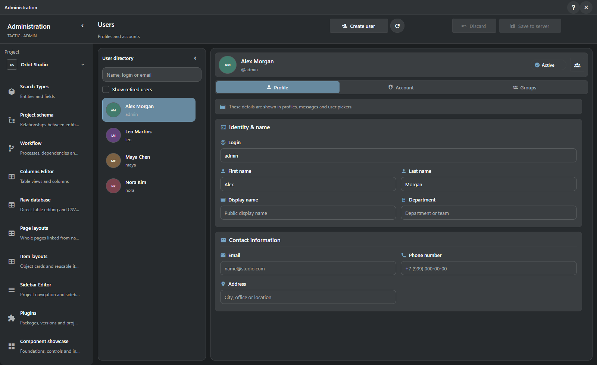

### Жизненный цикл аккаунта

Создайте пользователя, задайте начальный пароль и профиль, назначьте нужные группы. Существующие профиль и аккаунт редактируются без чтения сохранённого пароля. Retire прекращает активное использование учётной записи, Reactivate возвращает её; производственная история сохраняет идентичность автора. Архивация аккаунта и удаление объекта проекта — разные операции.

### Членство и политика доступа

Groups управляет участниками и описаниями групп. Access rules задаёт политику: уровень доступа, область проектов, поддерживаемые правила объектов/процессов/статусов/действий, наследование и явные allow/deny. Видимость sidebar — отдельная часть интерфейсной политики: скрыть ссылку не означает запретить доступ к её данным.

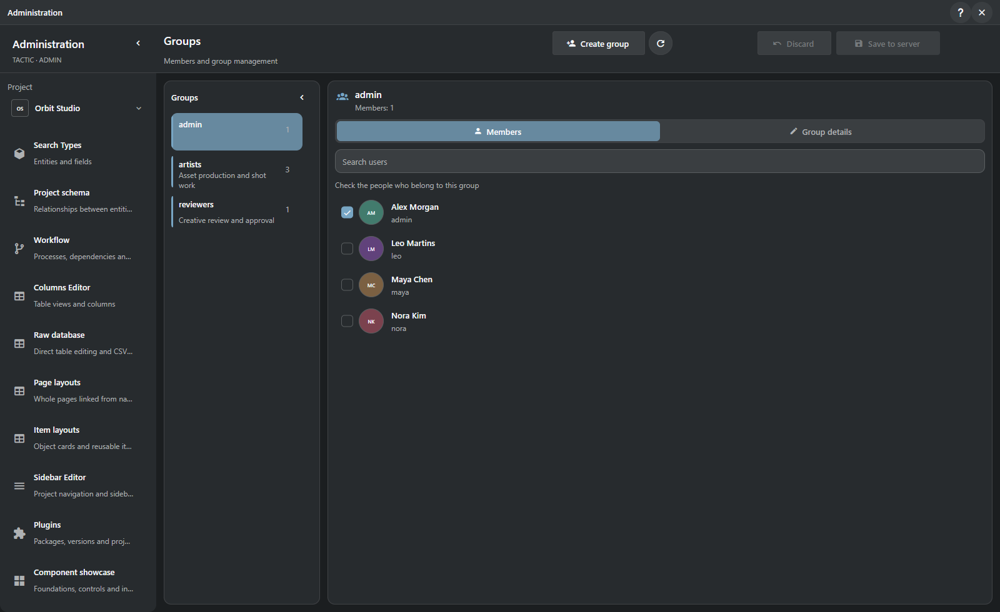

Человек может состоять в нескольких группах, а правила — наследоваться и переопределяться. Поэтому после настройки полезно проверить итоговый доступ конкретного пользователя. Матрица группы показывает отдельную часть политики; проверка эффективных прав помогает увидеть её результат для человека.

Практический порядок подключения сотрудника: **аккаунт → группы → права на проект и данные → видимость sidebar → проверка итогового доступа**. Выбранный проект Administration ограничивает проектные определения, но не превращает общие учётные записи в локальные аккаунты проекта. Черновики, подтверждения и нативные серверные проверки продолжают действовать.

## Configuration: подключение, хранение и ежедневные настройки

Адрес сервера, пути репозиториев и личная тема интерфейса меняются по другим причинам, чем схема проекта. Для них есть Configuration. У каждой страницы свой черновик: Apply применяет текущую страницу, Save сохраняет ожидающие изменения, а уход с несохранёнными настройками проверяется. Оформление можно сначала посмотреть, затем принять или отменить.

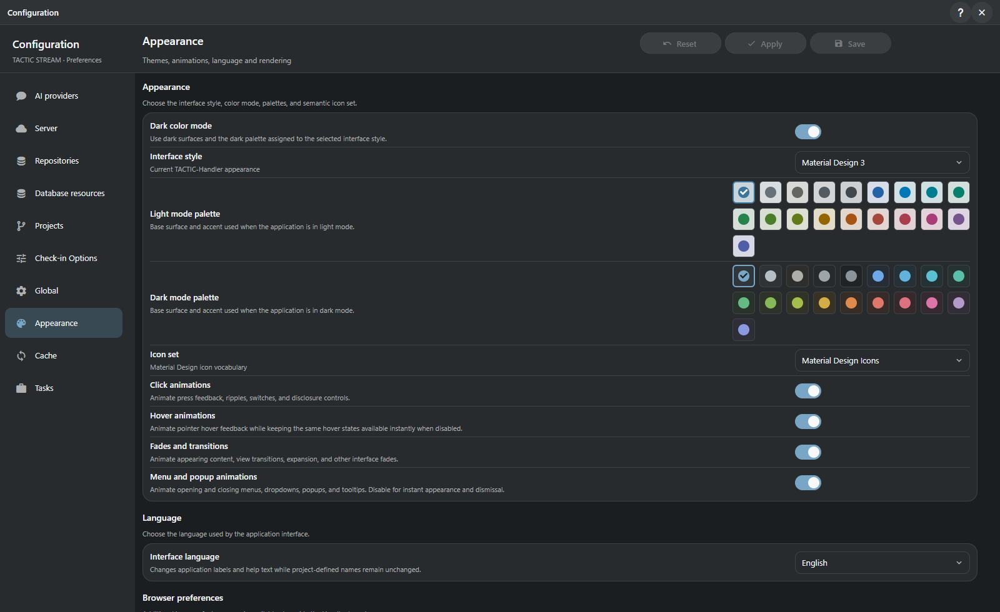

| Область | Назначение |
| --- | --- |
| **AI providers** | Профили провайдеров, получение моделей и выбор исполнителя ассистента. |
| **Server** | Подключение, поддерживаемые серверные параметры, состояние служб и явные команды управления. |
| **Database resources** | Настройка и проверка ресурсов, привязка существующих схем; без переноса данных. |
| **Repositories** | Имена, цвета, пути репозиториев и поддерживаемые настройки серверного хранения. Сохранение пути не перемещает файлы. |
| **Projects** | Создание проектов, шаблоны и проектные настройки. |
| **Check-in Options** | Параметры подготовки файлов, naming и публикации по умолчанию. |
| **Global** | Общие настройки взаимодействия и обновления данных, доступные данному клиенту. |
| **Appearance** | Светлые/тёмные темы, палитры, иконки, английский и русский интерфейс. |
| **Cache** | Политика, состояние и обслуживание кэша. |
| **Tasks** | Настройки задач, времени и трудозатрат. |


Поддерживаемые параметры серверного XML охватывают службы, сеть, безопасность, каталоги и расписание, с валидацией и указанием необходимости перезапуска. Сохранение конфигурации и рестарт службы — отдельные действия. Перенос базы или репозитория требует отдельной процедуры. [Справка по Configuration](../../frontend/public/help/configuration.ru.md)

## Чат-бот с контекстом реального проекта

Спросите, что готово к ревью, какая версия опубликована или чего не хватает для передачи работы. Встроенное окно **External agent** фиксирует проект, страницу, Search Type и выбранные объекты. Исполнитель читает и изменяет данные через ограниченные нативные инструменты.

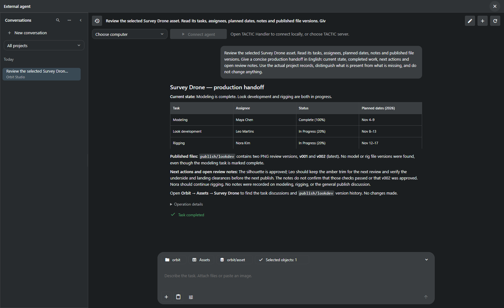

В этом примере ассистент обнаружил полезное расхождение: моделинг отмечен Complete, но публикации модели нет. Он также отделил замечания ревьюера от подтверждения согласования. Отдельная презентация разбирает диалоги, вложения, провайдеров, конфигурацию проекта, изменение задач, испытания скриптов и границы отмены.

**[Подробная презентация встроенного ассистента →](assistant.ru.md)**

## Кастомные дашборды как рабочие страницы

Обзор производства должен помогать понять, куда смотреть дальше. На собственной странице можно собрать показатели, отчёты и диаграммы, а рядом разместить Item View, формы и действия. Руководитель может перейти от общей картины к отдельному ассету; ревьюер — страницу, где дерево и детали выбранного объекта находятся рядом. Все блоки работают с данными проекта и действующими правами.

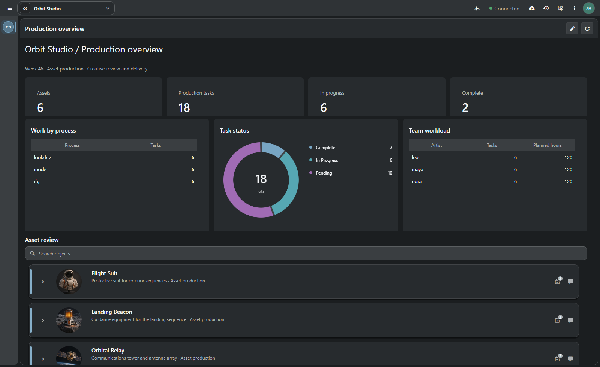

**[Подробная презентация дашбордов и визуального редактора →](dashboards.ru.md)**

## Запуск и расширение

### Локальный запуск из исходников

Нужны Python 3.14 на Windows и новый каталог данных для первой установки.

```powershell
Set-Location tactic_stream
py -3.14 -m venv .venv
.\.venv\Scripts\python.exe -m pip install -e .
..\START_TACTIC_STREAM.bat
```

Лаунчер при необходимости создаёт SQLite, запрашивает пароль администратора при первой настройке и открывает настроенный адрес. Собранные web-ресурсы входят в checkout. [CLI и разработка](../../README.md#local-development)

| Поставка | Состав | Руководство |
| --- | --- | --- |
| Portable Windows | Лаунчер, Python/web-приложение, SQLite и дополнительный сценарий с Handler | [Windows](../delivery/WINDOWS_DELIVERY.ru.md) |
| Отдельный Linux-сервер | Stream за Apache с PostgreSQL, поставка через Docker Compose | [Сервер](../delivery/SERVER_DELIVERY.ru.md) |

Базу, репозиторий и конфигурацию нужно резервировать вместе. Для отката приложения нужна соответствующая копия данных. [Восстановление](../delivery/RECOVERY_ACCEPTANCE.md)

### Серверный API и расширения

На работающем сервере `/api/documentation` открывает каталог методов, `/api/compatibility` — описание исходного контракта. XML-RPC сохраняется как вход для существующих клиентов. Ядро сохраняет привычные модули `pyasm`/`tactic` и семантику команд; интеграциям нужен соответствующий серверный API, а не объекты памяти клиента Handler.

[Карта серверного API](../admin_agent/SOURCES.md#ts-server-api) · [Модель данных](../../frontend/public/help/core_model.ru.md) · [Архитектура](../architecture.md) · [Пример Workspace Pulse](../../../examples/workspace_pulse/README.md) · [Пример Studio Review](../../../examples/studio_review/README.md)

## Границы и происхождение

Stream и Handler — отдельные репозитории и поставки. Stream не импортирует Handler или legacy-дерево при работе. Совместимость с исходным TACTIC проверяется явно; это не общее обещание запуска любого исторического плагина и скрипта без изменений.

Старый production layer `pyasm.prod` и Drupal не входят в порт, MySQL отложен, S3 исключён. Перед миграцией изучите [область совместимости](../compatibility.md). [Индекс документации](../index.md)

Скриншоты иллюстрируют настроенную работу на небольшом демопроекте. Это не бенчмарк и не подтверждение релизной приёмки. Скрипты студии, схема, интеграции и права проверяются на используемой версии продукта.

[Original TACTIC license](../../LICENSE.TACTIC) · [QuickJS-NG](../../LICENSE.QUICKJS-NG) · [Vue](../../frontend/public/LICENSE.VUE.txt) · [Icon-font notices](../../frontend/public/licenses/icon-fonts/SOURCES.md)
