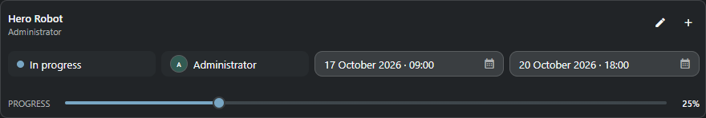
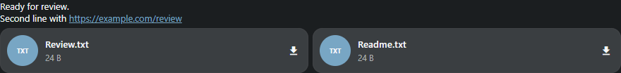

# Task Inspector dock

> Task Inspector combines the exact selected process or task with its editable details, notes,
> attachments and linked objects.

## Dock window

On desktop, Inspector is the shared **notes** workspace panel. Open it from **Workspace panels
→ Tasks and reports → Task Inspector**, or from an object's Notes/tasks and Task Manager.
All entry points use the same panel with the exact parent, process and task. An open desktop
Inspector follows Search or Task Manager selection. With no selection it asks you to select an object.

Use its dock header to float, dock, stack, maximize or close it. Account preferences, per-search-tab
layouts and named presets retain its placement, visibility and floating geometry. Closing the
panel keeps its note and task drafts. Switching targets restores each context's own draft and
original task revision; finish/cancel an active note edit or task action before switching.

On phones, Inspector opens as a workspace page below the main application header, like Task Manager.
The project selector and navigation stay available. **Back** in the top context header returns to the object
or Task Manager that opened Inspector. Note drafts remain
available when the same context is reopened. Back from nested Help returns to Inspector first.

On a phone, the object title, process selector, **Back**, Help and task menu share a compact
header above the timeline. The note composer stays at the bottom. There is no separate Task Inspector heading. **Task actions**
offers detail disclosure, refresh, time logging and timesheet access. The timeline uses the
remaining height and the main application header stays visible. Choosing Notes on a Task
Manager card opens that exact task and process; changing the process stays explicit.
Desktop retains the Handler Inspector layout; Handler has no corresponding phone layout.

## What the dock follows

Search selection supplies the parent sObject. Tasks or Task Manager can additionally select the
process and exact task. When several tasks share one process, the compact task selector remains in the
header even while the editor is collapsed.

The expanded or collapsed state is a saved user choice; selecting another task does not override it.

## Task details

The expanded inspector shows quick status, assignee, dates and progress fields. **Edit task** opens
all configured fields; **Create task** opens the full creation form, including an additional task
for the same process. Saving quick workflow defaults also creates a missing task.

Each sObject, process and selected task keeps its own unsent note draft. Moving between targets does
not place one task's draft into another task.

## Notes timeline

- Write a note for the current object, process or task.
- Attach local files or paste an image from the clipboard.
- Open linked sObjects and file attachments from the timeline.
- Edit or delete a note only when ownership and server permissions allow it.
- New entries follow the bottom only when you were already there. Reading older notes preserves
  the scroll position, including closing and reopening the same target during this session.

Keyboard behavior:

- **Enter** sends a note.
- **Ctrl+Enter** inserts a line break.

## Typical workflow

1. Select the parent object in Search.
2. Select the process or exact task in Tasks.
3. Confirm the target shown in the Inspector header.
4. Edit task details or add a note and attachments.
5. Save the task separately from sending the note.

## Empty and error states

- **No target** means no current sObject has been published by Search.
- **No task** still permits creating one from workflow defaults.
- A note upload failure preserves the draft and attachment selection for retry.
- If Notes was opened from Task Manager, it follows that task even when its parent was not previously selected.

Text drafts are stored locally under the authenticated user and exact object/process/task context,
matching Handler ComposerDrafts. Closing the view or reloading restores text; sending clears it.
Local attachment handles and reply selections remain in memory and are not restored after reload.
Storage errors are visible; do not close the page until unsaved content is copied or sent.

## Process, task and note ownership (0.112.34)

The header uses workflow process colors and note counts. A primary task writes notes to its
parent/process; a secondary task writes to that exact task. A single surviving task also reads
its task-bound history. Process counts include both parent and task notes.

Progress processes show linked tasks, statuses and the native approved/total counters. These
counters describe workflow links and may exceed the number of unique tasks; they are not a
clamped completion percentage. Select a linked task to inspect it. Work hours show planned,
approved, remaining and over-plan totals, with Log time and Timesheet actions.

Visible dock inspectors refresh with server updates; a dock does not require modal-window focus. Draft values and their original revision
survive refresh: a concurrent write produces a conflict instead of overwriting the server.
An uncertain save response requires reloading before another save. Leaving the target prevents
a delayed response from applying to another object or task.

Notes accept files without text. The paperclip, clipboard-image button, paste and file drop share
one staging list. Image previews and downloads represent each original file once, rather than
also listing generated web/icon renditions as separate attachments. Reply, edit history, copying
the note sKey and full task actions remain visible Stream additions. Configuration → Appearance
→ Object notes also retains a separate Notes view; Inspector is the default.

Configured browser task and Discussion commands currently require an administrator. Ordinary
SDK task/note calls have separate parent, record, column and ownership checks. Messages and own
profile operations support permitted ordinary accounts. This UI pass does not establish complete
SDK coverage or ordinary-user access to these configured task/note editors.

## Own journals (0.112.21)

Task detail edits and own note changes can be undone/redone from the user's saved
transaction journals. Notes preserve their IDs and reply links; delete replies before
their parent. Current parent/type/record/column rights are checked again. Status changes
with Workflow/history effects are not yet replayable. See Help: Internal structure,
“Task/note writes and undo/redo” for the tested scope and remaining limits.

## Status/Workflow replay (0.112.22)

Own task status and single-project Workflow journals now support undo/redo with their
status history, process states, messages/packages and own notes. Current rights are rechecked
and failures roll back. Historical Workflow journals lacking message backups are refused.
See Help: Internal structure, “Task status and complete Workflow replay” for boundaries.

## Workflow across projects (0.112.23)

Own complete dependency journals now replay across project databases with task status,
own notes, process states, history and messages. Each original parent's actual project
requires current rights; IDs and callback results survive replay without rerunning callbacks.
See Help: Internal structure, “Workflow replay across projects” for checks and boundaries.

## Legacy state ownership replay (0.112.24)

Own complete Workflow journals can now undo/redo the normal adoption of a legacy state
with an empty pipeline_code, retaining its original ID and data. The recorded owner must be
the parent's visible primary pipeline with its visible process. Arbitrary owner switching
remains denied. See Help: Internal structure, “Replay of legacy pipeline adoption”.

If a task cannot be loaded, note sending stays disabled. Use Retry; its draft remains intact.

## Note editing and files

Open a note's **Note actions → Edit note**. Its modeless editor keeps the text
when saving fails; Save closes it only after confirmation. **Delete note** uses
a modal confirmation. A lost reply blocks another write: close the child,
refresh and check the actual note first. Your composer draft is independent.
Long text, emoji-only notes, link previews and file cards use measured heights.
Browser files open FilePreview with Download; Handler retains local open/folder
and Repository Sync. sKey previews use the same protected resolver as Messages.
Quick **Edit task in full editor** opens the normal modeless object form;
Stream's existing inline editor remains in **Task actions → Edit task**.

## Presentation examples

Examples use test data and show the panel content. The surrounding window or dock keeps its normal behavior.

Task Manager's shared table/field editors, virtual creation and opt-in bulk workflow are described in [Tasks and planning](tasks.en.md). Existing configuration and permission owners remain unchanged.

In Stream, automatic note updates keep the current composer enabled. You can
send with Enter while a background read is pending; a late older response cannot
replace the freshly loaded reply. Opening another object or an explicit blocking
reload still protects the new context before editing.

The note field grows to fit wrapped placeholder text and ordinary input, up to
the existing height limit; longer drafts scroll inside the field. Status events
keep their tinted card and outline, using the theme accent if no workflow color
is available. Dashboard pages use the full body width when they fit; overflowing
pages retain room for their outer scrollbar.

On browser HTTP connections or denied clipboard permission, the clipboard button focuses the
note field and shows a Ctrl+V / Paste hint instead of an access error. Existing text and
attachments stay intact. HTTPS with clipboard permission supports direct insertion.

All window and dock title-bar actions use round buttons, including Help, maximize/restore, detach and Close. Local controls inside the panel keep their service styling.
