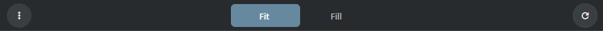
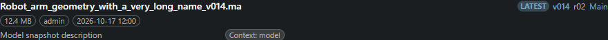

# Snapshot Browser dock

> Open Workspace panels → Browsing → Snapshot Browser to inspect files and previews of the selected object, process or snapshot.

## Selection and versions

The dock follows native snapshots of the selection. The default process is Publish,
then Icon, then the first available context. A process includes its slash subcontexts.
A task follows its parent object and process. A versionless snapshot shows the history
of its exact context; a numbered snapshot shows only itself. Choose numbered versions
in the object's Versions branch. Load more snapshots continues in pages of 50.
Old responses cannot restore the previous object or project after switching selection.

## Preview and layout

The options menu selects Preview and Files, Preview Only or Files Only, horizontal
(stacked) or vertical (side by side) orientation, Show All Files and Show More Info.
The splitter accepts dragging and arrow keys. These options and Fit/Fill are saved
in this browser. Fit preserves the entire image; Fill crops to fill the preview.
Previous/next, arrow keys, wheel and slider select a preview. The first web derivative
is used when available; the original is requested above physical display scale 1.2.
Refresh includes the native file modification time in preview URLs to avoid stale
versionless images at an unchanged filename.

## Files and actions

Published files are the initial list. Show All adds snapshot/type headers and Icon,
Web and Playblast files. Show More adds Size, directory Path, native snapshot Repo
and Base Type when wide enough. This is server metadata, not desktop sync state.
Use the preview's three dots or the file context menu. Open File uses the shared
browser preview/download window. Copy File Path copies the full server filename;
Copy Web Link copies its HTTP URL. Copy To Clipboard copies an image and requires
HTTPS or localhost and clipboard permission. Text copying also works on LAN HTTP.
Show Folder is unavailable: this browser cannot open a server folder on your computer.

Edit Info edits the exact sthpw/file record through native EditWdg metadata.
MetadataElementWdg remains read-only. Delete uses the owning Snapshot and FileUndo:
it removes that exact file and native aliases as appropriate, updates snapshot XML
and leaves the directory, snapshot and neighboring version files intact. A failed
snapshot commit restores the file record and bytes.

## Internal contract and remaining work

result-items retains existing project/type/selection checks and uses native Search
parent/context filters, File.get_by_snapshots and ThumbWdg XML file descriptors.
Actions retain captured file identity. No Handler/DCC connection, Repository Sync
or S3 is used. Snapshot Browser reads check project/type access and the owning
record, allowing authorized ordinary readers while hiding private records.
Metadata sequence/UDIM/UV groups expose nested member rows in pages of 50,
without expanding millions of frames in memory. Member operations retain the
native identity of the whole group, as Handler FileObject does. Qt-only formats
need browser-readable derivatives; the original remains downloadable. Current
offline comparisons render unchanged Handler QML and Chromium at matching sizes
using a native-record fixture, not a connected end-to-end Handler session.

## Shared snapshot surfaces

The toolbar, options, summary, splitter and file columns share one description.
Select a process/snapshot in the object report to open its actual files. Browser
preview uses authorized URLs/derivatives and Download. Watch-folder editing stays
native: the browser explains the missing desktop capability rather than claiming
to watch a local directory. Selection and native file identity remain with the
existing Snapshot Browser and repository adapters.

## Presentation examples

Examples use test data and show the panel content. The surrounding window or dock keeps its normal behavior.

