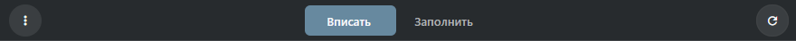
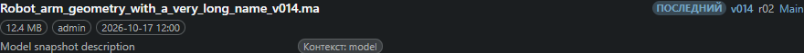

# Док «Браузер снапшотов»

Если у двух снапшотов есть изображения, в меню доступно **Сравнить снапшоты**.
Выберите A и B по версии, контексту и имени файла. Режим **Рядом** показывает
оба изображения. **Разделитель** совмещает их в одной области. Двигайте ползунок
мышью, касанием или клавишами со стрелками. Чтобы выбрать более старую версию,
сначала загрузите её в списке файлов.

> Откройте Панели рабочего пространства → Просмотр → Браузер снапшотов, чтобы увидеть файлы и превью выбранного объекта, процесса или снапшота.

## Выделение и версии

Док следует за native снапшотами выделения. Сначала выбирается Publish, затем Icon,
затем первый доступный контекст. Процесс включает подконтексты через `/`.
Задача передаёт родительский объект и свой процесс. Versionless показывает историю
своего точного контекста; номерной снапшот — только себя. Номерные версии выбирайте
в ветке «Версии» объекта. «Загрузить ещё снапшоты» продолжает страницами по 50.
Устаревший ответ не возвращает предыдущий объект или проект после смены выделения.

## Превью и компоновка

Меню выбирает Превью и файлы, Только превью или Только файлы, горизонтальную
(друг над другом) либо вертикальную (рядом) компоновку, Показать всё и Больше
информации. Разделитель перемещается мышью и клавишами со стрелками. Эти параметры
и Вписать/Заполнить сохраняются в браузере. Вписать показывает изображение целиком,
Заполнить обрезает его по области. Превью переключают стрелки, клавиатура, колесо
и ползунок. Сначала используется первая web-копия; оригинал запрашивается при
физическом масштабе отображения больше 1.2. Обновление добавляет время изменения
native файла в URL: versionless с прежним именем не продолжает показывать старый кэш.

## Файлы и действия

Сначала видны опубликованные файлы. «Показать всё» добавляет заголовки снапшотов/
типов и Icon/Web/Playblast. «Больше информации» раскрывает Размер, Путь каталога,
штатное Repo снапшота и Базовый тип при достаточной ширине. Это серверные сведения,
а не состояние синхронизации компьютера. Действия открываются через три точки
превью или контекстное меню файла. Открытие использует общее окно просмотра/
скачивания. Копирование пути отдаёт полное серверное имя; веб-ссылки — HTTP-адрес.
Копирование изображения требует HTTPS или localhost и разрешения буфера обмена.
Текст копируется и на LAN HTTP. «Показать папку» недоступно: браузер не открывает
серверный каталог на компьютере пользователя.

Редактирование информации открывает точную запись sthpw/file через метаданные
штатного EditWdg. MetadataElementWdg остаётся только для чтения. Удаление идёт
через владеющий Snapshot и FileUndo: убираются точный файл и нужные native aliases,
обновляется XML. Каталог, снапшот и файлы соседних версий сохраняются. Ошибка записи
снапшота откатывает запись файла и байты.

## Внутренний контракт и оставшаяся работа

result-items сохраняет проверки проекта/типа/выделения и использует native Search
с фильтрами родителя/контекста, File.get_by_snapshots и XML-дескрипторы ThumbWdg.
Действия сохраняют захваченную идентичность файла. Нет подключения Handler/DCC,
Repository Sync и S3. Чтение Snapshot Browser проверяет доступ к проекту,
типу и владеющему объекту; обычный пользователь может читать разрешённые версии,
а чужие приватные записи остаются скрыты. Metadata-группы sequence/UDIM/UV
показывают вложенные строки файлов с загрузкой страниц по 50 без разворачивания
миллионов кадров в памяти. Операции с членом группы сохраняют native-идентичность
всей группы, как в FileObject ТХ. Для форматов только Qt нужна браузерная
производная; оригинал можно скачать. Свежие сравнения используют неизменённые
QML Handler и Chromium при одинаковых размерах с fixture native-записей,
а не полный подключённый сеанс Handler.

## Общие поверхности снимков

Панель инструментов, настройки, сводка, разделитель и колонки файлов используют
общее описание. Выберите процесс/снимок в отчёте объекта для открытия его файлов.
Браузер использует разрешённые URL/производные и скачивание. Редактор отслеживаемой
папки остаётся нативным: браузер объясняет отсутствие настольной возможности.
Выбор и идентичность файлов сохраняют прежние владельцы Snapshot Browser и
адаптеры репозитория.

## Примеры панелей

На снимках показано содержимое панелей на тестовых данных. Окно или док сохраняет своё обычное поведение.

