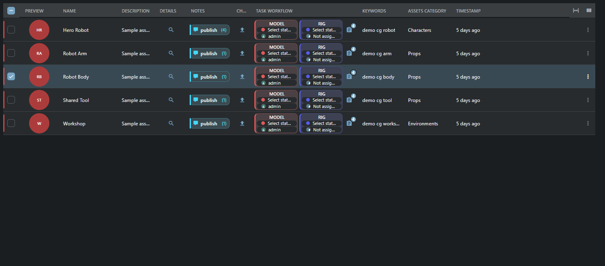
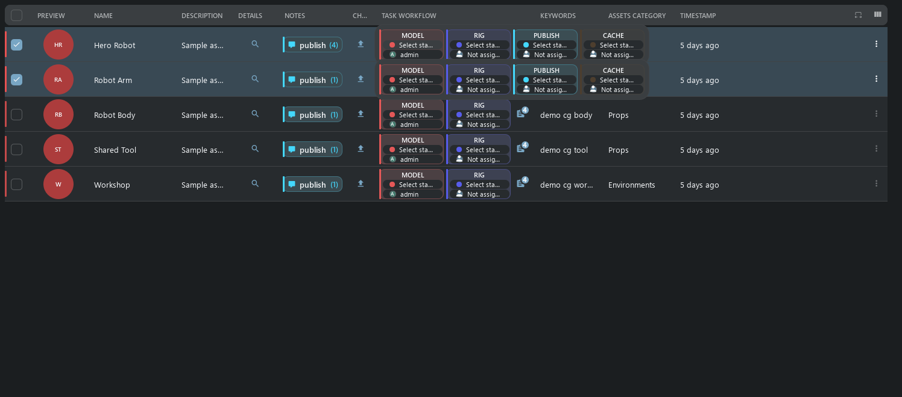
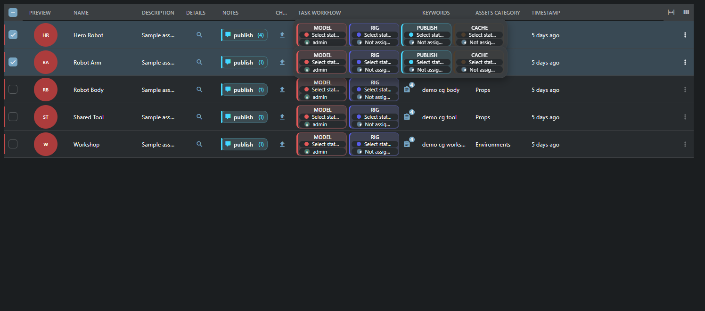
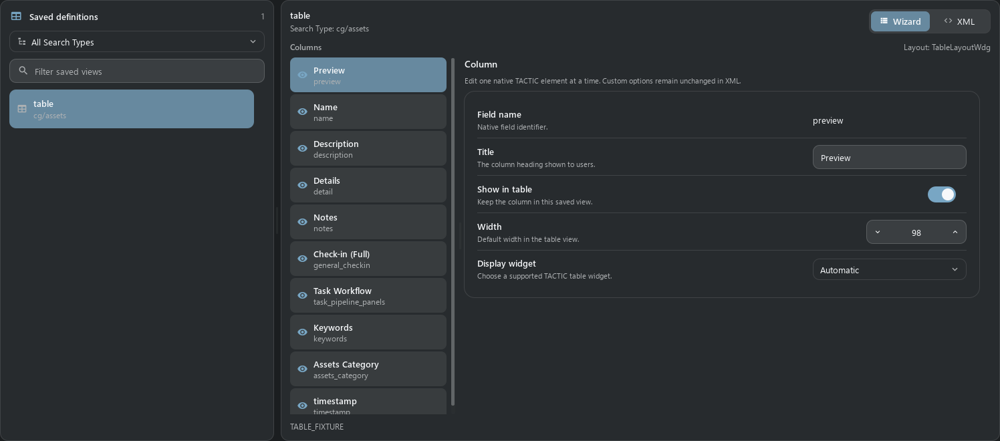
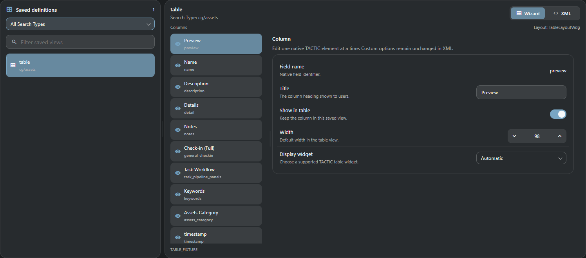

# Table View and Columns Editor

Column headings, plain values and status chips share a centered column axis by default. Explicit display options `justify` or `align` keep their `left`, `center` or `right` alignment. Wrapped labels retain that alignment when the column is resized.

The current adapted Handler Table View is ported to Stream: **45 registered names, 21 classes**. This covers current Handler scenarios, not the entire old HTML/JS runtime. Unfinished source widgets stay excluded.

## B07 checkpoint

The shared catalogue now contains **71 adapted classes / 172 named aliases** across the 104 inventory sources (30 production/3D/Maya/Flash wrappers and 3 unfinished source classes remain excluded). Geometry, menus, typed value editors, group/bottom summaries, nested `show_gear` column authoring, ordinary-user ACL, and form revision/uncertain-save checks share Frame modules. [Full cell examples and remaining explicit limits](table_widgets_b07.en.md). The following historical screenshots/counts describe the initial October 14 checkpoint.

## Table

The square header, 58px rows, 50px previews, 107 × 50px task cards, process note chips, relative dates and selection follow Handler. Quiet row dividers, subtle alternating surfaces and compact status badges keep the table readable in both themes. A normal click focuses the row; explicit checkboxes or Shift select records for bulk actions. Double-click a row to inspect it; double-click an editable cell to use its native input. Description uses a text panel. Enter or leaving the field commits the full text; Escape cancels.




Header menu: sorting, grouping/ungrouping, display/input definition, hide, order and row height. Drag column boundaries or use arrows in 8/16px steps. Auto Fit fits widths. The columns button selects saved views or saves a new one. All use config/widget_config, without another store. Long results are virtualized; server cells are read in batches of at most 500 objects.

Changing widths in an existing table definition saves the sizes in place without adding Undo or activity-history entries. Creating a view or changing its columns, titles, widgets or other settings is still recorded.

You can resize a table generated from object fields immediately. The first change remembers its displayed columns and their order; the width remains after reopening the table. Errors while preparing a change do not block the next resize. If a save response is lost, reload the server result before saving again.

In the CG project, Script shows the saved URL as a link. An empty Script field shows Not script as plain text.

Episode displays native previews, names and task controls. Related assets and shots open as tables scoped to that episode. The shots use the saved episode_shots view; asset categories remain visible as a column in the related-assets table.

Task Workflow accepts the stock legacy edit flag without hiding the cell. Status and assignee changes still use their native editors and permissions. Expression columns with a standard DatabaseAction bound to an existing field remain readable; unknown callbacks and options are rejected.

Table headers and rows fill the available width. Space for a scrollbar is reserved only while that scrollbar is needed.

Embedded tables use the same header, menus, selection and editors. They start with Auto Fit across all configured columns; manually hidden columns remain hidden. If minimum column widths cannot fit, use the horizontal scrollbar. A dashboard table's height includes its title, search, rows and footer, so adjacent blocks align without extra page gutters.

## Edits and tasks

Inputs resolve through edit/edit_definition and the real action.column. Assets Category therefore edits assets_category_code. Batch edits validate every revision before the first EditCmd; failure rolls back the entire batch. ID/code/project/timestamp/login and read_only are protected. Conflicts retain drafts; unknown save outcomes are checked before retrying. A ticket/project change blocks writes from the old draft.

Task cards use compact status/user editors and a separate dates panel. Selected task changes remain pending until Save task changes. Hover reveals all cards; hovering a selected row previews every selected row. Touch pins previews; Escape/outside click/scroll closes them. The count icon opens Task Manager/Inspector.

An unset status displays Select status as a hint; choose a task status from the list. Changing language does not itself modify the task.

The preview retains the full card height. When all tasks fit, no scrollbars appear; narrow windows use horizontal scrolling only. Press inside an open preview to pin it; scrolling its own card strip keeps it open.





## Columns Editor

Saved definitions, Search Type filter and search are on the left. Wizard/XML are on the right. Wizard changes title, hidden, width and display widget; the requested table column is selected immediately. Splitters adapt to width. Unknown options, other elements and comments remain in XML. Save to server updates the original record with revision validation; Discard restores stored XML.





## Adapted working classes

### Values

- `SimpleTableElementWdg`
- `RawTableElementWdg`
- `FormatElementWdg`
- `ArrayTableElementWdg`
- `XmlWdg`
- `JsonElementWdg`
- `SnapshotVersionElementWdg`

### Expressions and links

- `ExpressionElementWdg`
- `ExpressionValueElementWdg`
- `LinkElementWdg`

### Preview and collaboration

- `ThumbWdg`
- `DiscussionElementWdg`
- `TaskElementWdg`
- `TaskCompletionWdg`

### Actions

- `SObjectDetailElementWdg`
- `CheckinButtonElementWdg`
- `ExplorerElementWdg`
- `ExplorerTableElementWdg`
- `SObjectFilesElementWdg`
- `MetadataElementWdg`
- `DeleteElementWdg`

## Action examples

Add each element to an existing table; do not replace the whole config. Value, XML/JSON, expression and completion examples are in the [catalog](table_widget_examples.en.md). All class aliases are listed in src/tactic_stream/shared_ui/features/table/widgets.json.

### SObjectDetailElementWdg

Details opens the object inspector. use_parent selects the native parent.

```xml
<element name="detail" width="64">
  <display class="tactic.ui.table.SObjectDetailElementWdg"></display>
</element>
```

### CheckinButtonElementWdg

Check-in preserves the native target, process and context and opens the Drop Plate dock. Browser files are uploaded to the server.

```xml
<element name="general_checkin" width="64">
  <display class="tactic.ui.table.CheckinButtonElementWdg"><process>publish</process><mode>upload</mode></display>
</element>
```

### ExplorerElementWdg

Explorer resolves a native sandbox/repository path and copies it. Opening a client folder requires the separately excluded desktop bridge.

```xml
<element name="folder" width="64">
  <display class="tactic.ui.table.ExplorerElementWdg"><mode>repository</mode></display>
</element>
```

### SObjectFilesElementWdg

Files opens the object inspector with existing file and preview operations.

```xml
<element name="files" width="64">
  <display class="tactic.ui.table.SObjectFilesElementWdg"></display>
</element>
```

### MetadataElementWdg

Metadata opens the existing inspector; native metadata actions remain authoritative.

```xml
<element name="metadata" width="64">
  <display class="tactic.ui.table.MetadataElementWdg"></display>
</element>
```

### DeleteElementWdg

Delete opens the native object deletion confirmation; it never deletes on the first cell click.

```xml
<element name="delete" width="64">
  <display class="tactic.ui.table.DeleteElementWdg"></display>
</element>
```

## Validation and limits

Paired captures use current Handler QML and Stream Vue, one temporary CG project, EN, MD3 dark/light, Segoe UI, 1496 × 660, DPI 96/scale 1. Native commands separately validate data and writes. Captures use isolated display controllers and do not prove a user server session. HTTP, XML-RPC, revisions, rollback and admin-only behavior have separate tests. Qt and Chromium font rasterization differs. Physical phones, other DPI and other database engines were not checked in this run.

Browser check-in uploads files to the server. Local DCC/folders and desktop move/link transfers are not available in the browser. XML/JSON remain structured display, as in current Handler. Arbitrary JS/HTML actions and old totals are outside this port.


## Snapshot history files

The Files cell in snapshot history expands a table of files registered in that exact snapshot: file link, repository directory, type, frame range, size and timestamp. Filtering and paging stay within that snapshot; an empty version shows no files. Ordinary file links use the configured repository URL. Sequence rows retain their frame pattern and range; the link does not download an entire sequence. Directory packages remain registered file records; their recursive disk contents are not expanded here. Maya/applet actions are excluded.


Checkin Log shows the referenced object name and code in Code, as in legacy TACTIC. A missing or excluded owner displays n/a. Files opens the exact version file list. The old RenderSubmission action is part of the excluded production subsystem and is omitted from the built-in log.

Workflow hover previews use compact cards with editable dates, status and assignee. The preview arranges smaller cards in one to three columns with equal gaps and padding. Additional rows scroll vertically inside the bounded preview. Task Manager remains available in its separate footer. The count button remains a direct Task Manager action and does not trigger expansion; the same action is available in the preview. Compact table row height stays unchanged.

Only the cell under the pointer expands; selecting other rows does not open their previews. Bulk task editing still uses the selected rows.

The active expanded related table is raised with a shadow; the remaining parent table is dimmed. Click the dimmed area or Close to collapse it. If search is disabled for that view, no empty toolbar is reserved: remaining actions use the footer. Enabled search uses the main suggestion field within the current relation.

The task-count menu uses the compact Handler process picker. Choosing a process opens Task Manager for that object and process; choosing an individual task also selects that task. Notes retain their separate process-scoped action. Use All processes to return from the task list.

### Pipeline progress nodes

A progress node is an aggregate, with a ring and a completed-object/total-object count. It has no task status, assignee or dates. Click the ring or heading to open its related tasks in Task Inspector. An unconfigured or unavailable relation shows N/A; an accessible empty scope shows 0/0.

Counts follow the configured related Search Type, process, pipeline and local/global scope. For objects with pipelines, completion comes from their workflow status messages, as in legacy TACTIC. For objects without pipelines, Complete object/task statuses are used. Multiple completed tasks on one object count once. Ordinary task cards retain their inline editors, with aligned quiet rows and a single process accent.

Item views automatically use the same compact density as Handler when their panel is narrower than 445 logical pixels. The existing object cards become 64 pixels high with 42-pixel previews. Widen the panel to restore the selected view. Resizing retains selection and expanded children and does not reload the records. Explicit Compact rows remains compact at any width; table views keep their table layout.

The primary search toolbar keeps round buttons for Refresh, Script shelf, Tags, Quick filters, Help and Workspace panels. Local service toolbar buttons remain square.

Item lists keep equal left and right insets while their contents fit. Extra space on the right is reserved only when the scrollbar appears, and is released when the viewport fits again. Full and compact cards keep their existing internal padding and row spacing.

In Stream, open Commit Queue from the main top toolbar. The results footer keeps pagination, view loading and record creation controls; it has no duplicate queue button or Repository Sync action.

Related-table counts and their arrow form one compact button. Click the count, label or arrow to expand or collapse the same related table; keyboard activation and loading feedback stay within that row and column.

On phones, item cards keep titles, descriptions and complete thumbnails in a compact flowing layout. Tasks, notes and file actions sit below the text; the item menu and navigation arrow remain separate. Tap a card to browse its children and Back to return. Resizing preserves the desktop layout.

Duration displays its existing value and units in a compact clock badge. In **Administration → Columns Editor**, select a column and use **Cell icon** to choose or clear its leading icon. **Value appearance** chooses Automatic, Text or Badge for text values; Automatic badges Duration. Existing link/status/editor behavior is retained. Related-table buttons inherit their configured icon (or the selected Cell icon), combine the type and count (for example, Assets 5), and keep the disclosure arrow in the same button. Arbitrary custom captions remain unchanged. These settings are element attributes `value_icon` and `value_style` in XML, separate from widget options.

Tables use horizontal row separators without a default outer frame. In **Administration → Columns Editor**, select a column and choose **Cell text style**: Standard keeps the normal table font, Heading uses a larger semibold title (for example, Name), and Small text reduces descriptions. Styles apply to text values, links and configured value icons/badges; related-table count captions also support them. This affects cell values, not column headings. Existing actions, status colors and editing are unchanged. The XML element attribute is `value_text_style="heading"` or `value_text_style="small"`; an empty value restores Standard.

On phones, open Result actions (the three dots beside the section title) and choose Cards or Table. The choice is remembered per search tab, independently of its desktop view. Phone tables keep all columns and scroll horizontally inside their own viewport; swipe across a data row to see the remaining columns. Returning to cards preserves the selection and navigation state. Desktop column fitting settings stay unchanged.
