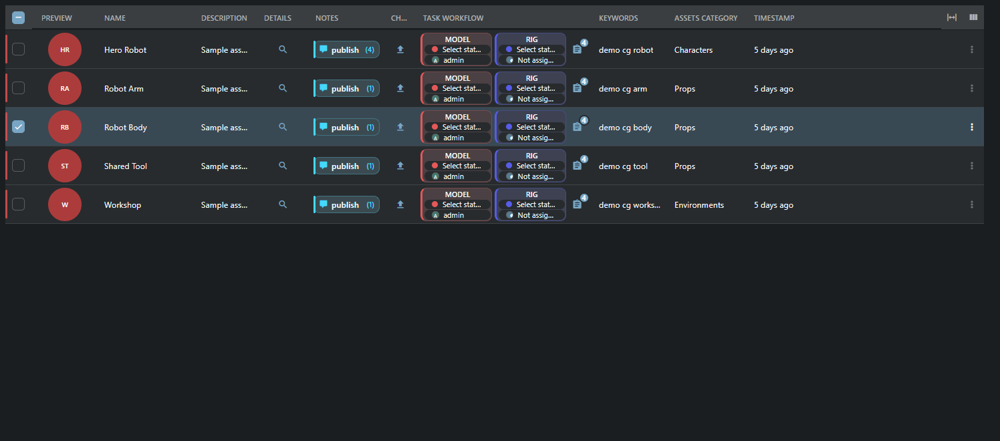
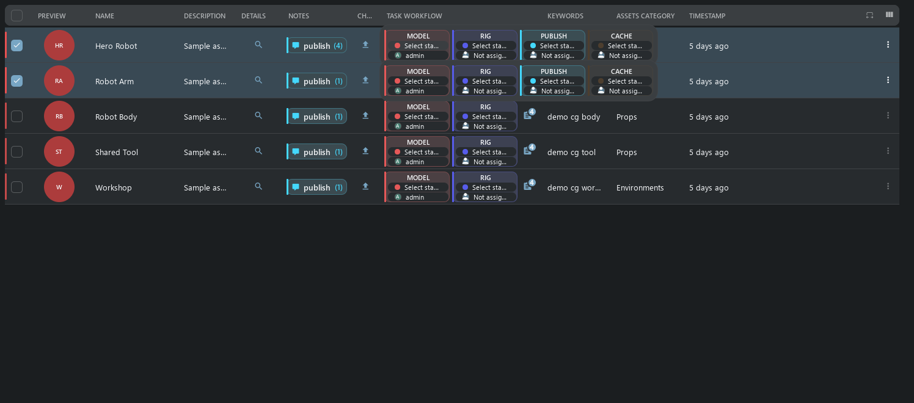
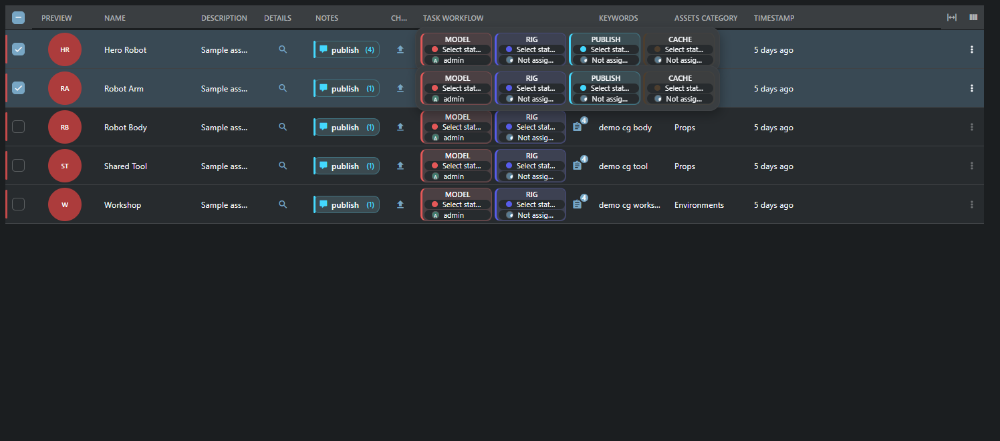
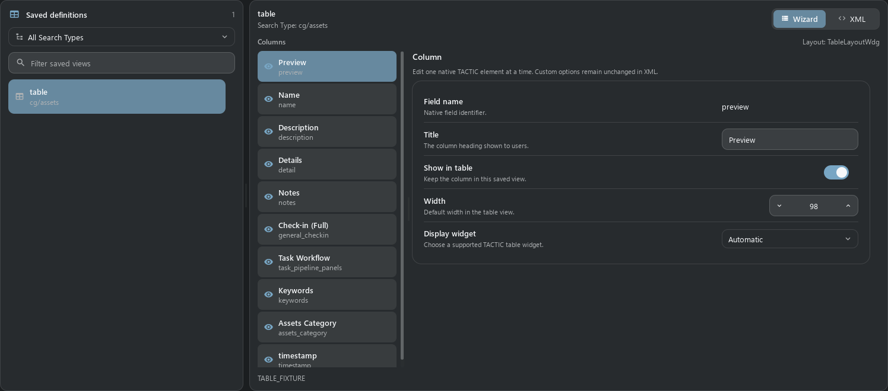
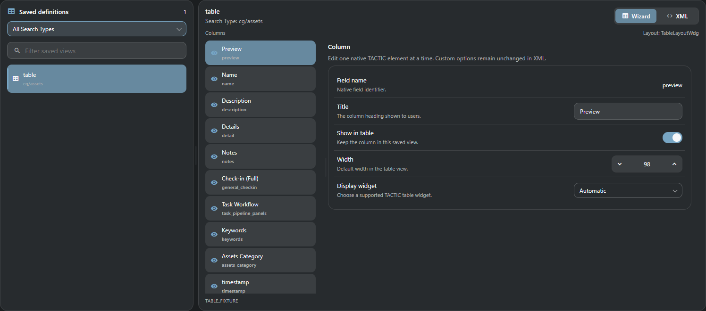

# Table View и редактор колонок

Заголовки колонок, обычные значения и бейджи статуса по умолчанию выровнены по центру одной колонки. Явные настройки отображения `justify` или `align` сохраняют выравнивание `left`, `center` или `right`. При изменении ширины переносимый текст сохраняет выбранное выравнивание.

Текущий адаптированный Table View ТХ перенесён в ТС: **45 зарегистрированных имён, 21 класс**. Это готовность действующих сценариев ТХ, а не полного старого HTML/JS runtime. Незавершённые исходники не переносятся.

## Этап B07

Общий каталог теперь содержит **71 адаптированный класс / 172 имени** из 104 источников инвентаря (30 production/3D/Maya/Flash-обёрток и 3 незавершённых класса остаются исключёнными). Геометрия, меню, редакторы значений, итоги групп и низа таблицы (`total_summary`, `bottom`, `group_bottom`), вложенный редактор колонок (`show_gear`), права обычного пользователя (ACL) и проверка ревизий/неизвестного результата сохранения форм используют общие модули Frame. [Примеры ячеек и явные оставшиеся ограничения](table_widgets_b07.ru.md). Следующие исторические снимки и числа относятся к исходной точке 14 октября.

## Таблица

Прямой заголовок, высота строки 58, превью 50, карточки задач 107 × 50, process chips заметок, относительные даты и фон выделения следуют ТХ. Тонкие разделители, лёгкое чередование фона строк и компактные метки статуса работают в обеих темах. Обычный клик фокусирует строку; галочки и Shift выбирают записи для групповых действий. Двойной клик по строке открывает объект; двойной клик по редактируемой ячейке открывает штатный input. Описание редактируется в текстовой панели. Enter или выход из поля сохраняет текст целиком; Escape отменяет.

Вложенные таблицы используют те же заголовок, меню и редакторы. По умолчанию Auto Fit подгоняет все заданные колонки; вручную скрытые колонки остаются скрытыми. Если минимальная ширина колонок не помещается, доступна горизонтальная прокрутка. Высота таблицы дашборда включает название, поиск, строки и нижнюю панель: соседние блоки выравниваются без лишних боковых отступов страницы.




Меню заголовка: сортировка, группировка/снятие группировки, настройка display/input definition, скрытие колонки, порядок и высота строки. Границы колонок изменяют ширину мышью или стрелками с шагом 8/16. Auto Fit подгоняет ширины. Кнопка колонок выбирает сохранённый вид и сохраняет текущий как новый. Это тот же config/widget_config, без отдельного хранилища. Большие выдачи виртуализированы; вычисления ячеек идут пакетами не больше 500 объектов.

Изменение ширины колонок в существующей таблице запоминает размеры без новых записей в истории и Undo. Создание представления и изменения состава колонок, названий, виджетов и остальных настроек по-прежнему записываются в журнал.

Ширину колонок можно менять и в таблице, автоматически собранной из полей объекта. Первая правка запоминает показанные колонки и их порядок; ширина сохраняется при повторном открытии. Ошибка подготовки правки не блокирует следующий ресайз. Если потерян ответ на сохранение, сначала загрузите результат с сервера.

В CG-проекте колонка Script показывает сохранённый URL ссылкой. Если поле пустое, отображается обычный текст Not script.

В Episode отображаются штатные превью, названия и управление задачами. Связанные ассеты и шоты открываются таблицами в рамках выбранного эпизода. Шоты используют сохранённый вид episode_shots; категории ассетов видны отдельной колонкой в таблице связанных ассетов.

Task Workflow отображается и со штатным старым флагом edit. Изменения статуса и исполнителя проходят через штатные редакторы и проверки прав. Вычисляемые колонки со стандартным DatabaseAction, привязанным к существующему полю, отображаются; неизвестные обработчики и параметры отклоняются.

Заголовок и строки таблицы заполняют доступную ширину. Место под полосу прокрутки появляется только тогда, когда она нужна.

## Правки и задачи

Input разрешается через edit/edit_definition и реальную action.column. Поэтому Assets Category редактирует assets_category_code. Групповая правка проверяет все ревизии до первого EditCmd; сбой откатывает весь batch. ID/code/project/timestamp/login и read_only защищены. Конфликт сохраняет черновик; неизвестный исход записи проверяется на сервере до повторной попытки. Смена ticket/project запрещает сохранение старого черновика.

Карточки задач используют компактные редакторы статуса и пользователя и отдельную панель дат. Правки выбранных задач остаются pending до Save task changes. Hover раскрывает все карточки; hover выбранной строки раскрывает превью всех выбранных строк. Touch закрепляет превью, Escape/клик снаружи/прокрутка закрывают. Значок с количеством открывает Task Manager/Inspector.

Если статус ещё не выбран, «Выберите статус» служит подсказкой; выберите статус задачи из списка. Переключение языка само по себе не изменяет задачу.

Превью сохраняет полную высоту карточек. Когда все задачи помещаются, полос прокрутки нет; в узком окне доступна только горизонтальная прокрутка. Нажатие внутри открытого превью закрепляет его; прокрутка самой ленты не закрывает превью.





## Columns Editor

Слева каталог сохранённых определений с фильтром Search Type и поиском. Справа Wizard/XML; Wizard меняет title, hidden, width и display widget. Колонка, вызванная из таблицы, выбирается сразу. Splitter работает горизонтально/вертикально по ширине окна. Неизвестные опции, другие элементы и комментарии остаются в XML. Save to server сохраняет исходную запись с проверкой ревизии; Discard возвращает сохранённый XML.





## Готовые адаптированные классы

### Значения

- `SimpleTableElementWdg`
- `RawTableElementWdg`
- `FormatElementWdg`
- `ArrayTableElementWdg`
- `XmlWdg`
- `JsonElementWdg`
- `SnapshotVersionElementWdg`

### Вычисления и ссылки

- `ExpressionElementWdg`
- `ExpressionValueElementWdg`
- `LinkElementWdg`

### Превью и общение

- `ThumbWdg`
- `DiscussionElementWdg`
- `TaskElementWdg`
- `TaskCompletionWdg`

### Действия

- `SObjectDetailElementWdg`
- `CheckinButtonElementWdg`
- `ExplorerElementWdg`
- `ExplorerTableElementWdg`
- `SObjectFilesElementWdg`
- `MetadataElementWdg`
- `DeleteElementWdg`

## Примеры действий

Добавляйте element в существующий table, не заменяйте весь конфиг. Остальные примеры значений, XML/JSON, вычислений и completion — [в каталоге](table_widget_examples.ru.md). Все class aliases перечислены в src/tactic_stream/shared_ui/features/table/widgets.json.

### SObjectDetailElementWdg

Details открывает инспектор объекта. use_parent выбирает штатного родителя.

```xml
<element name="detail" width="64">
  <display class="tactic.ui.table.SObjectDetailElementWdg"></display>
</element>
```

### CheckinButtonElementWdg

Check-in сохраняет штатную цель, процесс и контекст и открывает док Drop Plate. Файлы браузера загружаются на сервер.

```xml
<element name="general_checkin" width="64">
  <display class="tactic.ui.table.CheckinButtonElementWdg"><process>publish</process><mode>upload</mode></display>
</element>
```

### ExplorerElementWdg

Explorer вычисляет штатный sandbox/repository путь и копирует его. Открытие папки клиента требует отдельно исключённого desktop bridge.

```xml
<element name="folder" width="64">
  <display class="tactic.ui.table.ExplorerElementWdg"><mode>repository</mode></display>
</element>
```

### SObjectFilesElementWdg

Files открывает инспектор объекта со штатными файлами и превью.

```xml
<element name="files" width="64">
  <display class="tactic.ui.table.SObjectFilesElementWdg"></display>
</element>
```

### MetadataElementWdg

Metadata открывает существующий инспектор; изменения выполняются штатными metadata actions.

```xml
<element name="metadata" width="64">
  <display class="tactic.ui.table.MetadataElementWdg"></display>
</element>
```

### DeleteElementWdg

Delete открывает подтверждение штатного удаления объекта; первый клик по ячейке ничего не удаляет.

```xml
<element name="delete" width="64">
  <display class="tactic.ui.table.DeleteElementWdg"></display>
</element>
```

## Проверка и границы

Парные снимки: текущие QML ТХ и Vue ТС, один временный CG-проект, EN, MD3 dark/light, Segoe UI, 1496 × 660, DPI 96/scale 1. Данные и запись проверены отдельно штатными native командами. Captures используют отдельные display controllers и не доказывают работу пользовательского сервера. HTTP, XML-RPC, ревизии, rollback и admin-only проверяются отдельными тестами. Пиксельное сглаживание шрифтов Qt и Chromium различается. Физические телефоны, другие DPI и другие серверные СУБД в этом прогоне не проверены.

Browser check-in загружает файлы на сервер; локальные DCC/каталоги и desktop transfer move/link не воспроизводятся браузером. XML/JSON остаются structured display, как в текущем ТХ; произвольные JS/HTML actions и старые totals не включаются в этот перенос.


## Файлы в истории версий

Ячейка Files в истории раскрывает таблицу файлов, зарегистрированных именно в выбранном снапшоте: ссылка на файл, каталог репозитория, тип, диапазон кадров, размер и время. Фильтр и страницы ограничены этим снапшотом; у пустой версии список пуст. Ссылки на обычные файлы используют настроенный URL репозитория. Для последовательностей сохраняются маска имени и диапазон; ссылка не скачивает всю последовательность. Пакеты каталогов отображаются как зарегистрированные файловые записи, без рекурсивного раскрытия диска. Действия Maya/applet исключены.


В Checkin Log столбец Code показывает имя и код связанного объекта, как в легаси TACTIC. Для отсутствующего или исключённого владельца выводится n/a. Files открывает файлы конкретной версии. Старая команда RenderSubmission относится к исключённой production-подсистеме и убрана из штатного журнала.

При наведении открывается компактное превью с редактируемыми датами, статусом и исполнителем. Уменьшенные карточки размещаются в сетке от одной до трёх колонок с равными промежутками и отступами. Дополнительные ряды прокручиваются вертикально внутри превью, которое остаётся в границах окна. Кнопка Task Manager вынесена в отдельную нижнюю панель. Кнопка со счётчиком открывает список задач по нажатию и не запускает разворачивание; такая же кнопка доступна внутри превью. Высота компактной строки таблицы сохраняется.

Раскрывается только ячейка под курсором; выбор других строк не открывает их превью. Групповое редактирование задач по-прежнему учитывает выбранные строки.

Активная раскрытая таблица связей выделена тенью, остальная родительская таблица затемнена. Нажмите на затемнённую область или «Закрыть», чтобы свернуть её. Если поиск отключён в настройках вида, пустая панель не занимает место: оставшиеся кнопки находятся внизу. Включённый поиск использует основное поле с подсказками в пределах текущей связи.

Меню счётчика задач оформлено как компактный список процессов в ТХ. Выбор процесса открывает Task Manager для этого объекта и процесса; выбор отдельной задачи также выделяет её. Кнопка заметок сохраняет отдельное действие в контексте процесса. Из списка задач можно вернуться через «Все процессы».

### Ноды прогресса пайплайна

Progress-нода показывает кольцо и число завершённых объектов из общего количества. Полей статуса, исполнителя и дат задачи у неё нет. Нажмите на кольцо или заголовок, чтобы открыть связанные задачи в Task Inspector. Для ненастроенной или недоступной связи показано N/A; для доступной пустой области — 0/0.

Расчёт учитывает настроенные связанный серч-тайп, процесс, пайплайн и локальную/глобальную область. У объектов с пайплайнами завершение определяется сообщениями состояния рабочего процесса, как в легаси TACTIC. У объектов без пайплайна используются статусы Complete объекта или задачи. Несколько завершённых задач одного объекта считаются один раз. Обычные карточки задач сохраняют быстрые редакторы; их строки выровнены и оформлены спокойнее, с одним цветовым акцентом процесса.

При ширине панели меньше 445 логических пикселей итемы автоматически становятся компактными, как в ТХ: высота карточки объекта — 64 пикселя, превью — 42. При расширении панели возвращается выбранное представление. Выделение и раскрытые ветки сохраняются, записи заново не загружаются. Режим «Компактные строки» остаётся компактным при любой ширине; таблицы сохраняют табличное представление.

В главной строке поиска кнопки обновления, шелфа, тегов, быстрых фильтров, справки и меню панелей остаются круглыми. Кнопки локальных служебных панелей остаются квадратными.

Когда список итемов помещается целиком, отступы слева и справа одинаковые. Дополнительное место справа резервируется только при появлении полосы прокрутки и освобождается, когда список снова помещается. Внутренние отступы и промежутки между обычными и компактными карточками сохраняются.

В ТС очередь чекина открывается из верхней панели приложения. Внизу результатов остаются навигация по страницам, режим загрузки и создание записей; дублирующей кнопки очереди и действия Repository Sync там нет.

Счётчик связанных объектов и стрелка объединены в одну компактную кнопку. Нажатие на число, подпись или стрелку раскрывает и сворачивает ту же связанную таблицу; клавиатура и индикатор загрузки работают в пределах выбранной строки и столбца.

На телефонах карточки показывают названия, описания и целые миниатюры в компактной раскладке с переносом текста. Задачи, заметки и добавление файлов расположены под текстом; меню объекта и стрелка перехода отделены от них. Нажмите карточку для просмотра дочерних элементов, а «Назад» — для возврата. Изменение ширины сохраняет настольную раскладку.

Duration показывает текущее значение и единицы времени компактным баджем с часами. В **Администрирование → Редактор колонок** выберите колонку: **Иконка значения** позволяет выбрать или убрать иконку перед текстом. **Оформление значения** предлагает автоматический режим, текст или бадж для текстовых значений; автоматически бадж применяется к Duration. Ссылки, статусы и редактирование работают как прежде. Кнопки связанных таблиц наследуют настроенную иконку (либо выбранную иконку значения), объединяют тип и количество (например, Assets 5) со стрелкой раскрытия. Произвольные подписи сохраняются. В XML настройки хранятся в атрибутах элемента `value_icon` и `value_style`, отдельно от параметров виджета.

Строки таблиц отделяются горизонтальными линиями, без внешней рамки по умолчанию. В **Администрирование → Редактор колонок** выберите колонку и **Стиль текста ячейки**: «Обычный» сохраняет стандартный шрифт, «Заголовок» делает текст крупнее и полужирным (например, имя), «Мелкий текст» уменьшает описание. Настройка применяется к тексту, ссылкам и значениям с иконками/баджами, а также к подписям кнопок связанных таблиц. Это стиль значений, а не заголовков колонок. Действия, цвета статусов и редактирование сохраняются. Атрибут элемента XML: `value_text_style="heading"` либо `value_text_style="small"`; пустое значение возвращает обычный стиль.
