# Table View: widget examples

[Table View / Columns Editor](table_view.en.md) — October 14 update: the current 45 names/21 adapted Handler classes, actions and shared editor are ported. The original legacy audit/examples below remain historical; full legacy parity is not claimed.


> Working basic scenarios, XML and real Vue component captures with fixture values.

[Database and investigation queue](widget_database.en.md)

## Using the examples

In Columns Editor / Widget Configuration for the current SearchType, copy the display element into the intended table view. The full config illustrates structure; do not replace all existing columns with it. Replace name/description/amount/website/formula with real physical fields. Preview needs Snapshot/File; notes/tasks/completion need relationships and ACL. These captures show the renderer with prepared values, not every example executed against your database.

Use the exact class path: old pyasm.widget.TaskCompletionWdg and SimpleTableElementWdg are not aliases of the modern tactic.ui classes. The action handler must be empty; unsupported display options produce Widget unavailable. Column width is an element attribute, not a display option.

## Text

`tactic.ui.common.SimpleTableElementWdg`

A physical field. The basic renderer supports column; generic inline editing, empty and totals are still missing.


```xml
<config>
  <table layout="tactic.ui.panel.TableLayoutWdg">
    <element name="name">
      <display class="tactic.ui.common.SimpleTableElementWdg" />
    </element>
  </table>
</config>
```

## Raw value

`tactic.ui.common.RawTableElementWdg`

Displays the stored value. It does not apply the old get_display timestamp conversion or generic inline editing.


```xml
<config>
  <table layout="tactic.ui.panel.TableLayoutWdg">
    <element name="description">
      <display class="tactic.ui.common.RawTableElementWdg" />
    </element>
  </table>
</config>
```

## Formatted number

`tactic.ui.table.FormatElementWdg`

Native number/date/timecode formats; type, format, fps, timezone, constraint. Checkbox is read-only; no total_summary.


```xml
<config>
  <table layout="tactic.ui.panel.TableLayoutWdg">
    <element name="amount">
      <display class="tactic.ui.table.FormatElementWdg">
        <type>float</type>
        <format>-1234.12</format>
      </display>
    </element>
  </table>
</config>
```

## Link

`tactic.ui.table.LinkElementWdg`

Text link to HTTP(S), mailto or a root-relative URL. The icon option is not rendered. Executable/file URLs are rejected.


```xml
<config>
  <table layout="tactic.ui.panel.TableLayoutWdg">
    <element name="website">
      <display class="tactic.ui.table.LinkElementWdg" />
    </element>
  </table>
</config>
```

## Expression

`tactic.ui.table.ExpressionElementWdg`

Computes a virtual field with the native parser. Also supports value/boolean/check, alternate/display expressions and cache. No bottom/group_bottom, link/icon modes or general recalculate button.


```xml
<config>
  <table layout="tactic.ui.panel.TableLayoutWdg">
    <element name="computed_name">
      <display class="tactic.ui.table.ExpressionElementWdg">
        <expression>@GET(.name)</expression>
      </display>
    </element>
  </table>
</config>
```

## Expression stored in a field

`tactic.ui.table.ExpressionValueElementWdg`

The formula field must contain a native expression, e.g. @GET(.name). Its result is displayed; this is not an inline expression editor.


```xml
<config>
  <table layout="tactic.ui.panel.TableLayoutWdg">
    <element name="formula">
      <display class="tactic.ui.table.ExpressionValueElementWdg" />
    </element>
  </table>
</config>
```

## File preview

`pyasm.widget.ThumbWdg`

Uses existing Snapshot/File records and opens FilePreview. Supports context/cascade/latest/original, filename/file_type, HTTP. No legacy detail/redirect/size/JS options.


```xml
<config>
  <table layout="tactic.ui.panel.TableLayoutWdg">
    <element name="preview">
      <display class="pyasm.widget.ThumbWdg">
        <filename>true</filename>
        <icon_context>icon</icon_context>
      </display>
    </element>
  </table>
</config>
```

## Notes

`tactic.ui.widget.DiscussionElementWdg`

Process counters open the configured notes inspector. process/context/use_parent and default/icon modes are supported. Email is not implemented.


```xml
<config>
  <table layout="tactic.ui.panel.TableLayoutWdg">
    <element name="notes">
      <display class="tactic.ui.widget.DiscussionElementWdg">
        <process>publish</process>
        <allow_email>false</allow_email>
      </display>
    </element>
  </table>
</config>
```

## Tasks

`tactic.ui.table.TaskElementWdg`

Uses existing related tasks and their process/pipeline rules. Opens inspection and the task editor. Legacy CGI child-task filters and the full old presentation options are not migrated.


```xml
<config>
  <table layout="tactic.ui.panel.TableLayoutWdg">
    <element name="tasks">
      <display class="tactic.ui.table.TaskElementWdg">
        <process>lighting</process>
      </display>
    </element>
  </table>
</config>
```

## Completion

`tactic.ui.table.TaskCompletionWdg`

Reads the native completion average for related tasks. The current row now uses the TH progress bar: 18px, 10px margins, 0–100%, text and accessible values. task_expr can select a subset. Group/footer totals remain missing.


```xml
<config>
  <table layout="tactic.ui.panel.TableLayoutWdg">
    <element name="completion" width="240">
      <display class="tactic.ui.table.TaskCompletionWdg" />
    </element>
  </table>
</config>
```

## Array

`ArrayTableElementWdg`

The used legacy array cell strips edge pipes and replaces internal || with comma-space. It is read-only and does not change the stored value.


```xml
<config>
  <table layout="tactic.ui.panel.TableLayoutWdg">
    <element name="tags">
      <display class="ArrayTableElementWdg" />
    </element>
  </table>
</config>
```

TH/Stream pair with the same values, theme, language and 320×128px size:

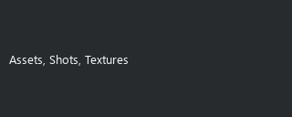

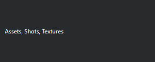

## XML

`XmlWdg`

Shows raw XML or decompresses the native zlib: form. Invalid XML keeps its text and shows a diagnostic; no HTML/script execution. Raw SDK/CSV values stay unchanged. General inline editing remains a separate table contract.

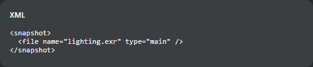

```xml
<config>
  <table layout="tactic.ui.panel.TableLayoutWdg">
    <element name="snapshot">
      <display class="XmlWdg" />
    </element>
  </table>
</config>
```

TH/Stream pair with the same values, theme, language and 320×128px size:

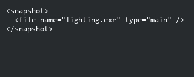

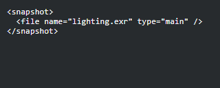

## JSON

`tactic.ui.table.JsonElementWdg`

Original sorted keys, two-space indentation and an empty display for false/empty JSON; maximum height is a pixel value up to 600. Read/copy/scroll support is implemented. General inline editing remains separate.

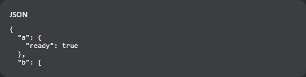

```xml
<config>
  <table layout="tactic.ui.panel.TableLayoutWdg">
    <element name="metadata">
      <display class="tactic.ui.table.JsonElementWdg">
        <height>72px</height>
      </display>
    </element>
  </table>
</config>
```

TH/Stream pair with the same values, theme, language and 320×128px size:

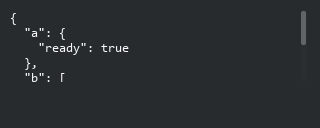

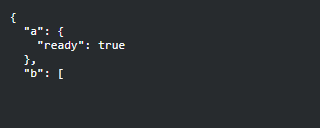

## Snapshot version

`tactic.ui.table.SnapshotVersionElementWdg`

Empty means No version, -1 Latest, 0 Current; positive versions use the field initial and checkin/version_padding (default 3). Only display; NULL now shows No version instead of raising a formatting error.

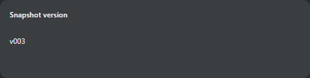

```xml
<config>
  <table layout="tactic.ui.panel.TableLayoutWdg">
    <element name="version">
      <display class="tactic.ui.table.SnapshotVersionElementWdg" />
    </element>
  </table>
</config>
```

TH/Stream pair with the same values, theme, language and 320×128px size:

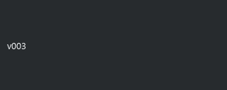

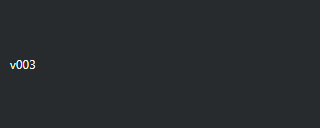

## Completion reference in TH

Current TacticCompletionCell.qml, dark theme, 240×52px per cell, 100% scale, English, 0/25/75/100%. Track height/margins, fill width, text and colors are compared. This verifies this presenter; old grouped totals remain a separate task.

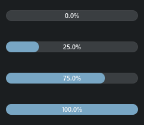

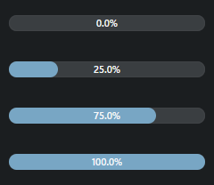
