# Table View: примеры виджетов

[Table View / Columns Editor](table_view.ru.md) — Обновление 14 октября: текущие 45 имён/21 адаптированный класс ТХ, действия и общий редактор перенесены. Ниже — исходный аудит legacy и прежние примеры; полная legacy-готовность не заявляется.


> Рабочие базовые сценарии, XML и реальные снимки компонентов Vue на тестовых значениях.

[Каталог и очередь исследования](widget_database.ru.md)

## Как использовать примеры

В Columns Editor / Widget Configuration текущего SearchType возьмите элемент display из примера и добавьте в нужный table view. Полный config показывает структуру, но не предназначен для замены всех существующих колонок. Имена name/description/amount/website/formula замените реальными физическими полями. Для превью нужны Snapshot/File; для notes/tasks/completion — реальные связи и ACL. Эти снимки показывают renderer с подготовленными значениями, не результат запуска всех примеров в вашей БД.

Имя класса указывайте точно: старые pyasm.widget.TaskCompletionWdg и SimpleTableElementWdg не являются alias современных tactic.ui классов. Display action должен быть пуст; неподдержанные options приводят к Widget unavailable. Width колонки задаётся attribute элемента, не display option.

## Текст

`tactic.ui.common.SimpleTableElementWdg`

Физическое поле. Базовый renderer поддерживает column; общего inline edit, empty и итогов пока нет.


```xml
<config>
  <table layout="tactic.ui.panel.TableLayoutWdg">
    <element name="name">
      <display class="tactic.ui.common.SimpleTableElementWdg" />
    </element>
  </table>
</config>
```

## Сырое значение

`tactic.ui.common.RawTableElementWdg`

Показывает сохранённое значение. Старое преобразование timestamp из get_display и общий inline edit не подключены.

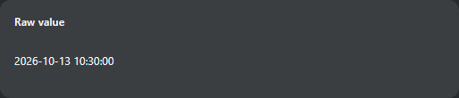

```xml
<config>
  <table layout="tactic.ui.panel.TableLayoutWdg">
    <element name="description">
      <display class="tactic.ui.common.RawTableElementWdg" />
    </element>
  </table>
</config>
```

## Форматированное число

`tactic.ui.table.FormatElementWdg`

Нативные форматы чисел, дат и timecode; type, format, fps, timezone, constraint. Checkbox только для чтения; total_summary нет.

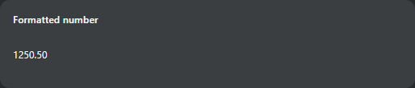

```xml
<config>
  <table layout="tactic.ui.panel.TableLayoutWdg">
    <element name="amount">
      <display class="tactic.ui.table.FormatElementWdg">
        <type>float</type>
        <format>-1234.12</format>
      </display>
    </element>
  </table>
</config>
```

## Ссылка

`tactic.ui.table.LinkElementWdg`

Текстовая ссылка на HTTP(S), mailto или URL от корня. Опция icon не отображается. Исполняемые/file URL отвергаются.


```xml
<config>
  <table layout="tactic.ui.panel.TableLayoutWdg">
    <element name="website">
      <display class="tactic.ui.table.LinkElementWdg" />
    </element>
  </table>
</config>
```

## Выражение

`tactic.ui.table.ExpressionElementWdg`

Вычисляет виртуальную колонку штатным parser. Есть value/boolean/check, alternate/display expression и cache. Нет bottom/group_bottom, link/icon режимов и общей кнопки пересчёта.


```xml
<config>
  <table layout="tactic.ui.panel.TableLayoutWdg">
    <element name="computed_name">
      <display class="tactic.ui.table.ExpressionElementWdg">
        <expression>@GET(.name)</expression>
      </display>
    </element>
  </table>
</config>
```

## Выражение из поля

`tactic.ui.table.ExpressionValueElementWdg`

Поле formula должно содержать нативное выражение, например @GET(.name). Выводится результат; inline редактора выражения нет.

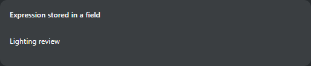

```xml
<config>
  <table layout="tactic.ui.panel.TableLayoutWdg">
    <element name="formula">
      <display class="tactic.ui.table.ExpressionValueElementWdg" />
    </element>
  </table>
</config>
```

## Превью файла

`pyasm.widget.ThumbWdg`

Использует существующие Snapshot/File и открывает FilePreview. Есть context/cascade/latest/original, filename/file_type, HTTP. Старые detail/redirect/size/JS опции не подключены.


```xml
<config>
  <table layout="tactic.ui.panel.TableLayoutWdg">
    <element name="preview">
      <display class="pyasm.widget.ThumbWdg">
        <filename>true</filename>
        <icon_context>icon</icon_context>
      </display>
    </element>
  </table>
</config>
```

## Заметки

`tactic.ui.widget.DiscussionElementWdg`

Счётчики процессов открывают настроенный инспектор заметок. Есть process/context/use_parent и default/icon. Email не реализован.


```xml
<config>
  <table layout="tactic.ui.panel.TableLayoutWdg">
    <element name="notes">
      <display class="tactic.ui.widget.DiscussionElementWdg">
        <process>publish</process>
        <allow_email>false</allow_email>
      </display>
    </element>
  </table>
</config>
```

## Задачи

`tactic.ui.table.TaskElementWdg`

Использует существующие связанные задачи и правила process/pipeline. Открывает инспектор и редактор задач. Старые CGI child-task filters и полный набор presentation опций не перенесены.

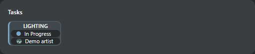

```xml
<config>
  <table layout="tactic.ui.panel.TableLayoutWdg">
    <element name="tasks">
      <display class="tactic.ui.table.TaskElementWdg">
        <process>lighting</process>
      </display>
    </element>
  </table>
</config>
```

## Готовность

`tactic.ui.table.TaskCompletionWdg`

Читает нативный средний процент связанных задач. Строка теперь использует полосу ТХ: 18px, отступы 10px, 0–100%, текст и доступное значение. task_expr выбирает подмножество. Итоги группы/таблицы пока отсутствуют.

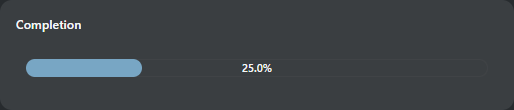

```xml
<config>
  <table layout="tactic.ui.panel.TableLayoutWdg">
    <element name="completion" width="240">
      <display class="tactic.ui.table.TaskCompletionWdg" />
    </element>
  </table>
</config>
```

## Массив

`ArrayTableElementWdg`

Используемая legacy-ячейка массива убирает крайние | и заменяет внутренние || на запятую с пробелом. Только отображение; исходное значение не изменяется.


```xml
<config>
  <table layout="tactic.ui.panel.TableLayoutWdg">
    <element name="tags">
      <display class="ArrayTableElementWdg" />
    </element>
  </table>
</config>
```

Пара ТХ/ТС на одинаковых значениях, теме, языке и размере 320×128px:

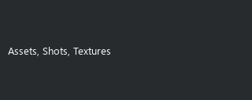

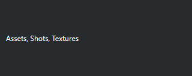

## XML

`XmlWdg`

Показывает XML или распаковывает нативный zlib: формат. Некорректный XML сохраняет текст и показывает ошибку; HTML/скрипты не исполняются. Raw SDK/CSV не изменяется. Общий inline edit остаётся отдельным контрактом таблицы.

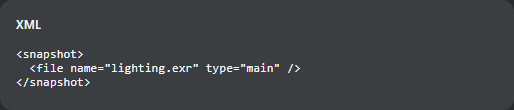

```xml
<config>
  <table layout="tactic.ui.panel.TableLayoutWdg">
    <element name="snapshot">
      <display class="XmlWdg" />
    </element>
  </table>
</config>
```

Пара ТХ/ТС на одинаковых значениях, теме, языке и размере 320×128px:

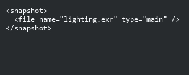

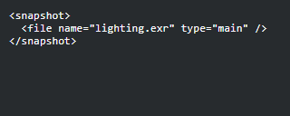

## JSON

`tactic.ui.table.JsonElementWdg`

Исходная сортировка ключей, отступ в два пробела и пустое отображение для false/пустого JSON; максимальная высота — до 600px. Есть чтение/копирование/прокрутка. Общий inline edit остаётся отдельным контрактом.

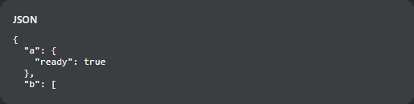

```xml
<config>
  <table layout="tactic.ui.panel.TableLayoutWdg">
    <element name="metadata">
      <display class="tactic.ui.table.JsonElementWdg">
        <height>72px</height>
      </display>
    </element>
  </table>
</config>
```

Пара ТХ/ТС на одинаковых значениях, теме, языке и размере 320×128px:

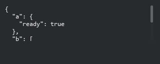

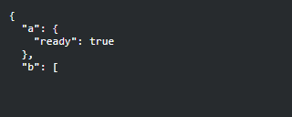

## Версия снапшота

`tactic.ui.table.SnapshotVersionElementWdg`

Пустое значение — Нет версии, -1 — Последняя, 0 — Текущий; положительная версия использует первую букву поля и checkin/version_padding (по умолчанию 3). Только отображение; NULL теперь показывает Нет версии вместо ошибки форматирования.

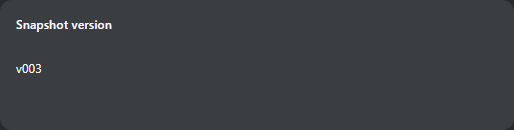

```xml
<config>
  <table layout="tactic.ui.panel.TableLayoutWdg">
    <element name="version">
      <display class="tactic.ui.table.SnapshotVersionElementWdg" />
    </element>
  </table>
</config>
```

Пара ТХ/ТС на одинаковых значениях, теме, языке и размере 320×128px:

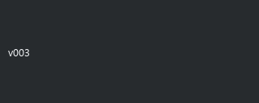

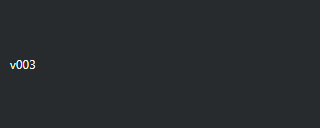

## Эталон Completion в ТХ

Текущий TacticCompletionCell.qml, тёмная тема, 240×52px на ячейку, масштаб 100%, английский, 0/25/75/100%. Сравниваются высота/отступы полосы, ширина заполнения, текст и цвета. Это проверка данного presenter; групповые итоги старого виджета остаются отдельной задачей.

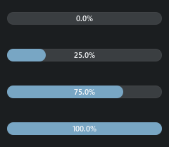

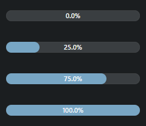
